# Dokumentasi Logika Bisnis & Siklus Hidup Entitas (fikpanel)

## 1. Siklus Hidup Entitas

### 1.1 Siklus Hidup Site & Sertifikat SSL

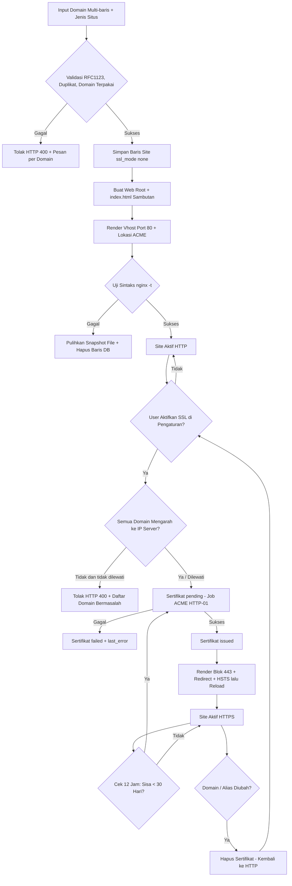

### 1.1a Siklus Penanganan Halaman Galat (Error Pages)

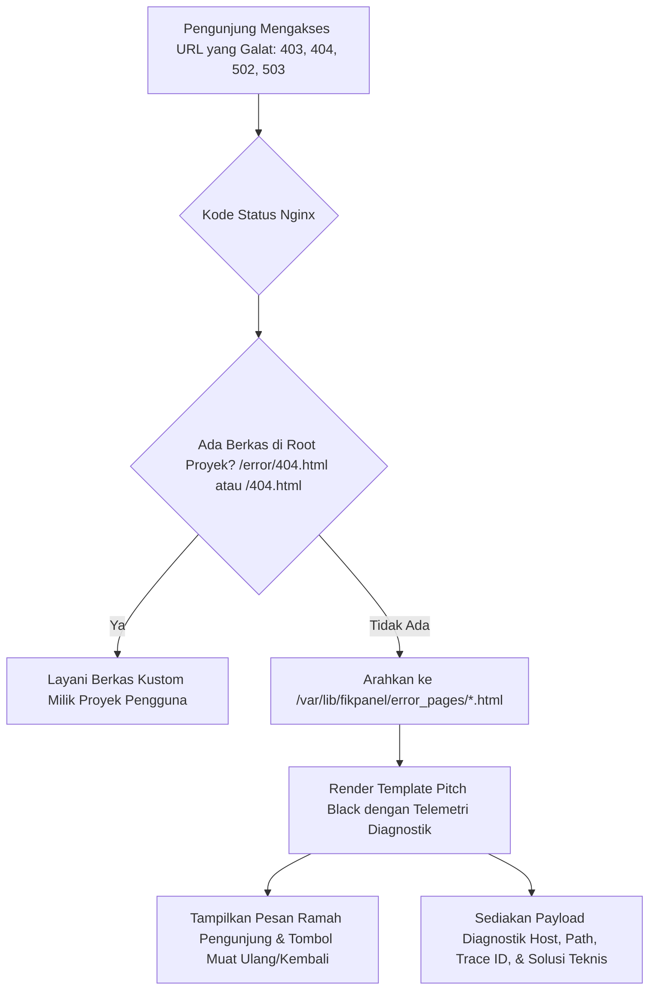

### 1.2 Siklus Hidup Sesi Pengguna & Sudo Mode

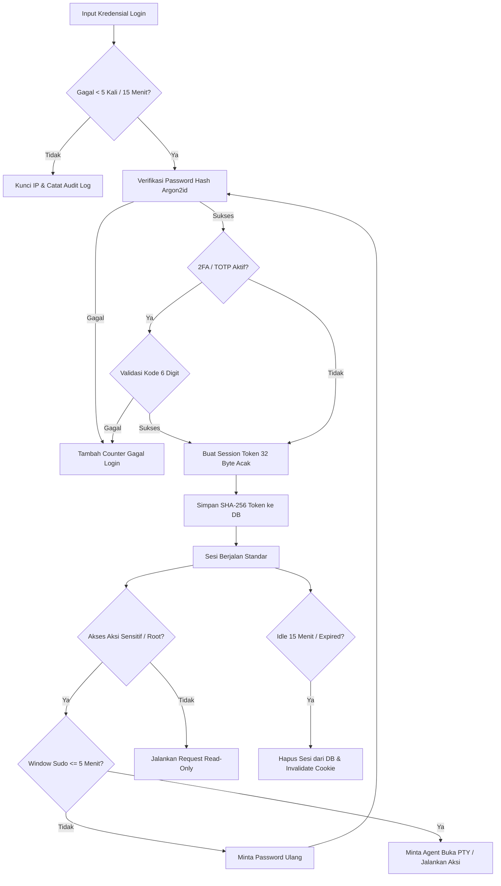

### 1.3 Siklus Operasi Manajemen Berkas (File Manager)

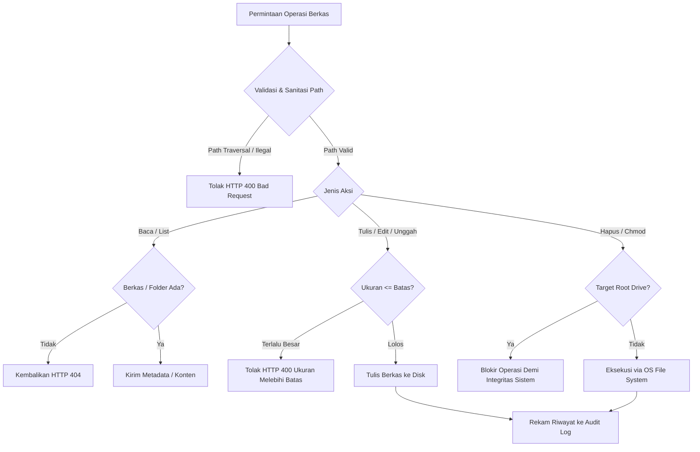

### 1.4 Siklus Hidup Database & Antrean Quick Install

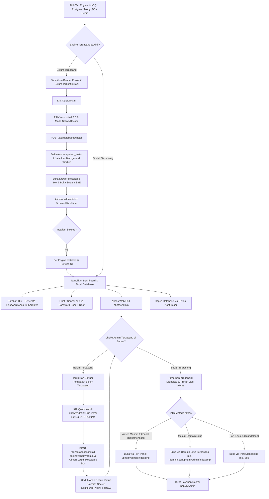

### 1.5 Siklus Hidup Kontainer & Stack Docker

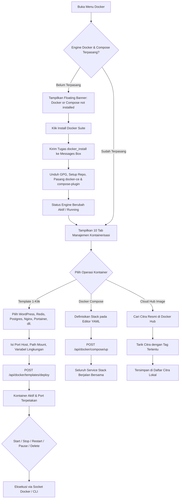

### 1.6 Siklus Hidup Pindai Host (Host Discovery) & Orkestrasi Kubernetes

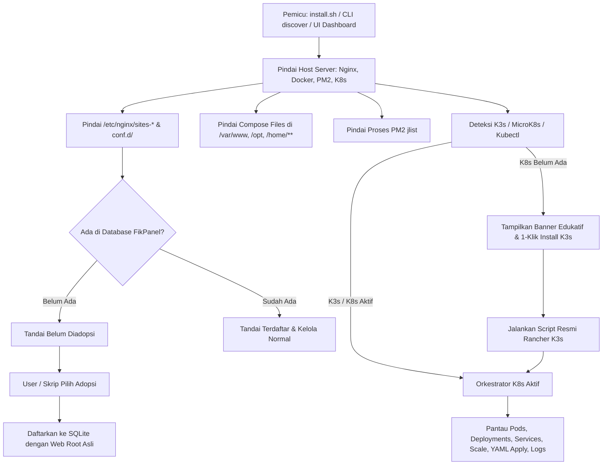

### 1.7 Siklus Instalasi Server Host & Pemilihan Stack Modular

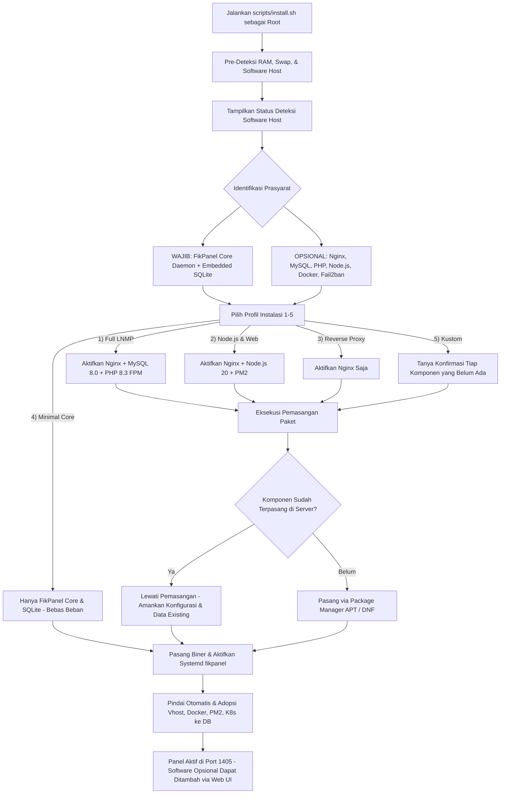

### 1.8 Siklus Manajemen Security Center (Firewall UFW, SSH, Brute Force Persisten & FIM)

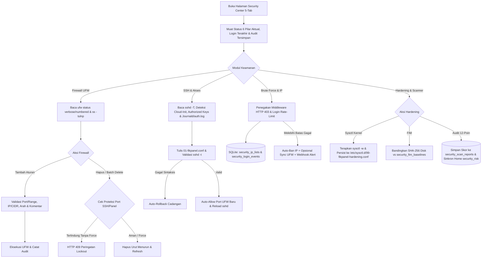

### 1.8 Siklus Hidup Penjadwal Tugas (Cron Jobs)

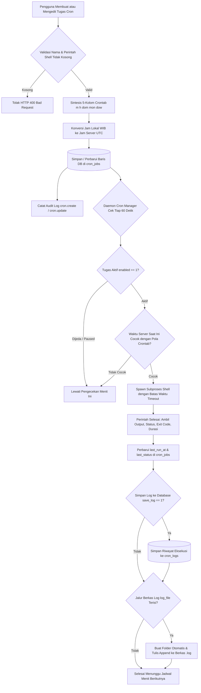

### 1.9 Siklus Hidup Layanan Sistem (Systemd & Supervisor)

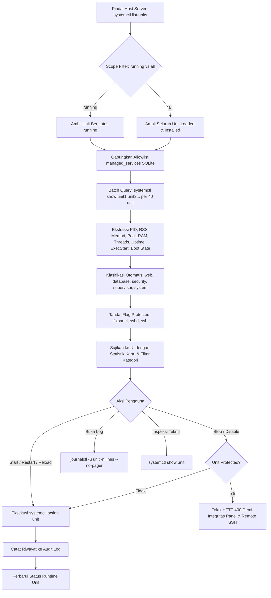

---

## 2. Aturan Bisnis Entitas (Entity Rules)

### 2.1 Entitas `users`

| Kolom | Aturan Validasi | Catatan Bisnis |
|---|---|---|
| `id` | Primary Key, Auto Increment | Identitas unik akun pengguna |
| `username` | Panjang 3-32 karakter, alphanumeric, wajib unik | Nama akun login operator panel |
| `password_hash` | Wajib string ter-encode Argon2id valid | Hash menggunakan parameter memori 19 MiB |
| `totp_secret` | BLOB terenkripsi AES-256-GCM, opsional (bisa NULL) | Kunci rahasia 2FA, hanya didekripsi saat validasi |
| `role` | Wajib bernilai `'admin'` atau `'viewer'` | Viewer hanya memiliki akses read-only |
| `created_at` | Timestamp Unix integer, tidak boleh null | Waktu pendaftaran akun |
| `last_login_at` | Timestamp Unix integer, nullable | Diperbarui saat proses autentikasi berhasil |

### 2.2 Entitas `sites`

| Kolom | Aturan Validasi | Catatan Bisnis |
|---|---|---|
| `id` | Primary Key, Auto Increment | Identifikasi unik site |
| `domain` | Wajib RFC1123, non-wildcard, unik (termasuk terhadap alias situs lain) | Domain utama = baris non-wildcard pertama; juga nama file vhost |
| `aliases` | JSON Array domain valid, tanpa duplikat | Boleh wildcard (`*.x.com`); `www.` ditambahkan otomatis untuk domain apex bila opsi aktif |
| `kind` | Wajib salah satu: `'php'`, `'node'`, `'go'`, `'python'`, `'static'`, `'proxy'` | Standar multi-runtime resmi FikPanel |
| `upstream` | Wajib URL `http(s)://host[:port]` jika `kind` bernilai `'proxy'`, `'node'`, `'go'`, atau `'python'` | Karakter `; { } ' "` dan spasi ditolak |
| `root_path` | Wajib path absolut untuk kind selain `'proxy'` | Standar FikPanel: `/home/<user>/web/<domain>/public` (PHP), `/home/<user>/node/<domain>` (Node.js), `/home/<user>/go/<domain>` (Go), `/home/<user>/python/<domain>` (Python), `/home/<user>/static/<domain>/public` (Static). Direktori sistem (`/`, `/etc`, `/usr`, `/root`, dst.) ditolak |
| `php_version` | Format `X.Y`, hanya untuk `kind='php'` | Menentukan socket `/run/php/phpX.Y-fpm.sock` |
| `framework` | String (misal: `'Laravel'`, `'Nuxt'`, `'Next.js'`, `'Hono'`, `'Express'`, `'Go Service'`, `'Python'`, dsb.) | Metadata framework proyek hasil inspeksi manifest direktori/proses untuk label badge informatif |
| `description` | Maks 200 karakter, opsional | Catatan bebas untuk operator |
| `ssl_mode` | Wajib salah satu: `'none'`, `'letsencrypt'`, `'custom'`, `'cloudflare'` | Mendukung mode Let's Encrypt ACME, sertifikat manual/kustom, serta mode Cloudflare Flexible / Cloudflare Tunnel |
| `force_https` | Boolean (0/1), default 1 | Redirect 301 ke HTTPS, aktif hanya bila sertifikat `issued` |
| `hsts` | Boolean (0/1), default 0 | Hanya bisa 1 bila `force_https=1`; header `max-age=31536000` |
| `extra_conf` | String konfigurasi Nginx bebas | Snippet wajib lolos uji sintaks `nginx -t` |
| `enabled` | Boolean (0 atau 1), default 1 | 0 = file vhost di-rename menjadi `.conf.disabled` |
| `request_count` | Integer (terhitung otomatis saat query API) | Jumlah riil permintaan HTTP dari baris log akses Nginx (`/var/log/nginx/<domain>.access.log`, `.log.1`, dan `.log.*.gz`) |
| `has_git` | Boolean (terdeteksi otomatis dari direktori `.git`) | Menentukan ketersediaan badge repositori Git & tombol operasi **Git Pull** khusus situs yang di-clone dari Git |
| `has_cicd` | Boolean (terdeteksi otomatis dari berkas alur kerja CI/CD) | Menandai proyek memiliki alur integrasi otomatis (GitHub Actions, Action Runner, GitLab CI, Jenkins) |
| `cicd_provider` | String (`github-actions`, `actions-runner`, `gitlab-ci`, `jenkins`) | Menentukan penyedia alur kerja otomatisasi CI/CD untuk menampilkan lencana visual |
| `updated_at` | Timestamp Unix integer | Waktu perubahan konfigurasi terakhir |

### 2.3 Entitas `certificates`

| Kolom | Aturan Validasi | Catatan Bisnis |
|---|---|---|
| `site_id` | Foreign Key ke `sites(id)`, Unik, On Delete Cascade | Satu sertifikat per site |
| `status` | `'none'`, `'pending'`, `'issued'`, `'failed'` | Hanya `issued` yang mengaktifkan blok 443 |
| `issuer` | String | Penerbit (misal: Let's Encrypt E6) |
| `domains` | JSON Array | SAN yang tercakup sertifikat (Issued To) |
| `not_before` / `not_after` | Timestamp Unix integer | Masa berlaku sertifikat |
| `signature` / `key_type` | String | Algoritma tanda tangan & jenis kunci (ECDSA P-256) |
| `last_error` | Text, nullable | Pesan kegagalan penerbitan / renew terakhir |
| `renewed_at` | Timestamp Unix integer, nullable | Waktu terakhir penerbitan berhasil |

### 2.4 Entitas `managed_services`

| Kolom | Aturan Validasi | Catatan Bisnis |
|---|---|---|
| `unit` | Primary Key, pola `*.service`, regex aman | Allowlist unit systemd yang diizinkan dikontrol; didaftarkan otomatis via dynamic discovery dari unit file yang terpasang di host Linux |
| `label` | String deskriptif, nullable | Nama manusia untuk unit layanan (misal: "MySQL Database Server", "PHP 8.5 FastCGI (FPM)") |
| `protected` | Boolean (0 atau 1), default 0 | Nilai 1 (seperti sshd, panel) wajib konfirmasi ganda sebelum modifikasi |

### 2.5 Entitas `audit_log`

| Kolom | Aturan Validasi | Catatan Bisnis |
|---|---|---|
| `id` | Primary Key, Auto Increment | Urutan peristiwa audit |
| `ts` | Timestamp Unix integer, wajib terindeks | Waktu presisi eksekusi perintah |
| `user_id` | Foreign Key ke `users(id)`, On Delete Set Null | Operator yang melakukan aksi (NULL jika system/AI) |
| `actor` | Wajib salah satu: `'user'`, `'system'`, `'ai'` | Pengklasifikasi sumber pemicu aksi |
| `action` | String nama aksi terformat (`kategori.verb`) | Nama operasi, misal `site.create`, `service.restart` |
| `target` | String identifier target | Nama unit service, domain site, atau PID |
| `ok` | Boolean (0 atau 1) | Hasil status keberhasilan aksi |
| `detail` | String teks maks 4096 byte | Rangkuman output atau pesan galat |

### 2.6 Entitas Docker & Kontainerisasi

| Entitas | Parameter Wajib | Catatan Bisnis |
|---|---|---|
| `Container` | `name`, `image`, `ports`, `volumes`, `restart_policy` | Kontainer wajib memiliki nama unik; pemetaan port divalidasi agar tidak bentrok dengan port servis host |
| `Image` | `repository`, `tag` | Citra ditarik dari Docker Hub atau registri privat terdaftar; penghapusan citra yang sedang dipakai kontainer wajib konfirmasi force |
| `Volume` | `name`, `driver` | Volume persisten lokal di `/var/lib/docker/volumes`; pembersihan massal (prune) hanya menghapus volume tak terikat |
| `Network` | `name`, `driver`, `subnet`, `gateway` | Jaringan terisolasi untuk komunikasi antarkontainer; jaringan bawaan host (`bridge`, `host`, `none`) diproteksi dari penghapusan |
| `Compose Stack`| `name`, `yaml` | Berkas disimpan di `/www/dk_project/<name>/docker-compose.yml`; mendukung kontrol siklus hidup up/down terpadu |
| `Daemon Config`| `registry_mirrors`, `log-opts`, `live-restore` | Konfigurasi disimpan di `/etc/docker/daemon.json`; perubahan memerlukan reload atau restart daemon Docker |

### 2.7 Entitas `cron_jobs` & `cron_logs`

| Kolom | Aturan Validasi | Catatan Bisnis |
|---|---|---|
| `id` | Primary Key, Auto Increment | Identitas unik tugas terjadwal |
| `name` | String 1-255 karakter, tidak boleh kosong | Nama deskriptif tugas, misal Backup MySQL atau Laravel Artisan |
| `schedule_type` | Wajib salah satu: `'minutes'`, `'hourly'`, `'daily'`, `'weekly'`, `'monthly'`, `'custom'` | Jenis preset interval antarmuka generator crontab |
| `spec` | Format 5 kolom crontab (`m h dom mon dow`), valid | Pola jadwal eksekusi Linux crontab |
| `command` | String shell command tidak boleh kosong | Perintah Linux yang dieksekusi; dilarang menjalankan perintah perusak fatal (misal `shutdown`, `init 0`, `mkfs`) |
| `enabled` | Integer boolean (0 atau 1) | Menandakan status aktif (1) atau jeda sementara (0) |
| `save_log` | Integer boolean (0 atau 1) | Menyimpan histori eksekusi ke tabel `cron_logs` |
| `log_file` | String path file `.log`, opsional | Jalur berkas log fisik kustom pada disk (misal `/var/cronlog/task.log`) |
| `timeout_sec` | Integer > 0 (default 3600) | Batas waktu maksimal eksekusi sebelum subproses dihentikan paksa (SIGKILL) |
| `last_run_at` | Timestamp Unix, nullable | Waktu terakhir tugas berhasil atau gagal dieksekusi |
| `last_status` | String (`'success'`, `'failed'`, `'running'`), nullable | Status eksekusi terakhir |

### 2.8 Entitas `managed_services` & Runtime Systemd Units

| Atribut / Field | Aturan Validasi | Catatan Bisnis |
|---|---|---|
| `unit` | Format nama unit systemd valid (berakhiran `.service`), unik | Pengidentifikasi unik unit layanan di tingkat sistem operasi |
| `name` | String nama pendek tanpa ekstensi `.service` | Nama singkat untuk pemfilteran dan label internal |
| `label` | String deskriptif ramah pengguna | Judul layanan yang ditampilkan pada antarmuka pengguna |
| `description` | String metadata asli dari berkas unit systemd | Deskripsi teknis yang disediakan oleh pengembang paket daemon |
| `category` | Enum: `'web'`, `'database'`, `'security'`, `'supervisor'`, `'system'` | Pengelompokan cerdas fungsional layanan pada arsitektur server |
| `category_label` | String label Bahasa Indonesia | Label tab dan pill kategori ("Web & App", "Database & Cache", dll.) |
| `protected` | Boolean (true/false) | Flag proteksi unit kritis (`fikpanel.service`, `sshd.service`, `ssh.service`); dilarang dihentikan (`stop`) atau dinonaktifkan (`disable`) |
| `load_state` | Nilai status muat systemd (`'loaded'`, `'not-found'`, `'masked'`) | Mengonfirmasi apakah berkas definisi unit tersedia di filesystem host |
| `active_state` | Nilai status aktivitas (`'active'`, `'inactive'`, `'failed'`, `'activating'`) | Status operasional runtime utama |
| `sub_state` | Nilai status spesifik (`'running'`, `'exited'`, `'dead'`, `'failed'`) | Status detil cgroup kernel subproses |
| `unit_file_state` | Nilai startup boot (`'enabled'`, `'disabled'`, `'static'`, `'masked'`) | Konfigurasi apakah layanan otomatis berjalan saat server dinyalakan |
| `main_pid` | Integer positif atau 0 | Nomor Process ID utama dari daemon yang aktif |
| `memory_current` | Angka byte unsigned 64-bit | Penggunaan memori RAM aktual yang dikonsumsi cgroup |
| `memory_peak` | Angka byte unsigned 64-bit | Puncak memori tertinggi yang pernah tercatat sejak unit berjalan |
| `tasks_current` | Integer jumlah task / threads | Jumlah subproses atau worker threads aktif di dalam cgroup |
| `uptime` | String durasi ramah manusia | Lama layanan aktif dihitung dari `ActiveEnterTimestamp` |
| `exec_start` | String perintah bersih | Perintah dan argumen biner yang dieksekusi saat daemon diinisialisasi |
| `restart` | String policy (`'always'`, `'on-failure'`, `'no'`, dll.) | Kebijakan restart otomatis systemd jika terjadi kegagalan proses |

---

## 3. Matriks Transisi Status Entitas

### 3.1 Transisi Status Site

| Status Awal | Pemicu (Trigger) | Status Akhir | Aturan Bisnis & Efek Samping |
|---|---|---|---|
| `None` | User membuat site & `nginx -t` lolos | `Active` | Web root + vhost port 80 dibuat, Nginx di-reload |
| `None` | Web root / vhost gagal diterapkan | `None` | Snapshot file dipulihkan dan baris DB dihapus |
| `Active` | User klik Nonaktifkan | `Disabled` | File di-rename `.conf.disabled`, Nginx di-reload |
| `Disabled`| User klik Aktifkan | `Active` | File vhost dipulihkan dan Nginx di-reload |
| `Active` | User mengubah pengaturan (PUT) | `Active` | Gagal uji sintaks = data DB & file dikembalikan |
| `Active`/`Disabled` | User menghapus site | `Deleted` | Vhost & sertifikat dihapus; isi web root dipertahankan |

### 3.2 Transisi Status Sertifikat SSL

| Status Awal | Pemicu (Trigger) | Status Akhir | Aturan Bisnis & Efek Samping |
|---|---|---|---|
| `none` | User aktifkan SSL & DNS siap / dilewati | `pending` | Job ACME HTTP-01 berjalan di background |
| `none`/`failed` | Domain wildcard terdaftar | (ditolak) | HTTP-01 tidak mendukung wildcard |
| `pending` | Job sedang berjalan & request baru | (ditolak) | HTTP 409, satu job per site |
| `pending` | Validasi & penerbitan sukses | `issued` | File cert ditulis atomik, blok 443 + redirect + HSTS diterapkan |
| `pending` | Validasi gagal | `failed` | `last_error` disimpan, situs tetap HTTP |
| `failed` | User klik terbitkan ulang | `pending` | Sama seperti penerbitan pertama |
| `issued` | Sisa masa aktif < 30 hari (loop 12 jam) | `pending` → `issued` | Perpanjangan otomatis, Nginx di-reload |
| `issued` | Domain / alias situs diubah | `none` | Record sertifikat dihapus, HTTPS nonaktif sampai terbit ulang |
| `issued` | User nonaktifkan SSL | `issued` | `ssl_mode=none`, blok 443 dilepas; sertifikat tetap tersimpan |

### 3.3 Transisi Status Layanan (Systemd & Supervisor Units)

| Status Awal | Pemicu (Trigger) | Status Akhir | Aturan Bisnis & Efek Samping |
|---|---|---|---|
| `inactive` / `dead` | Permintaan `start` | `active` (`running`) | Eksekusi `systemctl start <unit>`, Main PID dan cgroup memory dialokasikan |
| `active` (`running`) | Permintaan `stop` pada unit biasa | `inactive` (`dead`) | Eksekusi `systemctl stop <unit>`, memory dilepas, PID dinonaktifkan |
| `active` (`running`) | Permintaan `stop` pada unit dilindungi (`fikpanel.service`, `sshd.service`, `ssh.service`) | (DITOLAK) | Ditolak HTTP 400; perlindungan sistem mutlak agar akses web panel dan remote SSH tidak terputus |
| `active` / `failed` | Permintaan `restart` | `active` (`running`) | Eksekusi `systemctl restart <unit>`, menyegarkan subproses dan memuat ulang konfigurasi baru |
| `active` (`running`) | Permintaan `reload` | `active` (`running`) | Eksekusi `systemctl reload <unit>`, sinyal SIGHUP dikirim ke master daemon tanpa memutus koneksi klien aktif |
| `disabled` (Boot) | Permintaan `enable` | `enabled` | Eksekusi `systemctl enable <unit>`, membuat symlink di `/etc/systemd/system/multi-user.target.wants/` agar berjalan otomatis saat boot |
| `enabled` (Boot) | Permintaan `disable` pada unit biasa | `disabled` | Eksekusi `systemctl disable <unit>`, melepas symlink startup boot |
| `enabled` (Boot) | Permintaan `disable` pada unit dilindungi | (DITOLAK) | Ditolak HTTP 400; layanan vital wajib tetap aktif saat server dinyalakan kembali |
| `active` (`running`) | Proses daemon mengalami crash atau SIGKILL | `failed` | Terdeteksi otomatis via status systemctl show; diprioritaskan di baris teratas antarmuka pengguna |
| `failed` | Permintaan `restart` pemulihan | `active` (`running`) | Subproses diinisialisasi ulang dari kondisi crash |

---

### 3.4 Transisi Status Antrean Tugas (Task Queue / Quick Install)

| Status Awal | Kejadian (Trigger) | Status Akhir | Keterangan / Efek Samping |
|---|---|---|---|
| `pending` | Worker backend mengambil task dari antrean | `running` | Proses subprocess bash/apt/docker dimulai; output log dibuka untuk streaming SSE |
| `running` | Subprocess instalasi keluar dengan kode 0 & service aktif | `success` | Status engine diperbarui ke `installed: true`; log ditutup dengan penanda selesai |
| `running` | Subprocess menghasilkan kode != 0 atau timeout | `failed` | Catat error ringkas ke task log; sediakan opsi retry kepada user |
| `running` | User membatalkan proses instalasi | `cancelled` | Sinyal `SIGTERM`/`SIGKILL` dikirim ke grup proses |

---

### 3.5 Transisi Status Kontainer Docker

| Status Awal | Pemicu (Trigger) | Status Akhir | Aturan Bisnis & Efek Samping |
|---|---|---|---|
| `created` | Eksekusi start kontainer | `running` | Alokasi port, isolasi cgroup, dan proses utama kontainer dijalankan |
| `running` | Permintaan stop (`POST .../stop`) | `exited` | Mengirim sinyal `SIGTERM` lalu `SIGKILL` setelah grace period (10 detik) |
| `running` | Permintaan pause (`POST .../pause`) | `paused` | Proses dibekukan menggunakan cgroups freezer tanpa melepas alokasi memori |
| `paused` | Permintaan unpause (`POST .../unpause`)| `running` | Proses dicairkan kembali dan melanjutkan eksekusi |
| `running` | Kontainer mengalami crash / OOM | `exited` | Jika kebijakan restart `always` atau `unless-stopped`, daemon akan menyalakan ulang otomatis |
| `exited` / `created` | Permintaan hapus kontainer | `deleted` | Kontainer dihapus; volume persisten yang di-mount tetap aman di host |

### 3.6 Transisi Status Tugas Terjadwal (Cron Job)

| Status Awal | Pemicu (Trigger) | Status Akhir | Aturan Bisnis & Efek Samping |
|---|---|---|---|
| `None` | User membuat tugas baru (`POST /api/cron/jobs`) | `active` | Jadwal dicatat di database, diikutsertakan dalam loop pengecekan tiap menit |
| `active` | User klik jeda tugas (`POST .../toggle` enabled=false) | `paused` | Tugas dilewati oleh scheduler; riwayat eksekusi dan konfigurasi tetap aman |
| `paused` | User klik aktifkan (`POST .../toggle` enabled=true) | `active` | Tugas kembali dievaluasi setiap menit oleh scheduler daemon |
| `active`/`paused` | User mengedit konfigurasi (`PUT /api/cron/jobs/{id}`) | `active`/`paused` | Nilai `spec`, `command`, `timeout_sec`, dan opsi log diperbarui in-place tanpa mengubah ID tugas |
| `active`/`paused` | Pemicu jadwal tiba atau user klik 'Jalankan Sekarang' | `running` | Perintah dieksekusi di background thread; status UI menampilkan animasi loader |
| `running` | Eksekusi selesai dengan exit code 0 | `success` | Durasi dan output dicatat; status diperbarui menjadi 'Berhasil' |
| `running` | Eksekusi selesai dengan exit code != 0 atau timeout | `failed` | Error code dan pesan stderr dicatat; status diperbarui menjadi 'Gagal' |
| `active`/`paused` | User menghapus tugas (`DELETE /api/cron/jobs/{id}`) | `deleted` | Data tugas dan riwayat di `cron_logs` dihapus permanen |

---

## 4. Batasan Bisnis & Pemicu Otomatis (Triggers)

| Kode Aturan | Pemicu | Batasan Bisnis | Tindakan Sistem |
|---|---|---|---|
| **BR-01** | Mutasi Data Sensitif | Membutuhkan status Sudo Aktif | Tolak jika verifikasi sandi terakhir > 5 menit lalu |
| **BR-02** | Login Gagal | Maksimal 5 kegagalan per 15 menit per IP | Kunci autentikasi dari IP terkait selama 15 menit |
| **BR-03** | Eksekusi Alat AI | AI memproses permintaan diagnosa | Batasi hanya fungsi read-only, maks 8 iterasi |
| **BR-04** | Redaksi Log | Data log diambil sebelum dikirim ke AI | Hapus otomatis pola token, password, dan kunci privat |
| **BR-05** | Perpanjangan SSL | Pengecekan sertifikat tiap 12 jam | Picu penerbitan ulang ACME jika sisa masa aktif < 30 hari |
| **BR-06** | Retensi Audit & Chat| Job pembersihan berkala tengah malam | Hapus audit > 90 hari dan pesan AI > 30 hari |
| **BR-07** | Operasi Berkas Kritis | Upaya penghapusan root volume / traversal | Blokir path ilegal dan cegah penghapusan root drive |
| **BR-08** | Editor Teks Berkas | Perubahan konten berkas teks | Deteksi dirty state, konfirmasi sebelum tutup, simpan dengan `Ctrl+S` |
| **BR-09** | Ketersediaan Web Server | Akses menu Sites tanpa Nginx | Tampilkan interactive dependency warning card dan opsi 1-klik instalasi |
| **BR-10** | Live-Reload Pengembangan | File backend Go atau frontend Svelte berubah pada mode dev | Air otomatis kompilasi ulang & restart biner Go; Vite memperbarui komponen UI seketika via HMR tanpa restart manual |
| **BR-11** | SSL Setelah Situs Dibuat | Form tambah situs tidak menyediakan opsi SSL | SSL hanya diaktifkan dari tab SSL setelah vhost port 80 + lokasi ACME aktif |
| **BR-12** | Atomisitas Pembuatan Situs | Web root, vhost, atau `nginx -t` gagal | Baris DB dihapus dan file vhost dikembalikan ke snapshot sebelumnya |
| **BR-13** | Validasi Domain Realtime | Input domain di form (debounce ±450 ms) | Cek format, duplikat, domain terpakai, dan resolusi DNS vs IP server (DNS hanya informatif saat membuat situs) |
| **BR-14** | Prasyarat DNS untuk SSL | Penerbitan Let's Encrypt | Semua domain wajib mengarah ke IP server, kecuali opsi "lewati cek DNS" (NAT/CDN) dicentang |
| **BR-15** | Reset Sertifikat | Domain / alias situs diubah saat sertifikat `issued` | Sertifikat dihapus, situs kembali HTTP, UI meminta terbit ulang |
| **BR-16** | HSTS | Opsi HSTS dicentang | Hanya tersimpan bila Paksa HTTPS aktif |
| **BR-17** | Watchdog Nginx | Opsi daemon Nginx aktif | Nginx yang mati otomatis dinyalakan ulang setiap 1 menit setelah lolos `nginx -t` |
| **BR-18** | Simpan Konfigurasi Nginx | Edit `nginx.conf` dari Nginx Manager | Uji sintaks file sementara, backup rotasi 10 file, rename atomik, lalu reload |
| **BR-19** | Standar Desain UI & Token | Perubahan atau pembuatan komponen antarmuka | Nilai visual wajib berasal dari token terpusat (`tokens.css`). Dilarang memakai warna mentah, font eksternal, atau CDN. Divalidasi oleh `npm run lint:ui`. |
| **BR-20** | Dialog Konfirmasi Destruktif | Aksi penghapusan berkas, situs, stop service, dan reset SSL | Wajib menggunakan `confirmDialog()` atau `promptDialog()` berbasis Svelte runes; dilarang menggunakan fungsi dialog native browser (`confirm/alert/prompt`). |
| **BR-21** | Hardening Header Keamanan | Pengiriman respon HTTP dan frontend statis | Menyematkan `Content-Security-Policy` ketat, `Permissions-Policy`, `COOP`, `CORP`, `X-Content-Type-Options: nosniff`, dan `X-Frame-Options: DENY`. |
| **BR-22** | Klien API Terpusat & Anti-CSRF | Seluruh request HTTP frontend | Wajib melalui `apiFetch` relatif same-origin; menyematkan otomatis header `X-Panel-Request: 1` pada mutasi data dan penanganan 401 otomatis. |
| **BR-23** | Kustomisasi Provider LLM | Pengguna mengonfigurasi AI Copilot | Mendukung OpenAI-compatible (Omniroute, 9router, OpenAI, Groq, Ollama), Anthropic Claude, dan Google Gemini dengan Base URL bebas; API key disensor pada respon dan log. |
| **BR-24** | Persistensi Riwayat Percakapan AI | Pengguna mengirim dan membaca pesan AI | Riwayat disimpan dalam tabel `ai_conversations` dan `ai_messages`; menyertakan judul otomatis dan konteks memori maksimal 16 pesan terakhir. |
| **BR-25** | Fallback Diagnostik Server Offline | Provider eksternal tidak aktif atau gagal | AI Copilot otomatis beralih ke engine diagnostik lokal berbasis status real-time Nginx, CPU, RAM, dan Disk tanpa melempar kegagalan fatal. |
| **BR-26** | Deteksi Dinamis Engine Database | Akses tab engine (MySQL, Postgres, MongoDB, Redis) | Backend memeriksa ketersediaan biner & status systemd. Jika belum terpasang, antarmuka wajib merender State Edukatif disertai tombol Quick Install dan Remote DB. |
| **BR-27** | Asinkronitas & Log Streaming Instalasi | Eksekusi Quick Install paket database | Wajib berjalan di latar belakang (background task) dengan ID unik; output terminal di-stream melalui Server-Sent Events (SSE) agar antarmuka tidak blocking. |
| **BR-28** | Keamanan Kredensial Database | Pembuatan database dan user baru | Password wajib dibuat acak dengan entropi tinggi (minimal 16 karakter acak aman); host default dibatasi `localhost` kecuali user memilih wildcard `%` secara eksplisit. |
| **BR-29** | Prosedur Alih Versi SQL (Backward Incompatibility Protection) | Pengguna melakukan ganti versi (Switch Version) mesin database | Host native hanya menjalankan 1 versi aktif pada port 3306. Sistem wajib mengekspor cadangan otomatis seluruh database (`mysqldump --all-databases`) sebelum memasang paket baru untuk mencegah korupsi format InnoDB. |
| **BR-30** | Akses Web GUI Multi-Jalur (phpMyAdmin / FikPanel Client) | Manajemen visual tabel dan eksekusi query SQL | Menyediakan 3 jalur akses: (1) Melalui Domain Situs Terpasang (`domain/phpmyadmin` pada port standar 80/443 ber-SSL), (2) Melalui FikPanel Independen (`/pma/` pada port panel aktif tanpa keterikatan domain atau port 888), dan (3) Port Khusus Standalone (mis. 888) dengan One-Click SSO dan toggle akses publik. |
| **BR-31** | Batasan Kuota Kapasitas Database | Penetapan kuota ukuran pada database tertentu | Menggunakan kuota sistem berkas OS (XFS/ext4 project quota); pengisian nilai 0 menandakan kapasitas penyimpanan tanpa batas (unlimited). |
| **BR-32** | Integrasi Resmi phpMyAdmin via Reverse Proxy Daemon & Auto-Fill Form | Akses Web GUI phpMyAdmin (`/phpmyadmin/`, `/pma/`, `/phpMyAdmin/`) | FikPanel meneruskan permintaan secara transparan ke instance resmi phpMyAdmin fisik via daemon lokal (`127.0.0.1:8885`) tanpa mock/clone tiruan. Proxy secara otomatis menginjeksi auto-fill username, password (dari sesi SSO), target rute database (`route=/database/structure&db=...`), serta badge visual database pada formulir login resmi phpMyAdmin. |
| **BR-33** | Deteksi & Peringatan Otomatis Engine Docker | Pengguna membuka modul Docker tanpa engine Docker/Compose terpasang | Menampilkan floating alert banner persistens dan menyediakan tombol 1-klik instalasi otomatis ke Messages Box |
| **BR-34** | Manajemen Konfigurasi Atomik `daemon.json` | Pengguna mengubah pengaturan Accelerate URL, Log Rotation, atau konfigurasi JSON | Memvalidasi sintaks JSON sebelum disimpan, mencatat audit log, dan mengizinkan modifikasi langsung via editor modal |
| **BR-35** | Proteksi Jaringan Inti Sistem Docker | Pengguna mencoba menghapus jaringan `bridge`, `host`, atau `none` | Sistem menolak aksi penghapusan demi menjaga integritas konektivitas jaringan kontainer host |
| **BR-36** | Katalog Aplikasi 1-Klik Terisolasi | Pemasangan aplikasi populer (WordPress, Redis, Postgres, MySQL, Portainer, dll.) | Mempersiapkan direktori data persisten `/www/dk_project/<app>/data`, menyuntikkan variabel lingkungan aman, dan memetakan port host default |
| **BR-37** | Manajemen Proses & Port Sistem | Pengguna menginspeksi atau menghentikan proses OS | Menampilkan daftar proses CPU/memori tertinggi; penghentian proses mengirim SIGTERM/SIGKILL dengan larangan keras menghentikan proses vital PID 1 |
| **BR-38** | Pembersihan Sampah & Sinkronisasi Cache OS | Eksekusi System Cleaner | Memindai dan menghapus berkas usang APT, log lama terkompresi, dan berkas temporer `/tmp`; opsi `drop_caches` wajib menjalankan sinkronisasi disk (`sync`) sebelum mengosongkan cache RAM |
| **BR-39** | Perekaman Metrik Persisten aaPanel-Style | Pengguna mengaktifkan fitur Monitoring Historis | Daemon background merekam snapshot penggunaan CPU, RAM, Disk, Load, dan Jaringan setiap 60 detik ke SQLite; data melebihi batas retensi dibersihkan setiap 24 jam |
| **BR-40** | Hardening SSH & Proteksi Fail2Ban | Modifikasi konfigurasi SSH atau penanganan IP terblokir | Perubahan port dan otentikasi kata sandi memodifikasi `sshd_config` lalu me-reload daemon `sshd`; pembukaan blokir IP mengeksekusi unban terarah pada jail Fail2Ban |
| **BR-41** | Software App Store & Toolkit Linux | Instalasi paket aplikasi sistem operasi | Menggunakan antrean worker asinkron (`system_tasks`) dengan streaming kemajuan log real-time agar tidak memblokir UI panel |
| **BR-42** | Manajemen Proses Node.js & PM2 Multi-User | Pengguna mengelola aplikasi Node.js SSR / API | Mendeteksi seluruh direktori `.pm2` di server (`/root/.pm2` dan seluruh `/home/*/.pm2` termasuk instalasi NVM user), menggabungkan daftar proses dari semua user (`sudo -u <username> pm2 jlist` dengan `PM2_HOME=/home/<username>/.pm2`), menyertakan field pemilik `user`, serta mengeksekusi aksi lifecycle (`start`, `restart`, `stop`, `reload`, `delete`, `logs`, `save`) atas nama user pemilik proses tersebut. |
| **BR-43** | Integrasi Cadangan S3 pada Modul Database | Pengguna mengelola snapshot database dan S3 Cloud | Modul Backup S3 diintegrasikan sebagai sub-tab di dalam menu Databases, mengeliminasi menu redundan di sidebar dan menyederhanakan alur pencadangan data |
| **BR-44** | Pindai Otomatis Infrastruktur Host Berbatas Waktu & Adopsi Konfigurasi | Instalasi server via `install.sh`, CLI `fikpanel discover`, atau aksi Pindai di antarmuka | Memindai secara dinamis virtual host Nginx, stack Docker Compose, proses PM2 multi-user (`/root/.pm2` & `/home/*/.pm2`), dan status Kubernetes dengan batas waktu eksplisit 10 detik (`context.WithTimeout`). Penelusuran berkas compose dibatasi maksimal kedalaman 2 subdirektori dan melewati direktori berat (`actions-runner`, `.actions-runner`, `cache`, `.cache`, `logs`, `tmp`, `temp`, `vendor`, `node_modules`, `.output`, `dist`, `build`), serta selalu mengembalikan HTTP 200 dengan daftar parsial jika terjadi timeout. |
| **BR-45** | Orkestrasi Lengkap Kubernetes & K3s Host | Pengguna menginspeksi cluster Kubernetes di menu Kubernetes | Mendeteksi ketersediaan cluster K3s, MicroK8s, atau standar; menyediakan pemantauan workload Pods, Deployments, Services, scaling interaktif, pembacaan log kontainer, dan penerapan manifest YAML langsung via `kubectl apply`. |
| **BR-46** | Kemandirian Database FikPanel & Profil Instalasi Host Modular | Eksekusi installer `scripts/install.sh` di server host (server baru maupun server existing) | FikPanel Core berjalan dengan embedded SQLite independen tanpa memerlukan MySQL/MariaDB eksternal. MySQL, PHP, Docker, dan Fail2ban bersifat sepenuhnya opsional. Installer memindai software existing dengan proteksi smart-skip agar tidak menimpa vhost/data existing, menyediakan profil instalasi terstruktur, dan komponen opsional dapat dipasang kapan saja melalui antarmuka Web Panel (App Store / Databases / Security Center). |
| **BR-47** | Penjadwal Tugas (Cron Manager) & Penerjemah Bahasa Manusia Crontab | Pengguna menambahkan atau mengubah tugas cron pada jam atau ekspresi tertentu | Backend mendukung ekspresi 5-kolom Crontab Linux (`m h dom mon dow`). Antarmuka visual builder mengonversi jam lokal pengguna (WIB UTC+7) ke jam server (UTC) secara otomatis, menyediakan generator 5-kolom Crontab dengan tombol preset contoh cepat, serta mesin penerjemah jadwal human-friendly dalam bahasa Indonesia secara real-time (misal harian jam 12, bulanan tanggal 12, mingguan, interval menit/jam). |
| **BR-48** | Deteksi Dinamis Host Runtime PHP Multi-Version | Akses menu PHP Multi-Version & FPM Tuning | Memindai secara dinamis socket `/run/php/php*-fpm.sock`, direktori `/etc/php/*`, dan biner FPM (mendeteksi PHP 8.5, 8.4, 8.3, 8.2, 8.1, dst.) dengan sorting numerik menurun. Versi belum terpasang dapat diinstal 1-klik via paket APT sistem. |
| **BR-49** | App Store Terpadu & Fleksibilitas Tampilan (Grid / Table Switcher) | Pengguna membuka App Store dan mengelola aplikasi web stack atau paket sistem | Menggabungkan seluruh software katalog dan repositori global Linux (APT) dalam satu antarmuka terpadu tanpa pemisahan tab yang kaku. Menyediakan View Switcher (Tampilan Kartu Modern & Tabel Rinci), bilah pencarian autocomplete fuzzy dengan riwayat pencarian lokal dan rekomendasi populer (Trending), filter kategori (Semua, Terpasang, Web Server, Runtime, Database, Alat & Keamanan), serta tautan langsung ke manajer software terkait. |
| **BR-50** | Proteksi Auto-Renew SSL Ganda (Cron Task & Background Daemon) | Pemindaian masa aktif sertifikat Let's Encrypt / ACME HTTP-01 seluruh domain | Menggunakan proteksi 2-lapis: (1) Tugas Cron terdaftar `Domain SSL Auto-Renew (Let's Encrypt / ACME)` dieksekusi harian pukul 02:00 via CLI `fikpanel renew-ssl` dengan perekaman log dan eksekusi manual; (2) Goroutine daemon `sites.RunRenewLoop` memeriksa berkala setiap 12 jam (dan saat panel start) untuk sertifikat dengan sisa masa aktif < 30 hari, menulis sertifikat atomik, dan me-reload Nginx tanpa downtime sehingga sertifikat domain tidak pernah expired. |
| **BR-51** | Arsitektur Security Center 5-Tab & 6 Pilar Proteksi Aktual | Pengguna membuka dan mengelola modul Keamanan `/security` | Antarmuka mengonsolidasikan seluruh kontrol keamanan ke 5 tab terstruktur (**Overview & Audit**, **Firewall (UFW)**, **SSH & Akses**, **Brute Force & IP**, **Hardening & Scanner**) dengan 6 pilar proteksi nyata (Firewall UFW, SSH Guard, Nginx WAF live dari store/WAF manager, Brute Force Guard, Fail2Ban IPS, dan File Integrity Monitor) tanpa data statis/dummy. |
| **BR-52** | Proteksi Brute-Force Persisten SQLite, Middleware Enforcement & Webhook Alert | Percobaan autentikasi pada panel atau request ke `/api/*` | Konfigurasi, daftar putih/hitam IP & CIDR (`security_ip_lists`), dan riwayat login (`security_login_events`) disimpan persisten di SQLite. Middleware HTTP langsung menolak IP blacklist aktif (HTTP 403); `handleLogin` mengecualikan IP whitelist, mengunci sementara username yang gagal berulang, dan mengeksekusi auto-ban IP beserta opsi sinkronisasi UFW (`ufw insert 1 deny`) dan pengiriman notifikasi Webhook Alert. Dilengkapi proteksi anti self-lockout (menolak blacklist `127.0.0.1`, IP admin saat ini, dan IP yang sudah masuk whitelist). |
| **BR-53** | Audit Keamanan Terpadu 12-Poin, Persistensi Skor & Safe Quick-Fix | Eksekusi pemindaian keamanan server di Security Center | Menjalankan 12 pemeriksaan nyata (status & default policy UFW, eksposur port database `3306/5432/6379/27017` publik, hardening SSH, Fail2Ban, TLS panel, 2FA/Passkey, Brute Force, kernel sysctl, integritas FIM, izin `/etc/shadow`, pemindaian webroot situs di tabel `sites` terhadap webshell PHP/`.env`/`.git`, serta sertifikat SSL hampir kedaluwarsa). Hasil disimpan persisten di `security_scan_reports` dan menyuplai metrik `security_risk` real pada dashboard Home. Perbaikan cepat dibatasi pada allowlist aman (tanpa mutasi port/password SSH sepihak yang dapat mengunci admin). |
| **BR-54** | Hardening Kernel Persisten (`sysctl.d`), Pembatasan Compiler, Fail2Ban & File Integrity Monitor (FIM) | Pengerasan keamanan kernel, IPS, dan integritas berkas sistem | Membaca 6 parameter kernel langsung dari `/proc/sys` (`icmp_echo_ignore_all`, `tcp_syncookies`, `rp_filter`, `suid_dumpable`, `accept_redirects`, `dmesg_restrict`) serta menyimpannya permanen ke `/etc/sysctl.d/99-fikpanel-hardening.conf`; mengelola izin biner compiler (`0700`/`0755`), kontrol layanan & ban/unban Fail2Ban, serta File Integrity Monitor berbasis checksum SHA-256 (`security_fim_baselines`) untuk mendeteksi modifikasi/hilangnya berkas kritis sistem dan konfigurasi Nginx/SSH. |
| **BR-55** | Manajemen Firewall UFW Real, Inspektor Soket `ss -tulnp` & Proteksi Anti-Lockout | Pengguna mengelola aturan firewall masuk/keluar dan kebijakan default UFW | Parsing penuh `ufw status verbose` & `ufw status numbered` untuk IPv4/IPv6, `ALLOW`/`DENY`/`REJECT`/`LIMIT`, `IN`/`OUT`, CIDR, dan komentar asli; menyajikan tabel Port Listening real dari `ss -tulnp` (alamat bind, proses, PID, status eksposur publik); penghapusan massal berurutan menurun agar nomor UFW tidak bergeser; serta proteksi lockout otomatis untuk port SSH aktif dan port FikPanel saat menyalakan UFW atau menghapus aturan. |
| **BR-55b** | Hardening OpenSSH Aman (`01-fikpanel.conf`, `sshd -t`), Telemetri 7 Hari, Authorized Keys & Akun Sistem | Pengguna mengelola konfigurasi SSH, kunci publik, dan akun Linux | Membaca konfigurasi efektif via `sshd -T` dan mendeteksi override `cloud-init`; menulis drop-in `/etc/ssh/sshd_config.d/01-fikpanel.conf` (first-match-wins) dengan validasi wajib `sshd -t` + auto-rollback bila sintaksis salah, pencegahan mematikan password login saat belum ada SSH key, serta pembukaan otomatis port SSH baru di UFW. Menyediakan grafik statistik login 7 hari nyata dari `journalctl`/`auth.log`, manajemen `~/.ssh/authorized_keys` tervalidasi kriptografis, dan manajemen kunci akun sistem aktual dari `/etc/shadow`/`passwd -S` dengan proteksi akun `root`. |
| **BR-56** | Pencatatan Log Berkas Cron Dinamis (Dynamic File Logging) | Pengguna membuat atau mengubah tugas cron dengan opsi simpan berkas log | Mendukung jalur berkas kustom (misal `/var/cronlog/myjob.log` atau `/var/log/cron/...`). Sistem secara otomatis membuat hierarki direktori induk (`os.MkdirAll`) saat eksekusi tugas berjalan, menyematkan timestamp eksekusi beserta stdout dan stderr. Pada tabel Cron antarmuka, pill tautan log berkas ditampilkan secara dinamis. Modal penampil log menyediakan tab ganda: pembaca berkas disk langsung dengan tombol pengosongan log ("Kosongkan Log") dan riwayat eksekusi database SQLite standar. |
| **BR-57** | Modul WAF (Web Application Firewall) & Peta Serangan Dunia Zero-Dependency | Pengguna memantau dan mengelola mitigasi serangan web di menu WAF | Menyediakan arsitektur perlindungan 5 sub-tab: Overview, WebSite, Attack Map, Black/White List, dan Cloudflare Hub. Visualisasi peta dunia interaktif dibangun murni berbasis standar SVG dan proyeksi koordinat bawaan tanpa dependensi pihak ketiga atau file geo eksternal; menampilkan animasi sinar laser dari negara penyerang menuju server terlindungi, statistik QPS, ranking Top 10 domain dan URL yang diserang, serta perlindungan CC bertingkat. |
| **BR-58** | Integrasi Cloudflare Hub Dual-Auth, Auto-Discovery Subdomain Publik & Lokal Ber-Cache, Diagnostik Izin Token Collapsible (`Read` vs `Edit`), & Manajemen Edge/DNS Lengkap | Pengguna menghubungkan FikPanel dengan akun Cloudflare via API Token atau Global API Key dan mengelola zona/DNS | Mendukung autentikasi ganda: **Custom API Token** (`Authorization: Bearer`) dan **Global API Key + Email** (`X-Auth-Key` + `X-Auth-Email`). Memprioritaskan IPv4 publik server (`!ip.IsPrivate()`) di atas IP privat VPC/Docker (`172.31.x.x`) saat memverifikasi apakah rekaman `A`/`AAAA` mengarah ke server ini. Jika token aktif namun `/client/v4/zones` mengembalikan 0 zona (karena token belum diberi izin `Zone -> Zone -> Read` atau `Zone Resources: Include All Zones`), sistem secara otomatis menjalankan **Multi-Source Subdomain DNS Auto-Discovery** ber-cache memori 10 menit (menggabungkan tabel `sites` FikPanel, passive DNS publik `api.hackertarget.com`, Certificate Transparency log `crt.sh`, serta kamus prefix populer dan me-resolve secara paralel) sehingga seluruh domain/subdomain yang mengarah ke server ini (baik yang sudah terdaftar di Website seperti `yuha.fikfikk.my.id` maupun yang belum terdaftar seperti `yuhu.fikfikk.my.id`) langsung tampil instan (`<200ms`) beserta tag statusnya (`Terdaftar di Website` vs `Belum di Website`) dan dipisahkan secara tegas dari subdomain Cloudflare Tunnel (`main-tunnel`). Banner diagnostik izin `Read` vs `Edit` disajikan secara **collapsible** dengan 4 kartu langkah terstruktur, sedangkan kolom aksi disajikan dalam **Grid 2×2** (`Kelola DNS`, `Edge Config`, `Point IP`, `Purge Cache`) tanpa luapan horizontal. |
| **BR-59** | Konsol Web Terminal Multi-Sesi, Remote Server SSH & Dynamic Command Runner | Pengguna mengelola terminal konsol, menghubungkan server remote lain, dan menggunakan pintasan perintah | Antarmuka mengadopsi format multi-tab interaktif (aaPanel-style) dengan status koneksi real-time (`online`, `running`, `offline`) dan mode layar penuh (fullscreen). Pengguna dapat menyimpan kredensial remote server (IP, Port, Akun SSH, Password / Private Key dengan Passphrase, Remarks) dan melakukan pengujian konektivitas live ("Test connection") dengan pengukuran latensi milidetik (ms). Sesi terminal dapat berpindah antar-server secara dinamis. Panel samping menyediakan tab "Server List" (Connect, Test, Edit, Delete) dan "Commands" (Run langsung di tab aktif, Paste ke input prompt, Edit, Delete, serta filter pencarian instan). Eksekusi remote memanfaatkan native Go SSH Client (`golang.org/x/crypto/ssh`) dengan batasan timeout 15 detik dan buffer aman 64KB. |
| **BR-60** | Otomasi Pengunduhan Fisik, Proteksi ZipSlip & On-Demand Self-Healing phpMyAdmin | Pengguna melakukan Quick Install atau mengakses rute Web GUI phpMyAdmin | Menjalankan pengunduhan arsip resmi phpMyAdmin secara riil via HTTP client Go, mengekstrak arsip zip dengan perataan struktur direktori (root flattening) dan proteksi path traversal ZipSlip, menghasilkan Blowfish Secret 32-byte acak pada `config.inc.php`, serta menyiapkan direktori temporer `tmp` (0777). Jika berkas fisik belum tersedia saat rute `/phpmyadmin/` diakses, sistem secara otomatis mengeksekusi mekanisme pemulihan on-demand (self-healing) sehingga pengguna tidak mengalami kegagalan direktori hilang. |
| **BR-61** | Provisi Otomatis Database & User Fisik (Host Provisioning) | Pembuatan dan penghapusan database via `/api/databases/{engine}/create` dan `delete` | Sistem tidak hanya mencatat metadata ke SQLite internal, melainkan langsung mengeksekusi perintah SQL administratif (`CREATE DATABASE`, `CREATE USER`, `GRANT ALL PRIVILEGES`, `FLUSH PRIVILEGES`) ke daemon database aktif (MySQL) sehingga akun dan skema langsung aktif di server dan dapat diakses instan oleh phpMyAdmin. |
| **BR-62** | Autentikasi Bebas Sandi phpMyAdmin (One-Click SSO) | Pengguna mengklik tombol "Web GUI" pada baris tabel database di menu Databases | Tombol Web GUI pada baris database langsung memicu autentikasi SSO bebas sandi (`openWebGuiSso`) tanpa membuka modal konfigurasi berulang. Backend menerbitkan token SSO dengan validitas 2 menit untuk mencegah sesi hangus prematur saat redirect/refresh. Reverse proxy FikPanel menginjeksi kredensial target secara tegas (menimpa autofill usang peramban) dan mengeksekusi submit otomatis sehingga pengguna langsung masuk ke struktur tabel database target tanpa memasukkan sandi manual. |
| **BR-63** | Penyembunyian Skema Sistem MySQL di phpMyAdmin (`hide_db`) | Akses Web GUI phpMyAdmin oleh pengguna database | Konfigurasi `config.inc.php` secara otomatis menyuntikkan `$cfg['Servers'][$i]['hide_db'] = '^(information_schema|performance_schema|mysql|sys)$';` baik pada instalasi baru maupun server existing saat daemon FikPanel aktif, sehingga bilah navigasi kiri phpMyAdmin bersih dan hanya menampilkan database milik pengguna. |
| **BR-64** | Penyalinan Papan Klip Universal Anti-Gagal (Clipboard Non-Secure Context) | Pengguna mengklik tombol salin password, URL, atau token pada antarmuka panel | Fungsi penyalinan mendeteksi kapabilitas lingkungan: memprioritaskan Clipboard API modern jika berada dalam Secure Context (`isSecureContext` HTTPS / localhost), dan secara otomatis menggunakan fallback textarea DOM terfokus dengan `setSelectionRange` dan `document.execCommand('copy')` ketika diakses melalui HTTP IP server polos sehingga terbebas dari penolakan izin peramban. |
| **BR-65** | Panel Manajemen PHP Super Dinamis, Editor Fisik `php.ini` & Profil Tuning FPM | Pengguna mengonfigurasi runtime PHP, directives, pool FPM, fungsi terlarang, atau berkas konfigurasi | Antarmuka mengadopsi modal 2-kolom komprehensif bergaya aaPanel dengan 10 sub-tab (Service, Configuration, Configuration file, FPM profile, FPM www.conf, Disabled functions, Install extensions, Optimization, Logs, phpinfo). Editor berkas mentah (`php.ini` dan `www.conf`) dilengkapi penomoran baris (gutter), pencarian interaktif, shortcut keyboard (`Ctrl+S`, `Ctrl+F`), indikator perubahan (dirty state), dan pembuatan cadangan otomatis `.bak` sebelum penyimpanan dengan reload service FPM seketika. Formulir visual menyediakan kalkulator preset RAM 1-klik (1GB, 2GB, 4GB, 8GB) untuk parameter `pm.max_children`, `start_servers`, `min_spare`, dan `max_spare`, serta manajemen chip interaktif untuk fungsi keamanan PHP berbahaya. Sub-tab Install Extensions mendukung pemasangan/pencopotan modul otomatis 1-klik via paket APT host serta menyajikan modal panduan perintah terminal SSH siap-salin untuk kebutuhan administrasi manual. |
| **BR-66** | Arsitektur Direktori Standar Multi-Runtime Terpadu FikPanel (`/www/sites/<domain>/`) | Pembuatan situs baru atau penataan berkas situs di server | Mengeliminasi kelemahan HestiaCP (yang memisahkan berkas web di `/home/user/web/` dan konfigurasi di `/home/user/conf/web/` secara berjauhan). FikPanel menyatukan seluruh komponen situs dalam satu direktori induk mandiri (`/www/sites/<domain>/`) dengan sub-struktur terisolasi: `public/` (document root Nginx untuk Static, SPA build, atau Laravel `public`), `app/` (aplikasi backend Node.js, Go biner, Python venv, atau PHP core), `conf/` (konfigurasi vhost Nginx terisolasi, `rewrite.conf`, dan `custom.conf`), dan `logs/` (log akses dan kesalahan per-situs). Nginx `/etc/nginx/conf.d/` langsung merujuk ke konfigurasi ini, dan izin folder ACME dijamin `0755` agar validasi HTTP-01 Let's Encrypt tidak terhalang permission denied kernel Linux. |
| **BR-67** | Modal Pengaturan Situs Kontekstual Berbasis Tipe Proyek (`php`, `static`, `node`, `go`, `python`, `proxy`) | Pengguna membuka pengaturan situs di tabel Website | Menampilkan tab dan opsi yang relevan secara dinamis sesuai tipe proyek (`site.kind`): (1) **PHP Project (`php`)** menampilkan `Domain Manager`, `Directory` (dengan proteksi `PHP open_basedir`), `PHP Version` (pemilih soket PHP-FPM), `URL Rewrite` (preset Laravel, WordPress, ThinkPHP, CodeIgniter, SPA), `Default Document`, `SSL`, `Limit Access`, `Redirect`, `Hotlink Protection`, `Maintenance Mode`, `Error Pages`, `Nginx Config`, dan `Response Logs` (tanpa tab Reverse Proxy); (2) **Static HTML / SPA (`static`)** menyembunyikan tab `PHP Version`, `Reverse Proxy`, serta toggle `PHP open_basedir`, dan hanya menampilkan preset routing statis/SPA (`SPA History Mode` dan `Static Files Murni`); (3) **Node.js / Go / Python (`node`, `go`, `python`)** menyembunyikan tab `PHP Version` dan menggabungkan konfigurasi `Site Directory (Root Aplikasi)` dengan `Alamat & Port Layanan Lokal (Upstream)` di dalam tab runtime khusus (`Node.js & Port` / `Go Runtime & Port` / `Python & Port`) sambil mempertahankan `site.kind` asli saat disimpan; (4) **Reverse Proxy (`proxy`)** menampilkan tab `Reverse Proxy` murni tanpa direktori lokal atau opsi PHP. |
| **BR-68** | Telemetri Forensik WAF Real-Time, Geolokasi Presisi & Studio Peta Leaflet | Pengguna memantau percobaan serangan atau mengakses tab Attack Map di menu WAF | Pemindai log Nginx latar belakang (`waf.LogWatcher`) memindai berkas log akses secara real-time setiap 4 detik untuk mengekstraksi alamat IP klien, klasifikasi pola serangan OWASP (SQLi, XSS, Path Traversal, Sensitive File Probe, RCE, Bad Bot Scanner), status HTTP, dan User-Agent. Resolusi geolokasi presisi melacak negara, provinsi, kota, ISP/organisasi, dan koordinat GPS (lat/lng), dipadukan dengan parser fingerprint perangkat (Desktop/Mobile/Tablet/Bot, OS, dan Browser). Antarmuka Attack Map menyajikan studio peta interaktif penuh berbasis Leaflet dan CartoDB Dark Matter dengan dukungan zoom mulus hingga level jalan, lintasan kurva laser serangan real-time ke host server, filter pencarian multi-dimensi, chip filter negara asal serangan, serta laci inspeksi forensik detail dengan tombol blokir IP 1-klik ke blacklist. |
| **BR-69** | Pembaruan Konfigurasi & Penjadwalan Tugas Cron (In-Place Edit) serta Penstabilan Waktu Header Tabular | Pengguna memperbarui tugas cron atau mengamati live clock pada header Cron Manager | Antarmuka menyediakan tombol aksi Edit (`ri-edit-line`) pada tabel tugas untuk memuat dan memodifikasi konfigurasi tugas yang sudah ada via `PUT /api/cron/jobs/{id}` secara in-place tanpa perlu menghapus tugas. Tampilan jam server dan waktu klien diposisikan di header atas secara mandiri dengan styling monospace `tabular-nums` agar lebar karakter seragam, mengeliminasi goyangan layout ("maju mundur") pada tombol aksi (Refresh / Tambah Tugas) saat detik berganti. |
| **BR-70** | Manajemen Layanan Super Detail (Systemd & Supervisor), Telemetri Cgroup Kernel, dan Proteksi Unit Kritis | Pengguna memantau, memeriksa log, mengubah status boot, atau mengeksekusi aksi lifecycle layanan pada menu Services | Memindai seluruh layanan yang berjalan di server secara dinamis (`systemctl list-units`) dengan klasifikasi kategori otomatis (`web`, `database`, `security`, `supervisor`, `system`), telemetri cgroup (Main PID, Tasks Current / thread count, Memory RSS & Peak, Uptime presisi, dan ExecStart). Mendukung penampil log jurnal real-time (`journalctl -u <unit> -n <lines> --no-pager`) dan inspeksi teknis metadata bus systemd. Unit vital sistem (`fikpanel.service`, `sshd.service`, `ssh.service`) diproteksi mutlak dari perintah `stop` dan `disable` (ditolak HTTP 400) untuk menjamin kelangsungan koneksi panel dan SSH administrator. |
| **BR-71** | Live Clock Global pada Header Topbar, Relokasi Logout ke Footer Sidenav, dan Dekluter Tombol Aksi | Pengguna menavigasi seluruh halaman panel (Dashboard, Sites, Services, Cron, dll.) | Jam sinkronisasi real-time (Server UTC dan Waktu Lokal Klien / WIB) dipindahkan ke Topbar global sehingga dapat dipantau di semua rute panel dan tidak menyebabkan pergeseran layout pada halaman spesifik (Cron Manager). Tombol Keluar (Logout) direlokasi ke footer bilah samping (Sidenav) di samping label versi biner (`v0.3.8`) demi kemudahan akses dan kerapian visual. Tombol redundan pada Topbar (badge status Live, tombol Terminal yang sudah ada di menu kelola, dan tombol Refresh global) dieliminasi untuk menghasilkan antarmuka header yang bersih, tenang, dan fokus pada informasi penting. |
| **BR-72** | Pemetaan & Manajemen Situs Terhubung (Connected Websites) per Versi PHP serta Alih Versi 1-Klik | Pengguna membuka PHP Manager dan mengelola runtime PHP multi-version | Backend memetakan seluruh virtual host jenis PHP dari SQLite ke versi PHP aktif/terpasang dengan resolusi user Linux (misal `fikpanel`, `www-data`, `root`) dan path root direktori. Kartu versi PHP menyajikan ringkasan visual jumlah situs terhubung dan chip interaktif domain. Modal manajemen menyediakan sub-tab khusus 'Situs Terhubung' yang menampilkan tabel komprehensif seluruh domain terkait, status aktif, dan dropdown pemilih untuk mengalihkan runtime PHP situs secara instan (`POST /api/php/sites/{site_id}/switch`) yang merender ulang konfigurasi Nginx vhost tanpa downtime. |
| **BR-73** | Pelacakan Direktori Kerja Stateful (`cwd`) & Auto-Complete `Tab` / `Tab 2x` (`ls -la`) pada Web Terminal | Pengguna mengeksekusi perintah navigasi (`cd`) atau menekan tombol `Tab` pada input terminal lokal maupun remote SSH | Setiap tab terminal mempertahankan state direktori kerja aktif (`cwd`) secara persisten melalui pembungkusan eksekusi shell (`pwd` sentinel). Menekan `Tab` 1x pada satu kecocokan tunggal langsung melengkapi path otomatis (misal `cd da` menjadi `cd data/`). Jika terdapat lebih dari satu kandidat yang cocok, `Tab` ke-1 melengkapi hingga Longest Common Prefix (LCP) dan menampilkan baki kandidat interaktif; menekan `Tab` ke-2 (`Tab 2x`) mencetak daftar rinci bergaya `ls -la` dari seluruh kandidat yang cocok ke layar terminal. |
| **BR-74** | Desain Telemetri Arsitektural Dashboard Home & Pembersihan Tombol Simulasi Dev | Pengguna memantau metrik server di halaman Dashboard Home dan mengelola daftar Website | Kartu metrik utama (`System Load`, `CPU Usage`, `Memory (RAM)`, `Disk Storage`) menggunakan tata letak arsitektural bersih dengan tipografi angka tabular kontras tinggi, rincian kapasitas aktual, dan bilah progres tunggal 4px yang berubah warna hanya saat melampaui ambang batas peringatan/kritis (menggantikan cincin gauge warna-warni neon). Pada halaman Website, status ketersediaan Nginx selalu diambil langsung dari deteksi biner/systemd host tanpa tombol simulasi pengujian antarmuka. |
| **BR-75** | Site Builder Dinamis 5-Tab, Integrasi GitHub Multi-Mode (Public & Private Repo), One-Click Deploy, Batch Create & Backup Restore | Pengguna membuat situs baru melalui modal Add Site | Menyediakan 5 tab terpadu: (1) **Create site** (multi-runtime `php`, `node`, `go`, `python`, `static`, `proxy`, opsi `Apply for SSL` otomatis, dan pembuatan database MySQL `utf8mb4` otomatis); (2) **One-click Deploy** (template siap pakai Laravel, WordPress, Node.js Express, Golang HTTP, Python FastAPI, dan SPA dengan injeksi `.env`/`wp-config` otomatis); (3) **Create for Git** (mendukung koneksi akun GitHub via Personal Access Token 1-klik untuk repositori **Public & Private**, OAuth Device Flow `github.com/login/device` dengan kode 8 digit tanpa callback URL, maupun Username Publik tanpa token, ditambah generator Server SSH Deploy Key `id_ed25519.pub`, auto-detect runtime dari bahasa repo, pemilih branch dinamis, dan perintah build pasca-clone); (4) **Batch create** (pembuatan banyak situs sekaligus dengan format pipa `domain\|path\|kind\|php_or_port\|db` dan tabel pratinjau real-time); serta (5) **Create from backup** (pemindaian arsip `.tar.gz`/`.zip` lokal maupun unggah arsip dari browser untuk diekstrak langsung ke direktori situs). |
| **BR-76** | Proteksi Penghapusan Situs Berlapis (Anti-Paste Manual Typing, Opsi Granular & Auto-Backup Pra-Hapus) | Pengguna menghapus situs pada menu Website | Menggantikan dialog konfirmasi biasa dengan modal Danger Zone berlapis: (1) menampilkan peringatan destruktif serta path proyek dan nama database MySQL terkait; (2) menyediakan 3 checkbox granular yang aktif secara default (`Auto-Backup Proyek & Database Sebelum Dihapus` ke `/var/backups/fikpanel/<domain>-pre-delete-<timestamp>.tar.gz`, `Hapus Direktori Proyek & File Web Root`, dan `Hapus Database & User MySQL Terkait`); serta (3) mewajibkan pengetikan nama domain secara manual menggunakan keyboard (memblokir `paste`, `drop`, `contextmenu`, dan `Ctrl+V`/`Cmd+V`) sebelum tombol penghapusan permanen diaktifkan. |
| **BR-77** | Orkestrasi Auto-Deploy Universal PHP Biasa, Composer, Laravel & Filament (Pre-Migration Provider Bypass) | Situs di-deploy melalui Git Clone (`cloneGitRepoToSite`) | Sistem secara otomatis mendeteksi arsitektur proyek pasca-clone: (1) menyesuaikan `RootPath` vhost Nginx ke `/public` jika terdeteksi struktur Laravel/Symfony (`artisan` atau `public/index.php`), atau mengarahkannya langsung ke root proyek dan membersihkan folder `/public` kosong jika proyek berupa PHP Biasa / WordPress (`index.php` di root); (2) menghasilkan `APP_KEY` `base64:...` 32-byte secara native di Go saat menulis `.env`; (3) menjalankan pipeline Composer dan Artisan anti-deadlock yang secara otomatis mengosongkan sementara `bootstrap/providers.php` apabila `AdminPanelProvider` atau `AppServiceProvider` melakukan query ke tabel database yang belum dimigrasi (seperti tabel `settings` pada paket `outerweb/filament-settings`), mengeksekusi `migrate --force`, memulihkan `bootstrap/providers.php`, lalu menjalankan `package:discover`, `storage:link`, `filament:assets`, dan `shield:generate`; serta (4) memastikan kepemilikan `chown -R www-data:www-data` dan izin `chmod -R 775` pada akhir proses agar tidak terjadi `Permission denied` pada `storage/logs/laravel.log`. |
| **BR-78** | Penggunaan Kembali Sertifikat SSL Lokal (Anti Rate-Limit Let's Encrypt) & Pemulihan Status Pending Otomatis | Penerbitan sertifikat SSL (`IssueSSL` / `acmeIssue` / `RenewAllExpiring`) | Sebelum meminta sertifikat baru ke server ACME Let's Encrypt, sistem memeriksa apakah pasangan sertifikat dan kunci privat yang valid (`/etc/fikpanel/ssl/<domain>/{fullchain.pem,privkey.pem}`) sudah tersedia di disk, mencakup seluruh domain situs, dan memiliki sisa masa berlaku memadai. Jika tersedia, sertifikat lokal langsung digunakan kembali seketika sehingga penghapusan dan pembuatan ulang situs berulang kali tidak membentur batas *rate limit* Let's Encrypt (maksimal 5 sertifikat per 7 hari untuk domain yang sama). Selain itu, klien ACME menghentikan *retry* seketika pada respons HTTP 429 tanpa menggantung 5 menit, dan penyimpanan hasil akhir ke SQLite selalu menggunakan *context* independen agar status sertifikat tidak pernah terjebak pada `pending` ("Menerbitkan…"). |
| **BR-79** | Provisi Otomatis, Sanitasi Stub Policy `bezhansalleh/filament-shield` & Manajemen GUI Akun Super Admin | Pembuatan situs PHP/Laravel/Filament (`AddSiteModal`) dan tab `Super Admin (Filament)` pada pengaturan situs (`SiteSettings`) | Saat memilih repositori GitHub berbasis Laravel/Filament (`composer.json` memuat `filament/filament`, `bezhansalleh/filament-shield`, atau `laravel/framework`), panel secara otomatis mengaktifkan form pembuatan akun Super Admin (`Admin Name`, `Email Login`, `Password Login`), mengeksekusi `php artisan shield:generate --all`, memperbaiki otomatis placeholder stub policy yang tidak terganti (seperti `'{{ ViewAny }}'` atau `'{{ DeleteAny }}'` pada `app/Policies/*Policy.php` ketika sebagian `permission_prefixes` dikomentari di `config/filament-shield.php`), mendaftarkan seluruh permission yang direferensikan oleh policy ke tabel `permissions`, serta menyinkronkannya ke role `super_admin` dan `admin` sehingga seluruh menu Resource langsung tampil lengkap di sidebar Filament. Untuk situs yang sudah berjalan, tab **Super Admin (Filament)** pada modal pengaturan situs menampilkan seluruh pengguna di tabel `users` beserta role-nya dan memungkinkan pembuatan akun baru maupun reset password/role `super_admin` secara instan melalui GUI. |
| **BR-80** | Sanitasi Nama `SESSION_COOKIE` Berprefiks Unik Tanpa Titik (Anti-419 Page Expired) & Pelacakan Progress Bar Deployment Real-Time (`0%`–`100%`) | Injeksi `.env` proyek Laravel/Filament dan eksekusi pembuatan situs (`AddSiteModal`) | Karena `Str::snake(env('APP_NAME')).'_session'` mempertahankan karakter titik (`.`) dari nama domain sementara parser C `$_COOKIE` pada PHP (`PARSE_COOKIE`) mengubah karakter titik menjadi underscore (`_`) dan mengutamakan kemunculan cookie pertama pada header `Cookie` (RFC 6265), FikPanel secara eksplisit menyuntikkan `SESSION_COOKIE=fikpanel_<domain_slug>_session` berprefiks unik bebas titik pada `.env`. Prefiks `fikpanel_` memastikan cookie sesi baru tidak pernah tertimpa oleh cookie bertitik usang (`<domain>_session`) yang masih tersimpan di browser pengguna, sehingga sesi dan token CSRF Livewire/Filament selalu terbaca konsisten tanpa memicu galat `419 This page has expired`. Selama proses pembuatan dan deployment situs berlangsung, backend memperbarui tahapan dan persentase real-time (`vhost` 8% → `database` 18% → `git_clone` 28% → `env` 44% → `composer` 56% → `migrate` 72% → `filament` 84% → `admin` 90% → `ssl` 96% → `done` 100%) yang ditampilkan pada bilah progres interaktif di modal pembuatan situs, dilengkapi deteksi header `X-FikPanel-Build` agar tab panel otomatis menyegarkan diri ketika biner server diperbarui. |
| **BR-81** | Metrik Permintaan & Cadangan Nyata Situs, Deteksi Proyek Git, Sinkronisasi Kredensial Global & Modal Git Pull Dinamis | Pengguna membuka menu Website dan mengeksekusi aksi `Git Pull` atau `Perbarui SSL Semua` | Kolom `Permintaan` menghitung jumlah baris riil pada berkas `/var/log/nginx/<domain>.access.log*` (termasuk log terotasi `.1` dan `.gz`) dengan sparkline 6-segmen proporsional, sedangkan kolom `Cadangan` menghitung jumlah berkas arsip nyata di `/var/backups/fikpanel/`. Situs yang memiliki repositori `.git` menampilkan badge `repo branch #commit` dan tombol `Git Pull` yang membuka modal konfirmasi interaktif dengan editor perintah shell dinamis (`git pull origin <branch> && ...`) serta chip pintasan 1-klik (`&& php artisan optimize:clear`, `&& php artisan migrate --force`, `&& composer install`, `&& php artisan shield:generate --all`, `&& npm run build`). Backend menyinkronkan token GitHub ke `/root/.git-credentials` (`credential.helper store`), menyetel `core.fileMode=false` serta `safe.directory`, dan menjalankan pembaruan SSL hanya untuk situs ber-SSL aktif atau menerbitkan sertifikat bagi situs yang belum ber-SSL. |
| **BR-82** | Observatorium Lalu Lintas HTTP & Ancaman WAF Real-Time serta Stabilisasi Peta Serangan Saat Refresh Halaman | Pengguna membuka atau me-refresh (`F5`) halaman WAF (`#/waf`) dan menginspeksi lalu lintas masuk | Peta `Access / Block Map` dan `Attack Map` diikat secara reaktif (`$effect` + parameter `use:overviewMapAction={overview?.recent_events}` + `ResizeObserver`) serta dilengkapi fallback geolokasi deterministik multi-negara (`ensureValidEventCoordinates`) agar garis busur serangan dan titik koordinat selalu ter-render stabil meskipun halaman baru di-refresh. Pemindai `waf.LogWatcher` mem-parsing seluruh log akses Nginx (termasuk payload biner SOCKS5/TLS tanpa spasi dan berkas rotasi `.access.log.1`) ke dalam ring buffer real-time untuk menyajikan distribusi kode status HTTP (`2xx`, `3xx`, `4xx`, `5xx`), total bandwidth, Top 15 endpoint yang diakses, agregasi pengunjung aktif (`top_visitors`), serta tab khusus **Lalu Lintas & Akses Detail** dengan filter multi-dimensi dan modal forensik paket HTTP lengkap (dilengkapi aksi 1-klik Blokir IP, Whitelist IP, dan Blokir URL Path). |
| **BR-83** | Keamanan Kata Sandi Administrator Argon2id, Enkripsi Persisten & Proteksi Login Kredensial Nyata | Pengguna mengubah kata sandi di halaman Pengaturan (`#/settings`) atau masuk ke panel | Memvalidasi kata sandi lama terhadap hash Argon2id (19 MiB RAM cost, 2 iterasi) yang tersimpan di tabel SQLite `users`. Jika kata sandi saat ini cocok dan kata sandi baru memenuhi panjang minimal (4 karakter), sistem mengenkripsi kata sandi baru dengan Argon2id, memperbarui baris pengguna di SQLite, dan mencatat peristiwa audit log. Seluruh percobaan login berikutnya dengan kata sandi lama atau kosong langsung ditolak dengan kode status HTTP 401 Unauthorized demi menjaga keamanan server dan panel. |
| **BR-84** | Manajemen Versi Rilis CLI FikPanel & Auto-Updater Atomik Lintas-Versi | Pengguna mengeksekusi perintah CLI `fikpanel -v`, `fikpanel versions`, `fikpanel update --check`, `fikpanel update`, atau `fikpanel update <versi>` | CLI memeriksa daftar rilis resmi melalui GitHub Releases API (`api.github.com/repos/FikFikk/fikpanel/releases`), menampilkan status rilis (`[TERPASANG]`, `Tersedia`, `Pre-release`), dan membandingkan versi saat ini dengan versi stabil terbaru tanpa mengunduh biner jika menggunakan flag `--check`. Pada saat pembaruan dieksekusi, CLI mengutamakan penarikan skrip updater langsung dari GitHub untuk menjamin penanganan instalasi paling mutakhir, mengunduh biner terkompresi sesuai arsitektur mesin (`amd64` / `arm64`), membuat cadangan biner lama (`fikpanel.bak`), memasang biner secara atomik ke `/opt/fikpanel/bin/fikpanel` dan `/usr/local/bin/fikpanel` menggunakan `install -m 755` guna mencegah galat `Text file busy`, menyinkronkan skrip updater lokal, dan me-restart layanan `fikpanel.service` dengan mekanisme rollback otomatis jika daemon gagal menyala. |
| **BR-85** | Pemindai Konfigurasi Nginx Berbasis Stack Counter, Deteksi Multi-Domain & Adopsi SSL Otomatis | Pemindaian infrastruktur server (`fikpanel discover` atau GUI modal Adopsi Situs) | Menggunakan parser kurung kurawal (brace-counter) rekursif untuk mengekstrak blok `server { ... }` dengan kedalaman blok `location` bersarang tak terbatas (misal nested location phpmyadmin / php fastcgi). Mengekstrak seluruh domain primer dan alias pada `server_name`, port `listen`, direktori `root`, serta jalur sertifikat (`ssl_certificate` dan `ssl_certificate_key`). Menganalisis file sertifikat X.509 fisik untuk membaca penerbit asli (Let's Encrypt, ZeroSSL, Cloudflare) dan tanggal kedaluwarsa. Saat situs diadopsi, sistem mendaftarkan sertifikat berstatus `issued` langsung ke tabel `certificates` sehingga SSL langsung aktif tanpa memaksa pengguna menerbitkan ulang sertifikat yang telah berjalan. |
| **BR-86** | Sinkronisasi Status Engine & Compose Docker Antara Backend dan Frontend | Pengguna membuka antarmuka manajemen Docker (`#/docker`) | Menyelaraskan kontrak status `DockerStatus` antara Go backend dan Svelte frontend dengan menyediakan field `compose_installed` bernilai boolean selain `compose_version`. Backend mendeteksi keberadaan `docker compose` maupun biner standalone `docker-compose`, sehingga banner peringatan instalasi tidak lagi muncul keliru ketika Docker dan Compose telah aktif. |
| **BR-87** | Identitas Visual Merek "Jendela" Knockout F & Standardisasi Warna Aksen Oranye Lava (Dual-Mode WCAG AA) | Seluruh antarmuka web panel (Favicon, Sidebar, Login Header, Tombol Aksi Utama, Indikator Aktif, Chart) | Menerapkan identitas logo "Jendela" yang merepresentasikan struktur inti layout panel itu sendiri (sidebar, topbar, dan card konten yang dilubangi membentuk huruf F). Aksen merek distandarisasi menggunakan palet oranye lava bergradasi solid tanpa efek dekoratif semu: mode gelap memakai `#FF5A2B` (kontras 6.06:1 AA terhadap latar dan teks tombol `#121110`), sedangkan mode terang memakai oranye lava dalam `#C2330A` (kontras 5.57:1 AA terhadap teks tombol `#FFFFFF` dan 4.74:1 AA terhadap latar sidebar terang `#F1ECE6`). Teks merek pada header navigasi dan modal login menggunakan outline path vektor Archivo Bold k-terlepas, favicon SVG otomatis menyesuaikan skema warna sistem pengguna (`prefers-color-scheme`), serta token `--success` dipertahankan hijau semantik (`#10b981`) khusus untuk status operasional layanan dan kesehatan server. |
| **BR-88** | Self-Update Asinkron Tanpa Deadlock Web Terminal (`systemd-run --no-block`) & Otomatisasi Terpusat Skrip Pembaru | Pengguna memperbarui FikPanel melalui Web Terminal Dashboard (`fikpanel update`), SSH, atau skrip otomatis | Memisahkan proses eksekusi restart daemon FikPanel dari sesi terminal/PTY saat ini menggunakan `systemd-run --no-block systemctl restart fikpanel.service` (dengan fallback latar belakang `nohup`). Saat pembaruan dijalankan dari dalam Web Terminal bawaan panel, kematian proses induk FikPanel tidak memotong sinyal restart Linux sehingga daemon baru terjamin hidup kembali secara independen tanpa deadlock. Validasi biner baru dan cetak ringkasan sukses dilakukan sebelum pelepasan proses restart. Karena biner FikPanel selalu menarik `scripts/update.sh` secara langsung (live) dari branch `main` GitHub repo, seluruh instalasi yang sudah ada di server pengguna otomatis mewarisi perbaikan ini seketika saat menjalankan `fikpanel update`. |
| **BR-89** | Alokasi Batas Waktu Eksekusi Terminal Dinamis (10 Menit) & Graceful Sleep Pra-Restart Layanan | Pengguna mengeksekusi perintah terminal berdurasi panjang (`fikpanel update`, `apt-get`, `npm build`, `composer install`) | Backend `handleTerminalExec` memperluas batas waktu eksekusi lokal dari 15 detik menjadi 10 menit (`context.WithTimeout(r.Context(), 10*time.Minute)`) dan klien frontend `Terminal.svelte` meneruskan `timeoutMs: 600_000` pada `/api/terminal/exec` guna mengeliminasi galat semu `Server tidak merespons (timeout)`. Skrip pembaru `scripts/update.sh` menyematkan jeda 2 detik (`sleep 2`) sebelum mengeksekusi `systemctl restart` agar seluruh output teks keberhasilan dan respons HTTP 200 tuntas diterima oleh peramban klien sebelum daemon FikPanel dihentikan. |
| **BR-90** | Replikasi Sertifikat Fisik Saat Adopsi Vhost Host, Penerbitan 1-Klik Let's Encrypt & Mode Cloudflare Flexible SSL | Pengguna mengadopsi vhost eksisting via Host Discovery atau mengatur SSL situs di menu Website | Saat mengadopsi situs yang memiliki SSL aktif dari host server, backend tidak hanya mencatat metadata ke SQLite tetapi juga menyalin berkas fisik sertifikat dan kunci privat dari path asal (`ssl_cert_path` dan `ssl_key_path`) ke direktori internal FikPanel (`fullchain.pem` dan `privkey.pem`) serta memanggil `m.Apply(ctx, site, "")` sehingga Nginx langsung menyajikan blok `listen 443 ssl` yang valid. Pemindaian Host Discovery (`/api/discovery/scan`) secara cerdas menyinkronkan status SSL dari tabel database FikPanel untuk situs yang sudah terdaftar serta memindai fallback sertifikat Let's Encrypt di host (`/etc/letsencrypt/live/`). Pada modal konfigurasi situs, pengguna dapat menerbitkan sertifikat Let's Encrypt secara instan melalui tombol 1-klik tanpa hambatan alur DNS, serta mengaktifkan toggle mode "Cloudflare Flexible / Edge SSL" yang mengonfigurasi origin melayani HTTP port 80 (bebas redirect loop) sambil menampilkan lencana aktif aman berlabel Cloudflare di tabel dashboard. |
| **BR-91** | Auto-Deteksi Anycast IP Cloudflare Edge SSL & Eksekusi Langsung Restart Daemon Pembaru | Pemindaian infrastruktur server dan eksekusi pembaruan versi panel (`fikpanel update`) | Pemindai infrastruktur secara dinamis memeriksa resolusi DNS domain terhadap daftar CIDR Anycast resmi Cloudflare (`cloudflare.IsDomainProxiedByCloudflare`). Domain yang diproxy Cloudflare secara otomatis diidentifikasi memiliki SSL aktif (`Cloudflare Edge SSL (Flexible)`) di antarmuka modal Host Discovery, serta otomatis meng-upgrade status situs terdaftar yang sebelumnya berstatus `none` ke mode Cloudflare di database. Skrip pembaru `scripts/update.sh` mengeksekusi langsung `systemctl restart fikpanel` untuk memastikan daemon segera berganti ke biner terbaru tanpa memerlukan restart manual tambahan. |
| **BR-92** | Sinkronisasi Otomatis Cloudflare SSL pada API Daftar Situs & Tata Letak Kolom Operasi Anti-Overflow | Pengguna membuka halaman Website (`#/sites`) dan berinteraksi dengan tabel daftar situs | Endpoint `GET /api/sites` secara konkuren mendeteksi seluruh domain situs aktif yang diproxy oleh Cloudflare Anycast IP. Situs yang masih berstatus SSL `none` otomatis diperbarui ke mode `cloudflare` dan dibuatkan sertifikat virtual di database sehingga lencana `Cloudflare` langsung aktif tanpa perlu menekan tombol `Pasang SSL`. Pada tabel antarmuka, kolom operasi (`col-ops`) distandarisasi dengan lebar tetap `180px`, perataan kanan, serta kontainer kartu ber-scroll horizontal anti-overflow agar tombol `More` tidak menembus batas tepi kartu. |
| **BR-93** | Deteksi Otomatis Pipeline CI/CD (GitHub Actions & Action Runner) & Resolusi Direktori Proyek Multi-Level | Pengguna meninjau daftar situs pada halaman Website | Sistem backend FikPanel secara cerdas menyelesaikan direktori akar proyek (`resolveSiteProjectDir` & `findGitRootDir`) dengan menelusuri hierarki induk hingga 4 level (mendukung arsitektur bersarang seperti Nuxt `.output/public`, monorepo, build folder, serta aplikasi proxy Node.js/PM2 berbasis pencocokan domain). Fungsi inspeksi mendeteksi keberadaan pipeline CI/CD (`inspectProjectCICDMeta`): mengidentifikasi runner GitHub mandiri (`actions-runner` / berkas `.runner`), alur kerja GitHub Actions (`.github/workflows/*.yml`), commit dari `github-actions[bot]`, maupun GitLab CI / Jenkins. Frontend menampilkan lencana visual informatif (`.cicd-pill`) di samping metadata Git pada tabel situs dan ringkasan modal Git Pull. |
| **BR-94** | Pemindaian Otomatis Aturan Ingress Cloudflare Tunnel (`cloudflared`) pada Fitur Host Discovery | Pengguna memindai infrastruktur server via modal Host Discovery atau CLI `fikpanel discover` | Pemindai infrastruktur server secara otomatis memeriksa direktori konfigurasi Cloudflare Tunnel (`/etc/cloudflared/`, `~/.cloudflared/`, dan `/home/*/.cloudflared/` untuk berkas `config.yml`, `config.yaml`, atau `*.yml`/`*.yaml`). Aturan `ingress` diparsing untuk mengambil pasangan `hostname` dan target upstream `service` (reverse proxy). Domain yang terhubung melalui Cloudflare Tunnel secara otomatis dimasukkan ke daftar virtual host host dengan status SSL `Cloudflare Tunnel (Edge SSL)` aktif, siap untuk diadopsi langsung sebagai situs tipe `proxy` tanpa memerlukan konfigurasi Nginx vhost manual. |
| **BR-95** | Pelepasan Eksekusi Restart Daemon Pembaru Asinkron (`systemd-run --no-block` & `nohup`) Pencegah 502 Bad Gateway Web Terminal | Pengguna memperbarui FikPanel melalui Web Terminal Dashboard (`fikpanel update`) | Skrip pembaru `scripts/update.sh` melepaskan perintah `systemctl restart fikpanel` ke luar cgroup proses FikPanel menggunakan `systemd-run --no-block` (atau `nohup`) dengan jeda 1 detik (`sleep 1`). Hal ini mencegah terputusnya proses terminal anak secara prematur oleh sinyal shutdown kernel dan menjamin respons HTTP 200 tuntas diterima oleh browser sebelum daemon FikPanel berpindah ke biner baru. |
| **BR-96** | Optimasi Inspeksi Proses Port Ter-Cache & Resolusi Cloudflare SSL Paralel Anti-Timeout pada Host Discovery | Pengguna menekan tombol "Pindai Host" / "Pindai Ulang" di Dashboard atau memanggil `POST /api/discovery/scan` | Mengeliminasi bottleneck pemindaian berulang yang memicu error timeout ("Server tidak merespons"). Inspeksi port listening sistem (`ss -lptn`) dan proses PM2 (`pm2 jlist`) dieksekusi tepat satu kali per sesi pemindaian dengan batas waktu ketat 1 detik, lalu disimpan dalam cache memori sehingga lookup port bagi 15+ virtual host berjalan instan dalam memori (O(1)). Pengecekan Cloudflare Anycast SSL untuk domain tanpa sertifikat fisik dijalankan secara konkuren (paralel) via goroutine dengan batas waktu gabungan 2,5 detik (menggantikan loop serial). Handler backend memperluas batas waktu context menjadi 25 detik dengan jaminan respons HTTP 200 parsial aman (`partial: true`) jika batas waktu tercapai, serta klien frontend memperpanjang batas waktu timeout request menjadi 45 detik. |
| **BR-97** | Pemindaian Otomatis Basis Data Host (MariaDB/MySQL, PostgreSQL, Redis, MongoDB), Adopsi Skema & Pintasan Web GUI phpMyAdmin | Pengguna memindai infrastruktur server via modal Host Discovery atau menekan tombol "Pindai Ulang" | Pemindai infrastruktur server mendeteksi status keaktifan mesin basis data host pada port listening standar (MySQL 3306, PostgreSQL 5432, Redis 6379, MongoDB 27017) serta keberadaan UNIX domain socket sistem. Khusus MariaDB/MySQL, pemindai mengeksekusi perintah administratif terproteksi timeout (`SHOW DATABASES;` via biner `mariadb`/`mysql` dan `/etc/mysql/debian.cnf` atau UNIX socket) dan memfilter basis data internal sistem (`information_schema`, `performance_schema`, `mysql`, `sys`) untuk menyajikan daftar skema database pengguna. Pengguna dapat mengadopsi skema database langsung ke tabel `databases` SQLite FikPanel secara individual maupun massal bersama virtual host, serta mengakses antarmuka phpMyAdmin resmi 1-klik melalui tombol pintasan "Web GUI". |
| **BR-98** | Kalkulasi Dinamis Kapasitas Basis Data Host (information_schema & pg_database_size) & Manajemen Kata Sandi Pengguna Teradopsi | Pengguna membuka menu Database (#/databases) atau mengelola database yang diadopsi dari host server | Menghitung ukuran riil database secara dinamis langsung dari mesin host saat daftar database dimuat (kueri `SUM(data_length + index_length)` dari `information_schema.TABLES` untuk MySQL/MariaDB dan `pg_database_size` untuk PostgreSQL) serta menyinkronkannya ke penyimpanan SQLite FikPanel sehingga kolom ukuran tidak lagi bernilai 0 B. Menyediakan endpoint pembaruan kata sandi (`PUT` & `POST /api/databases/:engine/:name/password`) dan modal antarmuka "Ubah Password" (tombol Sandi pada tabel) yang mengeksekusi penyelarasan akun fisik di engine database (`CREATE USER IF NOT EXISTS` dan `ALTER USER` pada host 'localhost' dan '127.0.0.1') serta mencatatnya ke vault panel, menyelesaikan kendala autentikasi phpMyAdmin (`HY000/1045`) dan menampilkan status kata sandi secara transparan. |
| **BR-99** | Agregasi Unit Systemd Riil pada Ringkasan Dashboard & Tata Letak Grid Telemetri 4 Kolom Simetris | Pengguna membuka Dashboard (`#/home`) | Menghitung jumlah layanan aktif dan total unit systemd secara riil langsung dari runtime sistem menggunakan `ListServicesFiltered(ctx, "running", "", "")` (mencakup seluruh daemon aktif di host, mis. 25 berjalan / 26 total) alih-alih terbatas pada 2 entri allowlist lokal di SQLite. Menstandarisasi baris pertama dasbor menjadi 4 kartu telemetri perangkat keras (System Load, CPU, RAM, Disk) dengan grid simetris 4 kolom (responsif 2 kolom pada tablet, 1 kolom pada ponsel) dan memusatkan metrik domain aplikasi (Website, Services, Database, Security) pada sub-kartu "Ringkasan Infrastruktur", mengeliminasi ruang kosong ganjil pada baris kedua dan menghilangkan duplikasi informasi. |
| **BR-100** | Jeda Transisi Restart Daemon Asinkron (Graceful Self-Restart) & Deteksi Status Layanan pada Terminal Web | Pengguna memperbarui FikPanel via Terminal Web (`fikpanel update`) atau merestart daemon | Skrip pembaru `scripts/update.sh` mengisolasi eksekusi `systemctl restart fikpanel` dengan `sleep 4` dan menutup berkas deskriptor standar (`</dev/null >/dev/null 2>&1`) via `systemd-run --no-block` atau `nohup`, memberikan jendela waktu yang cukup bagi server HTTP FikPanel untuk menuntaskan pengiriman respons 200 OK ke browser sebelum proses daemon dihentikan sistem operasi. Terminal Web frontend secara cerdas mendeteksi pemutusan koneksi akibat restart layanan dan menampilkan petunjuk informatif bahwa FikPanel sedang memuat ulang di latar belakang alih-alih menampilkan galat HTTP 502 yang membingungkan. |
| **BR-101** | Updater Aman Berbasis Go (Checksum, Cadangan DB, Health Check, Rollback) & Auto-Update Terjadwal — menggantikan mekanisme pembaruan BR-84, BR-88, BR-95, dan BR-100 | Pengguna menjalankan `fikpanel update [versi]` (SSH atau Web Terminal), timer `fikpanel-autoupdate.timer` berjalan (setiap jam, jeda acak ≤ 30 menit), atau server lama (≤ v0.3.19) mengeksekusi `scripts/update.sh` | Paket `internal/updater` menjalankan proses di unit systemd transient `fikpanel-updater.service` (terkunci `flock`, sehingga tidak ikut mati saat `fikpanel.service` di-restart). Tag target ditentukan eksplisit dari redirect `github.com/<repo>/releases/latest` dengan `TLSHandshakeTimeout` 25 detik, retry otomatis 3× (percobaan ulang beralih ke jalur IPv4 `tcp4` + HTTP/1.1 untuk menghindari IPv6 blackhole/MTU ISP), serta fallback otomatis ke `api.github.com/repos/<repo>/releases/latest` (juga retry 3× pada unduhan aset `SHA256SUMS.txt` & arsip rilis); bila versi sama dan proses layanan sudah menjalankan inode biner terkini (`/proc/<MainPID>/exe` tanpa sufiks `(deleted)`), tidak ada unduhan maupun restart, dan bila layanan masih menjalankan biner lama maka hanya di-restart. Paket dan `SHA256SUMS.txt` diunduh dari tag yang sama dengan batas ukuran; checksum wajib cocok, biner hasil ekstraksi wajib melaporkan versi sesuai tag. Sebelum penggantian, biner lama dan snapshot database (`VACUUM INTO` + `PRAGMA quick_check`) disimpan ke `/opt/fikpanel/backups/updates/` (3 set terakhir). Biner diganti dengan `rename(2)` atomik, symlink `/usr/local/bin/fikpanel` dipulihkan, lalu `fikpanel.service` di-restart dan diverifikasi: aktif, menjalankan biner baru, `GET 127.0.0.1:<port>/api/auth/me` < 500, serta PID dan `NRestarts` tetap stabil 8 detik. Bila tidak sehat dalam 60 detik, layanan dihentikan, biner dan database (beserta pembuangan `-wal`/`-shm` versi baru) dipulihkan, layanan dinyalakan ulang dan diverifikasi; rilis tersebut ditandai agar auto-update tidak mencobanya lagi sampai rilis berikutnya. Setelah versi baru terbukti sehat, updater memanggil `fikpanel post-update` milik biner baru (saat ini memasang/menyegarkan timer auto-update kecuali admin menjalankan `fikpanel auto-update disable`). Hasil tiap eksekusi dicatat di `/opt/fikpanel/data/update/status.json` dan log per-run (`fikpanel update --status`). Dari Web Terminal, CLI kembali saat fase `restarting` dan worker menunda restart 3 detik agar respons HTTP terkirim. `scripts/update.sh` kini hanya bootstrapper: memverifikasi SHA-256 biner rilis terbaru lalu menyerahkan proses ke updater bawaan biner tersebut, seluruh logika dibungkus `main()` sehingga unduhan `curl \| bash` yang terpotong tidak mengeksekusi apa pun. |
| **BR-102** | Akun Administrator Tanpa Kata Sandi Dihapus, Kata Sandi Awal Acak, HTTPS Panel Default & Penutupan Proxy Vite di Produksi | `fikpanel serve` dijalankan tanpa `--dev` (instalasi baru maupun server lama yang diperbarui), admin mengganti kata sandi, atau admin menjalankan `fikpanel reset-password` | Flag `--dev` kini default `false`. Saat start produksi, paket `internal/credentials` membuat akun `root` dengan kata sandi acak 20 karakter (alfabet 57 simbol, `crypto/rand`) bila belum ada pengguna, atau mengganti setiap akun yang kata sandinya kosong (`VerifyPassword("", hash)`) dan mencabut seluruh sesinya; kredensial ditulis atomik ke `<data>/admin-credentials.txt` berizin `0600` (tidak pernah ke log). Bila langkah ini gagal, panel menolak start (fail-closed). Penggantian kata sandi via `POST /api/auth/password` mewajibkan minimal 8 karakter, mencabut semua sesi lain akun tersebut, dan menghapus berkas kredensial. `fikpanel reset-password` (sebelumnya stub) membaca database layanan dari `fikpanel.service`, membangkitkan kata sandi acak bila `--password` kosong, mencabut semua sesi, dan mencatat audit `auth.password_reset_cli`; `fikpanel init` tidak lagi membuat akun tanpa kata sandi. Panel melayani HTTPS di port yang sama (`--tls=auto`, default): listener memisahkan koneksi berdasarkan byte pertama; TLS ClientHello dilayani dengan sertifikat `<data>/tls/panel.crt` (ECDSA P-256 self-signed, 397 hari, diperbarui otomatis < 30 hari sebelum kedaluwarsa; sertifikat milik admin dimuat ulang otomatis dan tidak pernah ditimpa), HTTP biasa dari loopback tetap dilayani (reverse proxy lokal, health check updater), dan HTTP biasa dari alamat lain hanya menerima redirect 308 ke `https://` tanpa pernah menyentuh handler API. HSTS sengaja tidak dikirim agar peringatan sertifikat self-signed tetap dapat dilewati. Proxy Vite `127.0.0.1:5173` dan penyajian `web/dist` dari disk hanya aktif dengan `--dev`, karena di produksi proses lokal tak berhak mana pun (mis. PHP `www-data`) dapat membuka port 5173 dan menyajikan JavaScript ke sesi administrator. |
| **BR-103** | Web Terminal Interaktif PTY (WebSocket + xterm.js), Streaming SSE + Stop Proses, ANSI Renderer, Pencarian/Export Log, Riwayat Persisten + Template Variabel, serta SSH Pool + Enkripsi AES-256-GCM + Verifikasi TOFU | Pengguna membuka halaman Terminal (`#/terminal`), menjalankan perintah lokal/remote SSH, atau menyimpan kredensial server remote | Setiap tab terminal mendukung dua mode kerja: **PTY Interaktif** (default, WebSocket `/api/terminal/ws` + `xterm.js` dengan Linux PTY / remote SSH PTY yang langsung dimulai di `$HOME` (`~`) seperti login SSH AWS, mendukung penuh `nano`/`vim`/`htop`/`tail -f`, `Ctrl+C` cerdas yang menyalin teks jika ada seleksi atau mengirim SIGINT jika kosong, serta sesi tab tetap hidup di latar belakang, dengan penempatan padding pada `.xterm` (bukan parent host) + refit pasca-font `document.fonts.ready` + tinggi kontainer adaptif `100dvh` agar baris prompt terbawah tidak pernah terpotong saat output panjang) dan **Mode Console** (streaming SSE `/api/terminal/exec/stream` real-time hingga 512KB dengan tombol Stop/`Ctrl+C` yang menghentikan process group, parser warna ANSI bebas XSS, drag-select copy tanpa kehilangan seleksi saat `mouseup`, dan tombol Copy per blok). Bilah alat menyediakan pencarian output (`Ctrl+Shift+F`), export log `.txt`, serta Reverse Search riwayat perintah persisten di `localStorage` (`Ctrl+R` di Console / `Alt+R` di PTY). Panel samping **Commands** & **Server List** ditata ulang tanpa overflow horizontal dan mendukung parameter variabel dinamis `{{nama}}` / `{{nama:default}}` dengan modal pratinjau. Seluruh kredensial remote SSH (`password`, `private_key`, `passphrase`) dienkripsi at-rest dengan **AES-256-GCM** (`enc:v1:`, migrasi transparan dari plaintext lawas), koneksi remote di-reuse melalui **SSH Connection Pool** (idle TTL 5 menit + keepalive), dan verifikasi identitas host menggunakan kebijakan **TOFU (Trust On First Use)** pada tabel `terminal_known_hosts` yang menolak otomatis bila terjadi *host key mismatch* beserta opsi **Reset Host Key** eksplisit. |
| **BR-104** | Pusat Pengaturan 6-Tab Terpadu: Appearance & Branding Studio, 2FA TOTP + Sesi Aktif, Panel Custom TLS Hot-Reload + IP Allowlist Anti-Lockout, Sistem & Update Center GUI, Webhook Pintar, Backup/Migrasi, & Multi-Bahasa ID/EN | Pengguna membuka halaman Pengaturan (`#/settings`), login dengan 2FA, atau mengganti tema/bahasa di Topbar/Login | Halaman Pengaturan ditata ulang menjadi navigasi vertikal 6 kategori terfokus yang tersimpan di SQLite `settings` (dan tercache di `localStorage` sebelum login via `/api/settings/public`): (A) **Appearance & Branding Studio** mendukung mode Gelap/Terang/Otomatis, 7 preset aksen (`lava`, `ocean`, `emerald`, `violet`, `crimson`, `amber`, `slate`) + Custom Hex Picker dengan kalkulasi kontras WCAG otomatis & sinkronisasi instan ke kursor `xterm.js` Terminal, 3 nuansa latar gelap (`obsidian`, `midnight`, `carbon`), kerapatan UI (`comfortable`/`compact`), gaya sudut (`sharp`/`default`/`rounded`), white-label nama panel, dan lencana lingkungan Topbar (`PRODUCTION`/`STAGING`/`DEV`); (B) **Akun, 2FA TOTP & Sesi Aktif** melengkapi ubah kata sandi adaptif (menampilkan identitas akun login, indikator kekuatan live, toggle visibilitas, serta pemilih target akun `root`/`admin` otomatis bila administrator mengelola >1 akun dengan tetap memverifikasi kata sandi admin aktif), 2FA RFC 6238 dengan QR code offline data-URL, kunci Base32 manual, 8 kode pemulihan sekali pakai ter-hash SHA-256, kartu status terlindungi hijau beserta modal verifikasi untuk **Buat Ulang Kode Pemulihan** maupun **Nonaktifkan 2FA**, tantangan 2FA dua langkah di halaman Login, manajemen sesi perangkat aktif (cabut satuan / keluarkan sesi lain), dan tabel Audit Log keamanan terbaru; (C) **Panel HTTPS/TLS & Kebijakan Akses** menampilkan status sertifikat nyata (self-signed/custom, masa berlaku, SHA-256 fingerprint), pemasangan sertifikat PEM kustom secara *hot-reload* tanpa restart daemon, regenerasi self-signed, durasi sesi login (`6h`–`30d`), serta middleware **IP/CIDR Allowlist** dengan proteksi *anti-lockout* (selalu mengizinkan loopback dan menolak penyimpanan allowlist yang tidak mencakup IP pemanggil saat ini); (D) **Sistem & Update Center GUI** menampilkan OS host nyata (`/etc/os-release`), kernel Linux (`/proc/sys/kernel/osrelease`), Go runtime, uptime host, ukuran/path SQLite aktual, editor Hostname (`hostnamectl`) & Timezone (`timedatectl`), kontrol Update Center berbasis `internal/updater` (cek rilis GitHub, picu update atomik, toggle `fikpanel-autoupdate.timer`, log updater), dan tombol restart daemon terlepas; (E) **Webhook Pintar & Ambang Batas Alert** mendukung CRUD + builder Telegram Token/Chat ID (`tg://`), Discord Embed, Custom JSON, tombol **Test Send** 1-klik, dan konfigurasi threshold CPU/RAM/Disk/SSL/cooldown; (F) **Backup & Migrasi** menyediakan unduhan snapshot SQLite atomik via `VACUUM INTO` serta Export/Import profil konfigurasi JSON tanpa menyertakan kredensial sensitif; dan (G) **Multi-Bahasa ID/EN** reaktif tanpa dependensi eksternal yang menyelaraskan seluruh App Shell, Login, Settings, Dashboard, Terminal, atribut `html[lang]`, dan format waktu Topbar. |
| **BR-105** | Optimasi Aset Brotli/Gzip + Immutable Cache, Akselerasi GPU WebGL Terminal, Navigasi Anti-Kedip (Pre-Resolve + Hover Prefetch) & Actionable Command Palette (`Ctrl+K`) | Browser memuat aset statis panel, membuka Web Terminal PTY, berpindah halaman, atau menekan `Ctrl+K` | Pipeline build Vite menghasilkan berkas pra-kompresi Brotli (`.br`) untuk aset JS/CSS/HTML (`≥ 2 KB`) yang disajikan langsung oleh handler Go (`serveStaticWithCompression`) tanpa beban kompresi CPU beserta fallback Gzip streaming, header `Vary: Accept-Encoding`, dan `Cache-Control: public, max-age=31536000, immutable` untuk berkas hash `/assets/*` (sambil mempertahankan `no-store` pada `index.html` dan proteksi auto-reload chunk JS usang). Web Terminal PTY (`XtermConsole`) mengaktifkan `@xterm/addon-webgl` untuk rendering GPU 60 FPS dengan penanganan `onContextLoss` dan fallback otomatis ke renderer bawaan bila GPU/WebGL tidak tersedia. Perpindahan menu SPA menggunakan *pre-resolved route swap* (`activateRoute` dengan deduplikasi `inflight`, *hover/focus chunk prefetch* di Sidebar, *delayed skeleton* 180ms untuk jaringan lambat, dan transisi mikro `fp-route-enter` 100ms tanpa *bitmap overlay* bertumpuk) serta tetap menghormati `prefers-reduced-motion: reduce`. Command Palette (`Ctrl+K`) diperluas menjadi *Actionable Palette* yang selain mencari seluruh halaman lintas bahasa juga dapat langsung mengeksekusi aksi cepat (ganti mode tema, ganti 7 palet aksen, ganti bahasa ID/EN, segarkan data server, restart layanan non-terproteksi dengan dialog konfirmasi, dan logout). |
| **BR-106** | CodeMirror 6 IDE Editor Berbasis Design Token pada File Manager, Nginx Manager, Vhost/Rewrite Situs, Docker Compose/`daemon.json`, Kubernetes YAML, & PHP Manager | Pengguna menyunting berkas proyek, konfigurasi Nginx/Vhost, stack Docker Compose, manifest K8s, atau berkas `php.ini`/`www.conf` | Seluruh editor konfigurasi dan kode menggantikan `<textarea>` konvensional dengan komponen terpusat `CodeMirrorEditor` berbasis **CodeMirror 6** resmi (`codemirror` v6 & `@codemirror/*`). Editor mendeteksi otomatis 17+ bahasa (`nginx`, `yaml`, `json`, `php`, `javascript`/`typescript`, `html`/`svelte`/`vue`, `css`, `sql`, `python`, `markdown`, `shell`, `dockerfile`, `ini`/`.env`, `go`, `toml`), menyediakan nomor baris, *code folding*, *bracket matching*, *auto-close brackets*, multi-cursor, shortcut `Ctrl+S` simpan, pencarian & penggantian bawaan (`Ctrl+F`/`Ctrl+H` dengan regex & replace all), lompat baris (`Ctrl+G`), dan skema warna sintaks berbasis CSS design tokens sehingga otomatis menyelaraskan diri dengan mode Gelap/Terang, nuansa latar, serta seluruh palet warna Appearance Studio. |
| **BR-107** | Login Tanpa Kata Sandi Passkeys / WebAuthn (FIDO2: Windows Hello PIN, Scan QR HP, Touch ID/Face ID, USB Key) | Pengguna mendaftarkan Passkey pada Settings Tab Keamanan atau memilih "Masuk dengan Passkey" di layar Login | Backend mengintegrasikan `github.com/go-webauthn/webauthn` (FIDO2 discoverable credentials) dengan tabel SQLite `user_passkeys` (migrasi `016_passkeys.sql`). Konfigurasi `RPID` dan `RPOrigins` diturunkan secara dinamis dari domain HTTPS permintaan (atau `localhost`), menolak alamat IP mentah sesuai spesifikasi W3C WebAuthn, dan menyimpan sesi tantangan seremoni dengan TTL 5 menit sekali pakai. Pendaftaran mendukung verifikasi perangkat lokal maupun *hybrid* lintas perangkat (QR HP Android/iPhone). Saat login Passkey berhasil, panel memverifikasi tanda tangan kriptografi, mendeteksi peringatan kloning (`CloneWarning`), memperbarui `sign_count` dan `last_used_at`, menerbitkan cookie `panel_session` HttpOnly sesuai `session_hours`, dan mencatat audit `auth.passkey_login_success`. Tombol login Passkey tampil otomatis di halaman Login bila minimal 1 Passkey terdaftar (`passkeys_available: true` di `/api/settings/public`) dan origin browser valid. |
| **BR-108** | Built-in Uptime & SSL Monitor (HTTP/HTTPS/TCP) dengan 30-Bar Heartbeat, Notifikasi Webhook & Public Status Page (`/status`) | Worker `StartUptimeProber` berjalan berkala, pengguna membuka Monitor → tab `Uptime & SSL`, atau publik mengakses `/status` | Menyediakan pemantauan ketersediaan layanan bawaan tanpa perlu instalasi kontainer pihak ketiga (disimpan di tabel SQLite `uptime_monitors` & `uptime_checks`, migrasi `017_uptime_monitors.sql` dengan retensi 7 hari otomatis). Worker latar belakang `StartUptimeProber` memeriksa target HTTP/HTTPS (status kode, kata kunci respons opsional, serta inspeksi sisa masa berlaku & penerbit sertifikat TLS peer) dan TCP port secara konkuren (maks 6 probe paralel). Perubahan status `DOWN`, pemulihan `RECOVERED`, maupun peringatan sertifikat SSL mendekati kedaluwarsa (`alert_ssl_days`, menghormati `alert_cooldown_min`) langsung disiarkan ke seluruh webhook aktif (Telegram `tg://`/Bot API, Discord Embed, Custom JSON). Antarmuka menyediakan impor otomatis 1-klik dari daftar Situs FikPanel (`POST /api/uptime/import-sites`), strip visual 30-heartbeat, serta halaman **Public Status Page** mandiri (`/status` HTML auto-refresh 30 detik & `/api/status/public` JSON) yang dapat diakses tanpa login dan dikecualikan dari `IPAllowlistMiddleware`. |
| **BR-109** | Built-in MCP Server (Streamable HTTP `/mcp`) Fokus Integrasi Google Antigravity, 26 Tools Ter-Scope & 3 Runbook Prompts | Google Antigravity terhubung ke endpoint `/mcp` memakai `Authorization: Bearer fkp_...`, atau admin mengelola token pada Settings → Tab `MCP (Antigravity)` | FikPanel menyematkan server **Model Context Protocol (MCP)** resmi berbasis `github.com/modelcontextprotocol/go-sdk` (Streamable HTTP Spec 2025-03-26, tanpa CGO) pada endpoint `/mcp` dengan `DisableLocalhostProtection: true` (aman di balik reverse proxy lokal) serta penonaktifan `WriteTimeout` khusus aliran SSE `GET /mcp` via `http.ResponseController`. Autentikasi menggunakan **Bearer Token 256-bit** (`fkp_...`) yang hanya disimpan sebagai hash SHA-256 pada tabel SQLite `mcp_tokens` (migrasi `018_mcp_tokens.sql`) dan hanya ditampilkan satu kali saat diterbitkan. Sistem memisahkan secara tegas dua tingkat izin (*scope*): **`readonly`** (mengekspos **18 *diagnostic tools***: `server_overview`, `list_sites`, `read_site_vhost`, `read_site_logs`, `read_site_app_log` dengan pembacaan tail hemat RAM ≤ 256 KB untuk `storage/logs/laravel.log` & `logs/*.log`, `nginx_status_and_logs`, `list_services`, `read_service_logs`, `list_pm2_processes`, `read_pm2_logs`, `list_docker_containers`, `read_docker_logs`, `list_databases` metadata tanpa sandi, `list_listening_ports`, `list_uptime_monitors`, `get_waf_summary`, `list_cron_jobs`, `list_audit_logs` + 2 *MCP Prompts*: `diagnose_site_error`, `server_health_audit`) dan **`operator`** (menambahkan **8 aksi terukur non-destruktif**: `git_pull_site` tanpa arbitrary shell, `restart_service`, `restart_pm2_process`, `restart_docker_container`, `test_and_reload_nginx`, `check_uptime_now`, `check_site_dns`, `block_waf_ip` yang otomatis menolak IP loopback/privat + prompt `deploy_and_verify`). Tidak ada akses shell bebas maupun penghapusan data via MCP, seluruh pembacaan log melewati penyensoran rahasia `ai.RedactSecrets` (BR-04), setiap panggilan tool dicatat ke Audit Log beserta statistik `call_count`/`last_used_at`/`last_used_ip`, dan pencabutan token langsung memblokir sesi aktif dengan HTTP 401. |
| **BR-110** | Dashboard Terminal Interaktif `fikpanel tui` (`charmbracelet/bubbletea` + `lipgloss`) | Admin menjalankan `fikpanel tui` (atau `fikpanel top`) melalui SSH maupun Web Terminal PTY | Menyediakan antarmuka terminal layar penuh (*AltScreen*) bergaya `btop`/`k9s` murni Go (`CGO_ENABLED=0`, 0 MB overhead RAM saat idle) yang otomatis mendeteksi database SQLite layanan aktif (`resolveProductionDB`) dengan 5 tab interaktif: (1) **Overview** (CPU/RAM/Disk/Network bar progres adaptif, grafik sparkline 40 titik, dan ringkasan infrastruktur termasuk jumlah MCP token aktif); (2) **Sites** (daftar website, runtime, SSL, status, filter `/`); (3) **Uptime & SSL** (strip 20-bar heartbeat berwarna, sisa hari SSL, serta aksi `c` probe langsung); (4) **Services** (daftar systemd unit diprioritaskan `failed`, aksi `r` restart dengan konfirmasi `[y/N]`, dan `l` log viewer `journalctl` scrollable tersensor `ai.RedactSecrets`); serta (5) **Docker & PM2** (daftar gabungan kontainer Docker & proses PM2 lintas user dengan aksi restart terkonfirmasi & log viewer). Setiap aksi restart yang dijalankan dari TUI dicatat ke tabel Audit Log (`actor: tui`). |
| **BR-111** | ACME DNS-01 Wildcard SSL (`*.domain`), Reuse Cloudflare Hub & Auto-SSL Panel Hot-Reload via `go-acme/lego v4` | Admin menerbitkan SSL situs dengan metode `DNS-01 Wildcard`, menjalankan auto-renew 60 hari, atau menerbitkan Auto-SSL Panel pada Settings → Jaringan & HTTPS | FikPanel mengintegrasikan `github.com/go-acme/lego/v4` secara selektif (hanya mengimpor 5 DNS provider pure-HTTP ringan: **Cloudflare**, **DigitalOcean**, **Porkbun**, **Namecheap**, dan **DuckDNS** tanpa umbrella SDK cloud guna menjaga ukuran biner tetap ramping dan 100% `CGO_ENABLED=0`). Kolom `challenge_type` & `dns_provider` ditambahkan pada tabel `certificates` bersama tabel `acme_dns_providers` (migrasi `019_acme_dns01.sql`). Khusus Cloudflare, `GetACMEDNSProvider("cloudflare")` otomatis mewarisi kredensial Cloudflare Hub aktif (`cloudflare_configs WHERE id = 1 AND connected = 1`) sehingga penerbitan wildcard `*.domain.com` maupun SSL tanpa membuka port 80 (server di balik NAT/Cloudflare Tunnel) berjalan 1-klik tanpa input ulang API token. Penerbitan memakai kunci ECDSA P-256, resolver propagasi publik `1.1.1.1:53` & `8.8.8.8:53`, serta otomatis mempertahankan metode `dns01` + provider saat loop auto-renew (`sites.RunRenewLoop`). Mesin yang sama juga melayani **Auto-SSL Panel** (`POST /api/settings/tls/acme`) yang langsung memasang sertifikat Let's Encrypt ke listener HTTPS panel secara *hot-reload* tanpa restart daemon. |
| **BR-112** | Hardening Auto-Deploy Laravel/Filament, Webhook Push-to-Deploy (HMAC-SHA256), 1-Klik Rollback & Laravel Scheduler | Admin men-deploy situs Laravel/Filament dari GitHub, memicu Git Pull, menerima push webhook GitHub/GitLab, melakukan rollback, atau mengaktifkan Laravel Scheduler | Memperkuat seluruh siklus deploy produksi Laravel/Filament terutama untuk VPS RAM terbatas (1.75 GiB ARM64): (1) Resolusi binary PHP CLI presisi (`/usr/bin/php<site.PHPVersion>`) untuk `composer`, `artisan`, dan Super Admin agar 100% cocok dengan versi PHP-FPM situs; (2) Proteksi OOM build Vite/Tailwind (`NODE_OPTIONS=--max-old-space-size=768`, `npm ci --no-audit --no-fund`) serta deteksi diff otomatis (`resources/`, `package.json`, `vite.config.*`) untuk rebuild aset saat Git Pull; (3) Optimasi cache produksi otomatis (`php artisan optimize` dengan fallback `config:cache + view:cache` bila ada closure route + `php artisan filament:optimize` + `filament:assets`); (4) Hardening `.env` berizin `0640`, escaping aman `quoteEnvValue` untuk karakter spesial `#`/`$` pada password, serta `APP_URL` adaptif `https://`/`http://` mencegah `403 Invalid Signature` Livewire; (5) Template vhost Nginx PHP menyertakan `client_max_body_size 64m` & `fastcgi_read_timeout 120s` untuk upload/export besar Filament; (6) Penonaktifan `WriteDeadline` saat provisioning Git/Pull dan pelaporan `deploy_notes` transparan ke UI; (7) Re-deploy aman dengan per-site mutex anti-overlap, `artisan down --retry=15` / `defer artisan up`, **Webhook Push-to-Deploy** (`POST /api/webhooks/git/{id}/{secret}`, secret 256-bit constant-time + HMAC `X-Hub-Signature-256` / `X-Gitlab-Token`), riwayat 25 deploy di SQLite (`020_site_deployments.sql`) + **1-Klik Rollback** commit, serta toggle **Laravel Scheduler (`* * * * * artisan schedule:run`)** & **Optimize Produksi** 1-klik. |
| **BR-113** | Telemetri Live Health Probe Situs, Agregasi Multi-Vhost Access Log Real-Time, Cadangan 1-Klik Nyata & Aksi Massal pada Halaman Website | Pengguna membuka halaman Website (`#/website`), mengeklik tombol Cadangkan, memilih banyak situs via checkbox, atau melihat log situs | Menghapus seluruh elemen statis/dummy pada halaman Website dan menggantinya dengan data operasional nyata yang diperbarui otomatis: (1) **Live Health Probe Paralel** pada `GET /api/sites` dan `GET /api/sites/{id}` menguji port TCP upstream (`localhost` IPv4/IPv6 fallback, timeout 250ms), socket Unix PHP-FPM (`/run/php/php<ver>-fpm.sock`, timeout 150ms), serta status layanan Nginx untuk menghasilkan `live_status` (`running`/`down`/`degraded`/`stopped`) dan `live_detail` berwarna semantik; (2) **Agregasi Multi-Vhost Request Counter & Live Log Viewer** memindai dan menjumlahkan seluruh berkas `access_log` domain lintas `/etc/nginx/sites-enabled/*` dan `/etc/nginx/conf.d/*` (`DiscoverAllDomainLogPaths`) sehingga domain dengan vhost ganda (mis. `conf.d` 0-byte + `sites-enabled` port khusus) tetap terhitung akurat, menandai situs Cloudflare Tunnel/direct-port tanpa trafik Nginx secara jujur sebagai `request_source: "tunnel"` meski terdapat berkas `.access.log` 0-byte, melakukan polling senyap otomatis setiap 10 detik + `visibilitychange` saat kembali ke tab panel, serta melengkapi modal log dengan jalur berkas aktif (`log_path`), sinkronisasi `request_count` langsung, dan toggle **Live 5s**; (3) **Cadangan 1-Klik Nyata** (`POST /api/sites/{id}/backup`) mengarsipkan proyek ke `/var/backups/fikpanel/<domain>-<timestamp>.tar.gz` (mengecualikan `node_modules`/`.cache` serta menyertakan dump MySQL bila `.env` memuat `DB_DATABASE`); (4) **Pembenahan Tata Letak & Aksi Massal** menghapus kolom statis `Permanen`, memperketat lebar tabel agar kolom `Operasi` tidak terpotong di layar 1280–1366px, memakai tautan cerdas `https://`/`http://`, menyalakan **Bulk Action Bar** (Backup Terpilih, Perbarui SSL, Toggle Status), menampilkan ringkasan kesehatan real-time pada footer tabel (`X Online · Y Down · Z Stopped`), serta menyelaraskan lencana `Nginx RUNNING` ke warna hijau semantik (`--success`). |
| **BR-114** | Hardening Produksi Cron Manager: Scheduler Presisi Batas Menit (`:00`), Isolasi Process-Group Anti-Orphan, Validasi Keamanan & Spec, Alert Webhook Gagal, Retensi Log Otomatis & Inspeksi OS Crontab | Daemon `cronMgr.Start` berjalan, pengguna membuat/mengedit/menjalankan/menghentikan tugas cron pada `#/cron`, atau tugas cron gagal/timeout | Memastikan modul Penjadwal Tugas siap produksi 24/7: (1) **Minute-Boundary Scheduler (`:00.200`) + Deduplikasi `(jobID, minuteKey)`** menghilangkan drift ticker 60s sehingga tidak pernah melompati menit atau mengeksekusi ganda akibat pergeseran jam NTP; (2) **Isolasi Process-Group (`Setpgid: true` + `syscall.Kill(-pid, SIGKILL)`)**, pemulihan otomatis status `"running"` → `"interrupted"` saat panel restart (`RecoverStaleRunningCronJobs`), eksekusi manual terlepas (*detached* via `TriggerJobAsync` agar tidak mati saat pengguna pindah menu), serta tombol/endpoint **Stop Paksa** (`POST /api/cron/jobs/{id}/stop`); (3) **Parser Crontab 5-Field Penuh + `NextRunAt`** mendukung `*`, `*/S`, `A-B`, `A-B/S`, `A/S`, list koma, `L` (hari terakhir bulan kabisat), `JAN`–`DEC`, `SUN`–`SAT`, `@hourly`/`@daily`/`@weekly`/`@monthly`, semantik Vixie DOM/DOW OR, validasi server keras pada `POST`/`PUT`, serta kalkulasi jadwal berikutnya (`next_run_at`); (4) **Hardening Keamanan & Retensi**: validasi blokir perintah berbahaya (`shutdown`, `reboot`, `init 0/6`, `mkfs`, `rm -rf /`, `passwd`, fork bomb), whitelist prefix `log_file` (`/var/log/`, `/var/cronlog/`, `/tmp/`, `/home/`, `/www/`, `/opt/fikpanel/logs/`, bebas `..`), redaksi rahasia `ai.RedactSecrets`, pemangkasan otomatis `cron_logs` maksimal 100 riwayat/tugas, serta rotasi otomatis file `.log` > 10 MB; (5) **Alert Webhook Kegagalan (`notify_on_fail`)** menyiarkan kegagalan/`timeout` ke Telegram/Discord/Custom Webhook aktif, plus tab read-only **Cron Sistem OS** (`GET /api/cron/system` dari `crontab -l`, `/etc/crontab`, `/etc/cron.d/*`), input Timeout & Direktori Kerja (migrasi `021_cron_hardening.sql`), filter/pencarian, dan polling otomatis 3 detik saat tugas sedang berjalan. |
| **BR-115** | Responsivitas Mobile & Resolusi Bentrok Cascade Layer Topbar (`@layer components` → `@layer layout`) | Pengguna mengakses panel melalui viewport ponsel (`320px`–`768px`) atau layar laptop sempit (`≤ 1200px`) | Menata ulang urutan CSS Cascade Layers pada `index.css` menjadi `vendor → tokens → base → components → layout → utilities → pages` serta memindahkan gaya elemen dasar `kbd` dari `components/button.css` ke `base.css`, sehingga aturan responsif `@layer layout` tidak pernah lagi tertimpa oleh `.btn`, `.badge`, maupun `kbd` (menyembunyikan tombol hamburger di desktop, menyembunyikan lencana OS pada `≤ 1200px`, menyembunyikan `<kbd>Ctrl K</kbd>` Topbar di mobile dan Sidebar di tablet, serta mengganti `<kbd>Esc</kbd>` Command Palette dengan tombol tutup sentuh di mobile). Pada layar ponsel (`≤ 640px`), Topbar muat hingga lebar `320px` tanpa luapan horizontal dengan brand ringkas di sisi kiri dan metadata host (IP 1-tap salin/sensor, info OS, jam server live, pengalih bahasa `ID/EN`) di dalam dropdown profil. Melengkapi ketahanan tata letak mobile lintas halaman: `min-width: 0; max-width: 100%` pada `.app-shell__main`, tabel bergulir horizontal halus (`min-width: 640px` + penghilangan garis tepi ganda `.card > .table-wrap`), tajuk halaman & modal (`92dvh`) adaptif, toolbar/pencarian lebar penuh pada Cron dan Website, serta pelindung grid `minmax(min(..., 100%), 1fr)` pada Pengaturan, App Store, Layanan, dan PHP Manager. |
| **BR-116** | Hardening Produksi PHP Manager Multi-Version: Validasi Sintaks `php-fpm -t` + Rollback Otomatis, Switcher CLI Default, Pengurutan Runtime Aktif & Pembenahan Suite Instalasi FPM | Pengguna membuka halaman PHP Manager (`#/php`), mengedit konfigurasi `php.ini`/`www.conf`, memasang versi PHP atau ekstensi, atau mengganti versi CLI default | Menyelesaikan seluruh celah fungsional dan UI pada modul PHP Manager: (1) **Validasi Input & Uji Sintaks + Rollback**: setiap operasi memvalidasi format versi `X.Y` dan nama ekstensi (`^[a-z0-9][a-z0-9_+-]{0,39}$`), menyimpan perubahan `php.ini`/`www.conf` dengan pembaruan direktif presisi `applyIniUpdates` (meng-uncomment baris `;key = ...` di seksi aslinya serta memblokir injeksi baris baru), menguji sintaks via `php-fpm<ver> -t` sebelum reload dengan rollback otomatis dari `.bak` bila gagal, serta mengembalikan respons galat JSON ter-escape (`writeJSONErr`) dan batas waktu tulis 5 menit untuk instalasi ekstensi APT; (2) **Suite FPM Anti-Apache2**: menambah `php8.4` ke katalog AppStore dan memastikan instalasi versi PHP apapun (`php8.4`, `php8.1`, `php8.0`, `php7.4`) selalu memasang paket `php<ver>-fpm` + ekstensi web inti tanpa menarik `libapache2-mod-php`; (3) **Pengurutan & Deteksi CLI Default**: menyortir versi PHP terpasang/berjalan di bagian teratas (`Runtime Terpasang`) terpisah dari `Tersedia untuk Dipasang`, menambahkan deteksi & tombol 1-klik **CLI Default** (`POST /api/php/versions/{version}/set-default` via `update-alternatives`), pembacaan real `MemoryCurrent` cgroup + OPcache `conf.d`, serta tombol quick restart FPM per kartu; (4) **Perbaikan UI & State Frontend**: memperbaiki ketidakcocokan field `snake_case` (`service_status.pid`, `fpm_socket`, `ini_path`), menyelaraskan seluruh tombol ke kelas BEM standar (`.btn--primary`/`.btn--ghost`/`.btn--danger`/`.btn--sm`/`.btn--xs`), memperbaiki tautan `#/sites` → `#/website` + tautan cerdas `https://`/`http://`, mereset state editor saat berpindah versi PHP agar tidak bocor antar versi, menghapus bilah pencarian mati pada editor CodeMirror `php.ini`, dan menata ulang formulir/modal PHP Manager agar responsif di layar mobile. |

