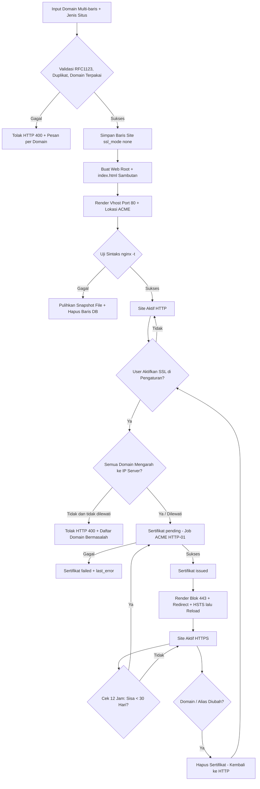
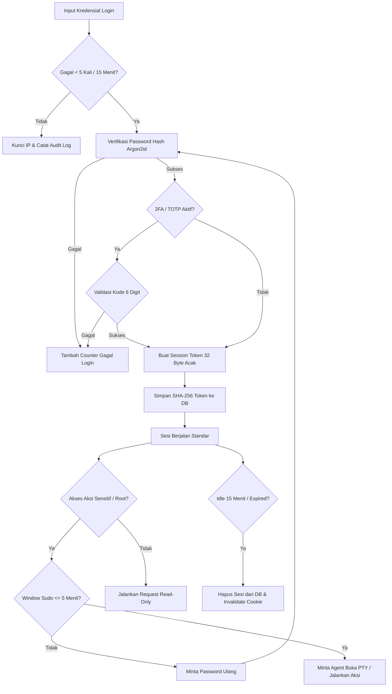
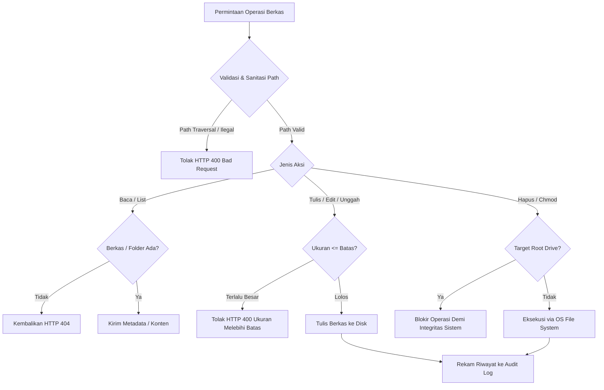
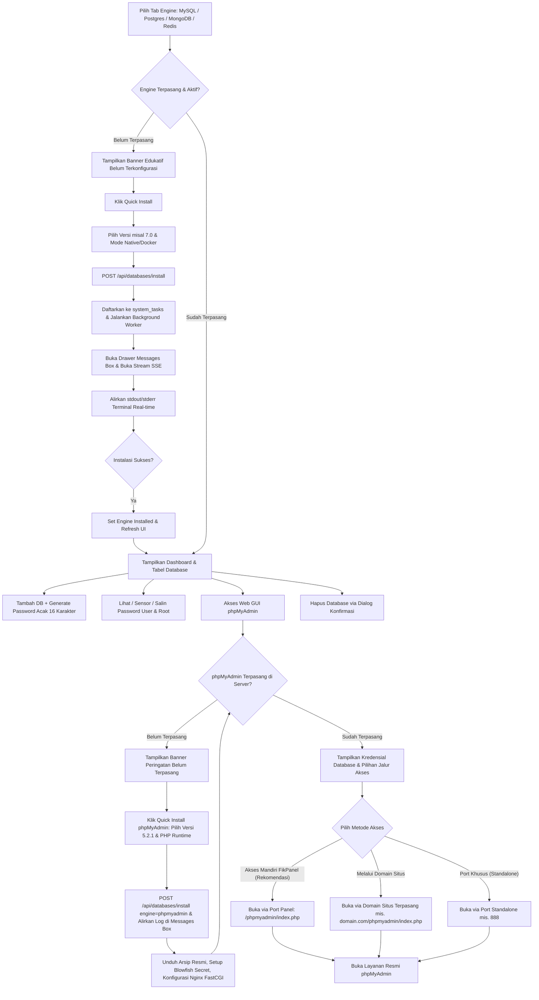
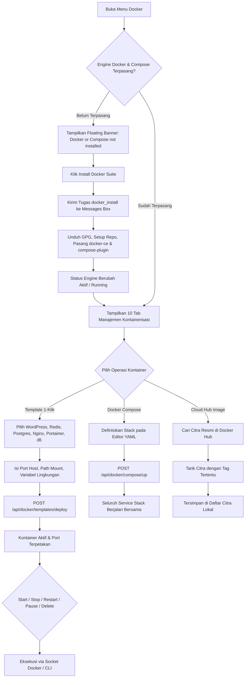
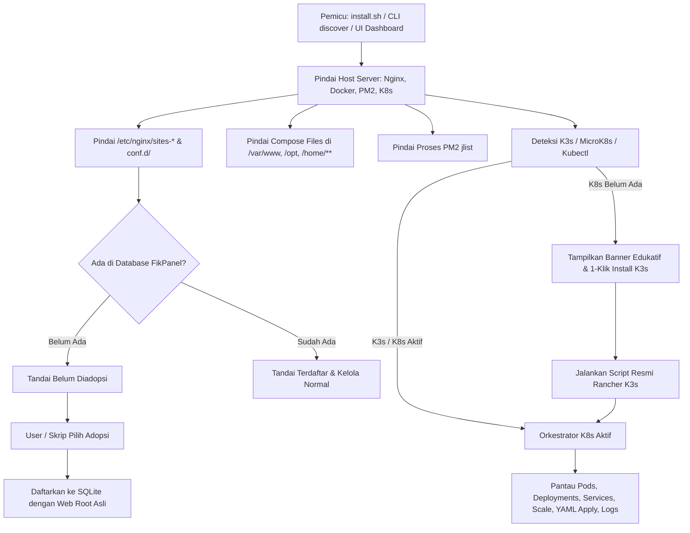
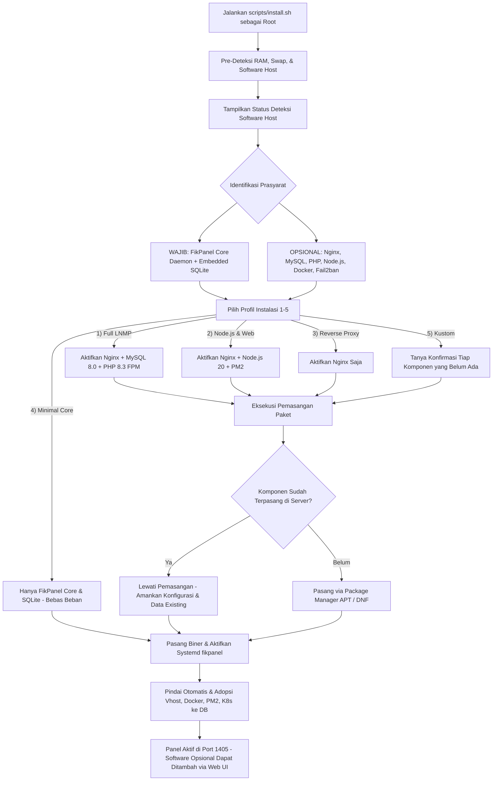

# Dokumentasi Logika Bisnis & Siklus Hidup Entitas (fikpanel)

## 1. Siklus Hidup Entitas

### 1.1 Siklus Hidup Site & Sertifikat SSL

### 1.2 Siklus Hidup Sesi Pengguna & Sudo Mode

### 1.3 Siklus Operasi Manajemen Berkas (File Manager)

### 1.4 Siklus Hidup Database & Antrean Quick Install

### 1.5 Siklus Hidup Kontainer & Stack Docker

### 1.6 Siklus Hidup Pindai Host (Host Discovery) & Orkestrasi Kubernetes

### 1.7 Siklus Instalasi Server Host & Pemilihan Stack Modular

---

## 2. Aturan Bisnis Entitas (Entity Rules)

### 2.1 Entitas `users`

| Kolom | Aturan Validasi | Catatan Bisnis |
|---|---|---|
| `id` | Primary Key, Auto Increment | Identitas unik akun pengguna |
| `username` | Panjang 3-32 karakter, alphanumeric, wajib unik | Nama akun login operator panel |
| `password_hash` | Wajib string ter-encode Argon2id valid | Hash menggunakan parameter memori 19 MiB |
| `totp_secret` | BLOB terenkripsi AES-256-GCM, opsional (bisa NULL) | Kunci rahasia 2FA, hanya didekripsi saat validasi |
| `role` | Wajib bernilai `'admin'` atau `'viewer'` | Viewer hanya memiliki akses read-only |
| `created_at` | Timestamp Unix integer, tidak boleh null | Waktu pendaftaran akun |
| `last_login_at` | Timestamp Unix integer, nullable | Diperbarui saat proses autentikasi berhasil |

### 2.2 Entitas `sites`

| Kolom | Aturan Validasi | Catatan Bisnis |
|---|---|---|
| `id` | Primary Key, Auto Increment | Identifikasi unik site |
| `domain` | Wajib RFC1123, non-wildcard, unik (termasuk terhadap alias situs lain) | Domain utama = baris non-wildcard pertama; juga nama file vhost |
| `aliases` | JSON Array domain valid, tanpa duplikat | Boleh wildcard (`*.x.com`); `www.` ditambahkan otomatis untuk domain apex bila opsi aktif |
| `kind` | Wajib salah satu: `'proxy'`, `'static'`, `'php'` | Aplikasi Node/Go/Python memakai `proxy` |
| `upstream` | Wajib URL `http(s)://host[:port]` jika `kind='proxy'` | Karakter `; { } ' "` dan spasi ditolak |
| `root_path` | Wajib path absolut jika `kind='static'/'php'` | Default `/var/www/<domain>/public_html`; `..`, karakter khusus, dan direktori sistem (`/`, `/etc`, `/usr`, `/root`, dst.) ditolak |
| `php_version` | Format `X.Y`, hanya untuk `kind='php'` | Menentukan socket `/run/php/phpX.Y-fpm.sock` |
| `description` | Maks 200 karakter, opsional | Catatan bebas untuk operator |
| `ssl_mode` | `'none'` atau `'letsencrypt'` | Selalu `none` saat dibuat; diubah hanya dari tab SSL |
| `force_https` | Boolean (0/1), default 1 | Redirect 301 ke HTTPS, aktif hanya bila sertifikat `issued` |
| `hsts` | Boolean (0/1), default 0 | Hanya bisa 1 bila `force_https=1`; header `max-age=31536000` |
| `extra_conf` | String konfigurasi Nginx bebas | Snippet wajib lolos uji sintaks `nginx -t` |
| `enabled` | Boolean (0 atau 1), default 1 | 0 = file vhost di-rename menjadi `.conf.disabled` |
| `updated_at` | Timestamp Unix integer | Waktu perubahan konfigurasi terakhir |

### 2.3 Entitas `certificates`

| Kolom | Aturan Validasi | Catatan Bisnis |
|---|---|---|
| `site_id` | Foreign Key ke `sites(id)`, Unik, On Delete Cascade | Satu sertifikat per site |
| `status` | `'none'`, `'pending'`, `'issued'`, `'failed'` | Hanya `issued` yang mengaktifkan blok 443 |
| `issuer` | String | Penerbit (misal: Let's Encrypt E6) |
| `domains` | JSON Array | SAN yang tercakup sertifikat (Issued To) |
| `not_before` / `not_after` | Timestamp Unix integer | Masa berlaku sertifikat |
| `signature` / `key_type` | String | Algoritma tanda tangan & jenis kunci (ECDSA P-256) |
| `last_error` | Text, nullable | Pesan kegagalan penerbitan / renew terakhir |
| `renewed_at` | Timestamp Unix integer, nullable | Waktu terakhir penerbitan berhasil |

### 2.4 Entitas `managed_services`

| Kolom | Aturan Validasi | Catatan Bisnis |
|---|---|---|
| `unit` | Primary Key, pola `*.service`, regex aman | Allowlist unit systemd yang diizinkan dikontrol; didaftarkan otomatis via dynamic discovery dari unit file yang terpasang di host Linux |
| `label` | String deskriptif, nullable | Nama manusia untuk unit layanan (misal: "MySQL Database Server", "PHP 8.5 FastCGI (FPM)") |
| `protected` | Boolean (0 atau 1), default 0 | Nilai 1 (seperti sshd, panel) wajib konfirmasi ganda sebelum modifikasi |

### 2.5 Entitas `audit_log`

| Kolom | Aturan Validasi | Catatan Bisnis |
|---|---|---|
| `id` | Primary Key, Auto Increment | Urutan peristiwa audit |
| `ts` | Timestamp Unix integer, wajib terindeks | Waktu presisi eksekusi perintah |
| `user_id` | Foreign Key ke `users(id)`, On Delete Set Null | Operator yang melakukan aksi (NULL jika system/AI) |
| `actor` | Wajib salah satu: `'user'`, `'system'`, `'ai'` | Pengklasifikasi sumber pemicu aksi |
| `action` | String nama aksi terformat (`kategori.verb`) | Nama operasi, misal `site.create`, `service.restart` |
| `target` | String identifier target | Nama unit service, domain site, atau PID |
| `ok` | Boolean (0 atau 1) | Hasil status keberhasilan aksi |
| `detail` | String teks maks 4096 byte | Rangkuman output atau pesan galat |

### 2.6 Entitas Docker & Kontainerisasi

| Entitas | Parameter Wajib | Catatan Bisnis |
|---|---|---|
| `Container` | `name`, `image`, `ports`, `volumes`, `restart_policy` | Kontainer wajib memiliki nama unik; pemetaan port divalidasi agar tidak bentrok dengan port servis host |
| `Image` | `repository`, `tag` | Citra ditarik dari Docker Hub atau registri privat terdaftar; penghapusan citra yang sedang dipakai kontainer wajib konfirmasi force |
| `Volume` | `name`, `driver` | Volume persisten lokal di `/var/lib/docker/volumes`; pembersihan massal (prune) hanya menghapus volume tak terikat |
| `Network` | `name`, `driver`, `subnet`, `gateway` | Jaringan terisolasi untuk komunikasi antarkontainer; jaringan bawaan host (`bridge`, `host`, `none`) diproteksi dari penghapusan |
| `Compose Stack`| `name`, `yaml` | Berkas disimpan di `/www/dk_project/<name>/docker-compose.yml`; mendukung kontrol siklus hidup up/down terpadu |
| `Daemon Config`| `registry_mirrors`, `log-opts`, `live-restore` | Konfigurasi disimpan di `/etc/docker/daemon.json`; perubahan memerlukan reload atau restart daemon Docker |

---

## 3. Matriks Transisi Status Entitas

### 3.1 Transisi Status Site

| Status Awal | Pemicu (Trigger) | Status Akhir | Aturan Bisnis & Efek Samping |
|---|---|---|---|
| `None` | User membuat site & `nginx -t` lolos | `Active` | Web root + vhost port 80 dibuat, Nginx di-reload |
| `None` | Web root / vhost gagal diterapkan | `None` | Snapshot file dipulihkan dan baris DB dihapus |
| `Active` | User klik Nonaktifkan | `Disabled` | File di-rename `.conf.disabled`, Nginx di-reload |
| `Disabled`| User klik Aktifkan | `Active` | File vhost dipulihkan dan Nginx di-reload |
| `Active` | User mengubah pengaturan (PUT) | `Active` | Gagal uji sintaks = data DB & file dikembalikan |
| `Active`/`Disabled` | User menghapus site | `Deleted` | Vhost & sertifikat dihapus; isi web root dipertahankan |

### 3.2 Transisi Status Sertifikat SSL

| Status Awal | Pemicu (Trigger) | Status Akhir | Aturan Bisnis & Efek Samping |
|---|---|---|---|
| `none` | User aktifkan SSL & DNS siap / dilewati | `pending` | Job ACME HTTP-01 berjalan di background |
| `none`/`failed` | Domain wildcard terdaftar | (ditolak) | HTTP-01 tidak mendukung wildcard |
| `pending` | Job sedang berjalan & request baru | (ditolak) | HTTP 409, satu job per site |
| `pending` | Validasi & penerbitan sukses | `issued` | File cert ditulis atomik, blok 443 + redirect + HSTS diterapkan |
| `pending` | Validasi gagal | `failed` | `last_error` disimpan, situs tetap HTTP |
| `failed` | User klik terbitkan ulang | `pending` | Sama seperti penerbitan pertama |
| `issued` | Sisa masa aktif < 30 hari (loop 12 jam) | `pending` → `issued` | Perpanjangan otomatis, Nginx di-reload |
| `issued` | Domain / alias situs diubah | `none` | Record sertifikat dihapus, HTTPS nonaktif sampai terbit ulang |
| `issued` | User nonaktifkan SSL | `issued` | `ssl_mode=none`, blok 443 dilepas; sertifikat tetap tersimpan |

### 3.3 Transisi Status Layanan (Systemd Unit)

| Status Awal | Pemicu (Trigger) | Status Akhir | Aturan Bisnis & Efek Samping |
|---|---|---|---|
| `inactive` | Permintaan start | `active` | Agent mengeksekusi `systemctl start <unit>` |
| `active` | Permintaan stop | `inactive` | Ditolak jika unit `protected=1` tanpa konfirmasi |
| `active` | Permintaan restart | `active` | Agent mengeksekusi `systemctl restart <unit>` |
| `failed` | Permintaan restart | `active` | Mencoba pemulihan unit yang crash |
| `active` | Unit mengalami crash | `failed` | Terdeteksi oleh loop polling / supervisor |

---

### 3.4 Transisi Status Antrean Tugas (Task Queue / Quick Install)

| Status Awal | Kejadian (Trigger) | Status Akhir | Keterangan / Efek Samping |
|---|---|---|---|
| `pending` | Worker backend mengambil task dari antrean | `running` | Proses subprocess bash/apt/docker dimulai; output log dibuka untuk streaming SSE |
| `running` | Subprocess instalasi keluar dengan kode 0 & service aktif | `success` | Status engine diperbarui ke `installed: true`; log ditutup dengan penanda selesai |
| `running` | Subprocess menghasilkan kode != 0 atau timeout | `failed` | Catat error ringkas ke task log; sediakan opsi retry kepada user |
| `running` | User membatalkan proses instalasi | `cancelled` | Sinyal `SIGTERM`/`SIGKILL` dikirim ke grup proses |

---

### 3.5 Transisi Status Kontainer Docker

| Status Awal | Pemicu (Trigger) | Status Akhir | Aturan Bisnis & Efek Samping |
|---|---|---|---|
| `created` | Eksekusi start kontainer | `running` | Alokasi port, isolasi cgroup, dan proses utama kontainer dijalankan |
| `running` | Permintaan stop (`POST .../stop`) | `exited` | Mengirim sinyal `SIGTERM` lalu `SIGKILL` setelah grace period (10 detik) |
| `running` | Permintaan pause (`POST .../pause`) | `paused` | Proses dibekukan menggunakan cgroups freezer tanpa melepas alokasi memori |
| `paused` | Permintaan unpause (`POST .../unpause`)| `running` | Proses dicairkan kembali dan melanjutkan eksekusi |
| `running` | Kontainer mengalami crash / OOM | `exited` | Jika kebijakan restart `always` atau `unless-stopped`, daemon akan menyalakan ulang otomatis |
| `exited` / `created` | Permintaan hapus kontainer | `deleted` | Kontainer dihapus; volume persisten yang di-mount tetap aman di host |

---

## 4. Batasan Bisnis & Pemicu Otomatis (Triggers)

| Kode Aturan | Pemicu | Batasan Bisnis | Tindakan Sistem |
|---|---|---|---|
| **BR-01** | Mutasi Data Sensitif | Membutuhkan status Sudo Aktif | Tolak jika verifikasi sandi terakhir > 5 menit lalu |
| **BR-02** | Login Gagal | Maksimal 5 kegagalan per 15 menit per IP | Kunci autentikasi dari IP terkait selama 15 menit |
| **BR-03** | Eksekusi Alat AI | AI memproses permintaan diagnosa | Batasi hanya fungsi read-only, maks 8 iterasi |
| **BR-04** | Redaksi Log | Data log diambil sebelum dikirim ke AI | Hapus otomatis pola token, password, dan kunci privat |
| **BR-05** | Perpanjangan SSL | Pengecekan sertifikat tiap 12 jam | Picu penerbitan ulang ACME jika sisa masa aktif < 30 hari |
| **BR-06** | Retensi Audit & Chat| Job pembersihan berkala tengah malam | Hapus audit > 90 hari dan pesan AI > 30 hari |
| **BR-07** | Operasi Berkas Kritis | Upaya penghapusan root volume / traversal | Blokir path ilegal dan cegah penghapusan root drive |
| **BR-08** | Editor Teks Berkas | Perubahan konten berkas teks | Deteksi dirty state, konfirmasi sebelum tutup, simpan dengan `Ctrl+S` |
| **BR-09** | Ketersediaan Web Server | Akses menu Sites tanpa Nginx | Tampilkan interactive dependency warning card dan opsi 1-klik instalasi |
| **BR-10** | Live-Reload Pengembangan | File backend Go atau frontend Svelte berubah pada mode dev | Air otomatis kompilasi ulang & restart biner Go; Vite memperbarui komponen UI seketika via HMR tanpa restart manual |
| **BR-11** | SSL Setelah Situs Dibuat | Form tambah situs tidak menyediakan opsi SSL | SSL hanya diaktifkan dari tab SSL setelah vhost port 80 + lokasi ACME aktif |
| **BR-12** | Atomisitas Pembuatan Situs | Web root, vhost, atau `nginx -t` gagal | Baris DB dihapus dan file vhost dikembalikan ke snapshot sebelumnya |
| **BR-13** | Validasi Domain Realtime | Input domain di form (debounce ±450 ms) | Cek format, duplikat, domain terpakai, dan resolusi DNS vs IP server (DNS hanya informatif saat membuat situs) |
| **BR-14** | Prasyarat DNS untuk SSL | Penerbitan Let's Encrypt | Semua domain wajib mengarah ke IP server, kecuali opsi "lewati cek DNS" (NAT/CDN) dicentang |
| **BR-15** | Reset Sertifikat | Domain / alias situs diubah saat sertifikat `issued` | Sertifikat dihapus, situs kembali HTTP, UI meminta terbit ulang |
| **BR-16** | HSTS | Opsi HSTS dicentang | Hanya tersimpan bila Paksa HTTPS aktif |
| **BR-17** | Watchdog Nginx | Opsi daemon Nginx aktif | Nginx yang mati otomatis dinyalakan ulang setiap 1 menit setelah lolos `nginx -t` |
| **BR-18** | Simpan Konfigurasi Nginx | Edit `nginx.conf` dari Nginx Manager | Uji sintaks file sementara, backup rotasi 10 file, rename atomik, lalu reload |
| **BR-19** | Standar Desain UI & Token | Perubahan atau pembuatan komponen antarmuka | Nilai visual wajib berasal dari token terpusat (`tokens.css`). Dilarang memakai warna mentah, font eksternal, atau CDN. Divalidasi oleh `npm run lint:ui`. |
| **BR-20** | Dialog Konfirmasi Destruktif | Aksi penghapusan berkas, situs, stop service, dan reset SSL | Wajib menggunakan `confirmDialog()` atau `promptDialog()` berbasis Svelte runes; dilarang menggunakan fungsi dialog native browser (`confirm/alert/prompt`). |
| **BR-21** | Hardening Header Keamanan | Pengiriman respon HTTP dan frontend statis | Menyematkan `Content-Security-Policy` ketat, `Permissions-Policy`, `COOP`, `CORP`, `X-Content-Type-Options: nosniff`, dan `X-Frame-Options: DENY`. |
| **BR-22** | Klien API Terpusat & Anti-CSRF | Seluruh request HTTP frontend | Wajib melalui `apiFetch` relatif same-origin; menyematkan otomatis header `X-Panel-Request: 1` pada mutasi data dan penanganan 401 otomatis. |
| **BR-23** | Kustomisasi Provider LLM | Pengguna mengonfigurasi AI Copilot | Mendukung OpenAI-compatible (Omniroute, 9router, OpenAI, Groq, Ollama), Anthropic Claude, dan Google Gemini dengan Base URL bebas; API key disensor pada respon dan log. |
| **BR-24** | Persistensi Riwayat Percakapan AI | Pengguna mengirim dan membaca pesan AI | Riwayat disimpan dalam tabel `ai_conversations` dan `ai_messages`; menyertakan judul otomatis dan konteks memori maksimal 16 pesan terakhir. |
| **BR-25** | Fallback Diagnostik Server Offline | Provider eksternal tidak aktif atau gagal | AI Copilot otomatis beralih ke engine diagnostik lokal berbasis status real-time Nginx, CPU, RAM, dan Disk tanpa melempar kegagalan fatal. |
| **BR-26** | Deteksi Dinamis Engine Database | Akses tab engine (MySQL, Postgres, MongoDB, Redis) | Backend memeriksa ketersediaan biner & status systemd. Jika belum terpasang, antarmuka wajib merender State Edukatif disertai tombol Quick Install dan Remote DB. |
| **BR-27** | Asinkronitas & Log Streaming Instalasi | Eksekusi Quick Install paket database | Wajib berjalan di latar belakang (background task) dengan ID unik; output terminal di-stream melalui Server-Sent Events (SSE) agar antarmuka tidak blocking. |
| **BR-28** | Keamanan Kredensial Database | Pembuatan database dan user baru | Password wajib dibuat acak dengan entropi tinggi (minimal 16 karakter acak aman); host default dibatasi `localhost` kecuali user memilih wildcard `%` secara eksplisit. |
| **BR-29** | Prosedur Alih Versi SQL (Backward Incompatibility Protection) | Pengguna melakukan ganti versi (Switch Version) mesin database | Host native hanya menjalankan 1 versi aktif pada port 3306. Sistem wajib mengekspor cadangan otomatis seluruh database (`mysqldump --all-databases`) sebelum memasang paket baru untuk mencegah korupsi format InnoDB. |
| **BR-30** | Akses Web GUI Multi-Jalur (phpMyAdmin / FikPanel Client) | Manajemen visual tabel dan eksekusi query SQL | Menyediakan 3 jalur akses: (1) Melalui Domain Situs Terpasang (`domain/phpmyadmin` pada port standar 80/443 ber-SSL), (2) Melalui FikPanel Independen (`/pma/` pada port panel aktif tanpa keterikatan domain atau port 888), dan (3) Port Khusus Standalone (mis. 888) dengan One-Click SSO dan toggle akses publik. |
| **BR-31** | Batasan Kuota Kapasitas Database | Penetapan kuota ukuran pada database tertentu | Menggunakan kuota sistem berkas OS (XFS/ext4 project quota); pengisian nilai 0 menandakan kapasitas penyimpanan tanpa batas (unlimited). |
| **BR-32** | Integrasi Resmi phpMyAdmin via Reverse Proxy Daemon & Auto-Fill Form | Akses Web GUI phpMyAdmin (`/phpmyadmin/`, `/pma/`, `/phpMyAdmin/`) | FikPanel meneruskan permintaan secara transparan ke instance resmi phpMyAdmin fisik via daemon lokal (`127.0.0.1:8885`) tanpa mock/clone tiruan. Proxy secara otomatis menginjeksi auto-fill username, password (dari sesi SSO), target rute database (`route=/database/structure&db=...`), serta badge visual database pada formulir login resmi phpMyAdmin. |
| **BR-33** | Deteksi & Peringatan Otomatis Engine Docker | Pengguna membuka modul Docker tanpa engine Docker/Compose terpasang | Menampilkan floating alert banner persistens dan menyediakan tombol 1-klik instalasi otomatis ke Messages Box |
| **BR-34** | Manajemen Konfigurasi Atomik `daemon.json` | Pengguna mengubah pengaturan Accelerate URL, Log Rotation, atau konfigurasi JSON | Memvalidasi sintaks JSON sebelum disimpan, mencatat audit log, dan mengizinkan modifikasi langsung via editor modal |
| **BR-35** | Proteksi Jaringan Inti Sistem Docker | Pengguna mencoba menghapus jaringan `bridge`, `host`, atau `none` | Sistem menolak aksi penghapusan demi menjaga integritas konektivitas jaringan kontainer host |
| **BR-36** | Katalog Aplikasi 1-Klik Terisolasi | Pemasangan aplikasi populer (WordPress, Redis, Postgres, MySQL, Portainer, dll.) | Mempersiapkan direktori data persisten `/www/dk_project/<app>/data`, menyuntikkan variabel lingkungan aman, dan memetakan port host default |
| **BR-37** | Manajemen Proses & Port Sistem | Pengguna menginspeksi atau menghentikan proses OS | Menampilkan daftar proses CPU/memori tertinggi; penghentian proses mengirim SIGTERM/SIGKILL dengan larangan keras menghentikan proses vital PID 1 |
| **BR-38** | Pembersihan Sampah & Sinkronisasi Cache OS | Eksekusi System Cleaner | Memindai dan menghapus berkas usang APT, log lama terkompresi, dan berkas temporer `/tmp`; opsi `drop_caches` wajib menjalankan sinkronisasi disk (`sync`) sebelum mengosongkan cache RAM |
| **BR-39** | Perekaman Metrik Persisten aaPanel-Style | Pengguna mengaktifkan fitur Monitoring Historis | Daemon background merekam snapshot penggunaan CPU, RAM, Disk, Load, dan Jaringan setiap 60 detik ke SQLite; data melebihi batas retensi dibersihkan setiap 24 jam |
| **BR-40** | Hardening SSH & Proteksi Fail2Ban | Modifikasi konfigurasi SSH atau penanganan IP terblokir | Perubahan port dan otentikasi kata sandi memodifikasi `sshd_config` lalu me-reload daemon `sshd`; pembukaan blokir IP mengeksekusi unban terarah pada jail Fail2Ban |
| **BR-41** | Software App Store & Toolkit Linux | Instalasi paket aplikasi sistem operasi | Menggunakan antrean worker asinkron (`system_tasks`) dengan streaming kemajuan log real-time agar tidak memblokir UI panel |
| **BR-42** | Manajemen Proses Node.js & PM2 | Pengguna mengelola aplikasi Node.js SSR / API | Menghubungkan langsung ke daemon PM2 host tanpa dummy data; mendukung start aplikasi, reload, delete, dan pembacaan log real-time dengan sinkronisasi `pm2 save` |
| **BR-43** | Integrasi Cadangan S3 pada Modul Database | Pengguna mengelola snapshot database dan S3 Cloud | Modul Backup S3 diintegrasikan sebagai sub-tab di dalam menu Databases, mengeliminasi menu redundan di sidebar dan menyederhanakan alur pencadangan data |
| **BR-44** | Pindai Otomatis Infrastruktur Host & Adopsi Konfigurasi | Instalasi server via `install.sh`, CLI `fikpanel discover`, atau aksi Pindai di antarmuka | Memindai secara dinamis virtual host Nginx, stack Docker Compose, proses PM2, dan status Kubernetes. Menyimpan path root kustom asli (misal `/home/fikfikk/projects/**`) ke database SQLite agar resource terkelola langsung di panel tanpa perombakan struktur direktori. |
| **BR-45** | Orkestrasi Lengkap Kubernetes & K3s Host | Pengguna menginspeksi cluster Kubernetes di menu Kubernetes | Mendeteksi ketersediaan cluster K3s, MicroK8s, atau standar; menyediakan pemantauan workload Pods, Deployments, Services, scaling interaktif, pembacaan log kontainer, dan penerapan manifest YAML langsung via `kubectl apply`. |
| **BR-46** | Kemandirian Database FikPanel & Profil Instalasi Host Modular | Eksekusi installer `scripts/install.sh` di server host (server baru maupun server existing) | FikPanel Core berjalan dengan embedded SQLite independen tanpa memerlukan MySQL/MariaDB eksternal. MySQL, PHP, Docker, dan Fail2ban bersifat sepenuhnya opsional. Installer memindai software existing dengan proteksi smart-skip agar tidak menimpa vhost/data existing, menyediakan profil instalasi terstruktur, dan komponen opsional dapat dipasang kapan saja melalui antarmuka Web Panel (App Store / Databases / Security Center). |
| **BR-47** | Penjadwal Tugas (Cron Manager) & Sinkronisasi Waktu Server-Klien (WIB vs UTC) | Pengguna menambahkan atau mengubah tugas cron pada jam tertentu | Backend mendukung ekspresi 5-kolom Crontab Linux (`m h dom mon dow`). Antarmuka visual builder HestiaCP + aaPanel Style mengonversi jam lokal pengguna (WIB UTC+7) ke jam server (UTC) secara otomatis sebelum disimpan, disertai display waktu sistem live dan konversi real-time. |
| **BR-48** | Deteksi Dinamis Host Runtime PHP Multi-Version | Akses menu PHP Multi-Version & FPM Tuning | Memindai secara dinamis socket `/run/php/php*-fpm.sock`, direktori `/etc/php/*`, dan biner FPM (mendeteksi PHP 8.5, 8.4, 8.3, 8.2, 8.1, dst.) dengan sorting numerik menurun. Versi belum terpasang dapat diinstal 1-klik via paket APT sistem. |
| **BR-49** | App Store Terpadu & Fleksibilitas Tampilan (Grid / Table Switcher) | Pengguna membuka App Store dan mengelola aplikasi web stack atau paket sistem | Menggabungkan seluruh software katalog dan repositori global Linux (APT) dalam satu antarmuka terpadu tanpa pemisahan tab yang kaku. Menyediakan View Switcher (Tampilan Kartu Modern & Tabel Rinci), bilah pencarian autocomplete fuzzy dengan riwayat pencarian lokal dan rekomendasi populer (Trending), filter kategori (Semua, Terpasang, Web Server, Runtime, Database, Alat & Keamanan), serta tautan langsung ke manajer software terkait. |

