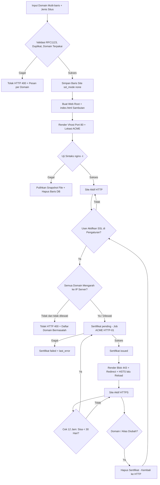
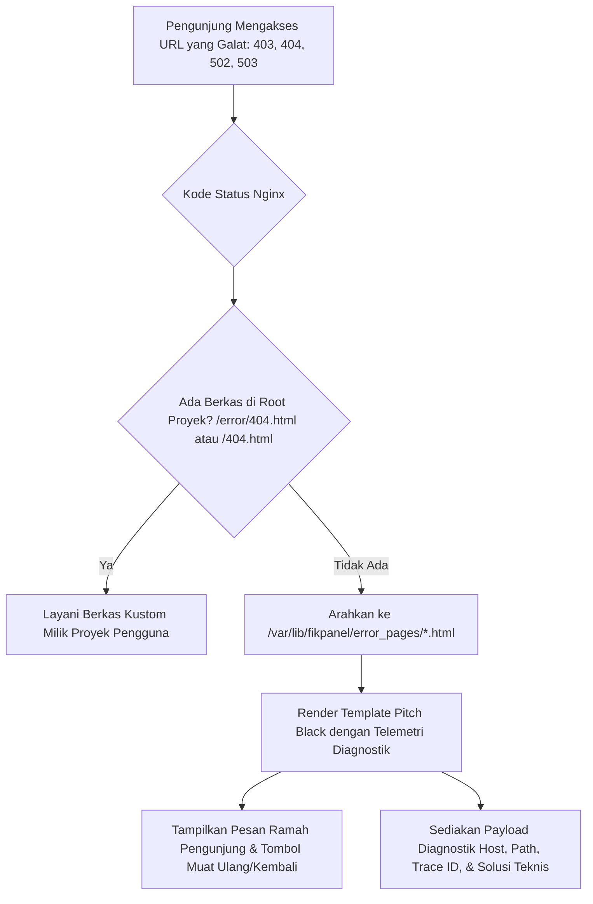
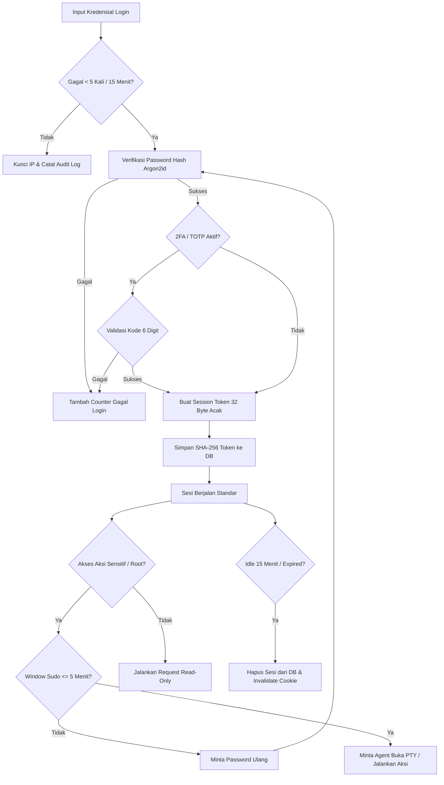
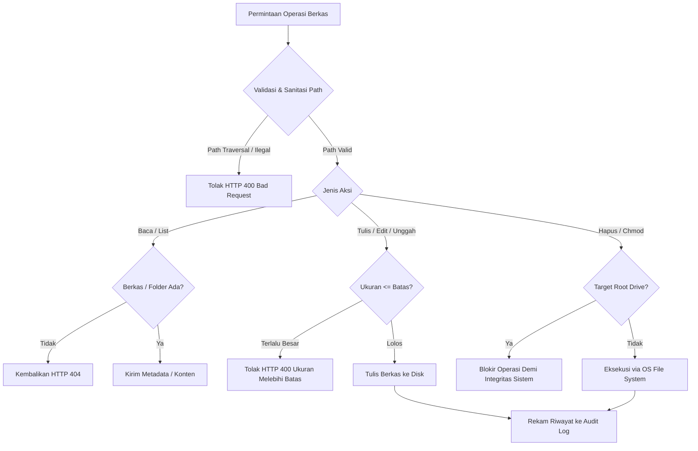
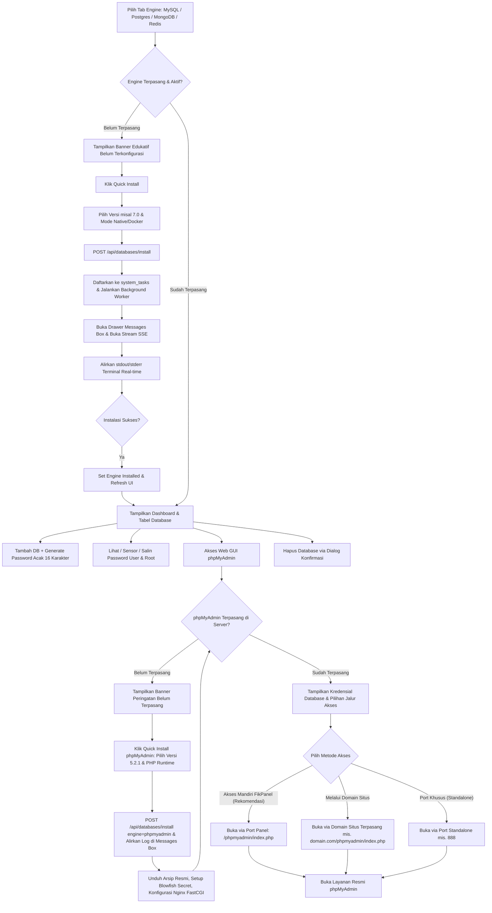
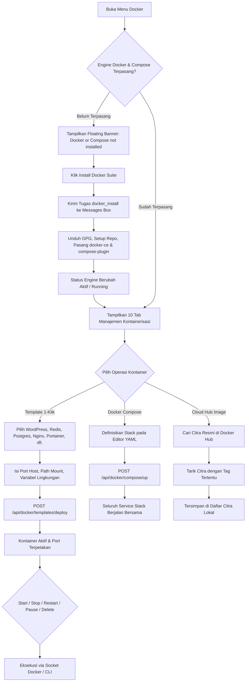
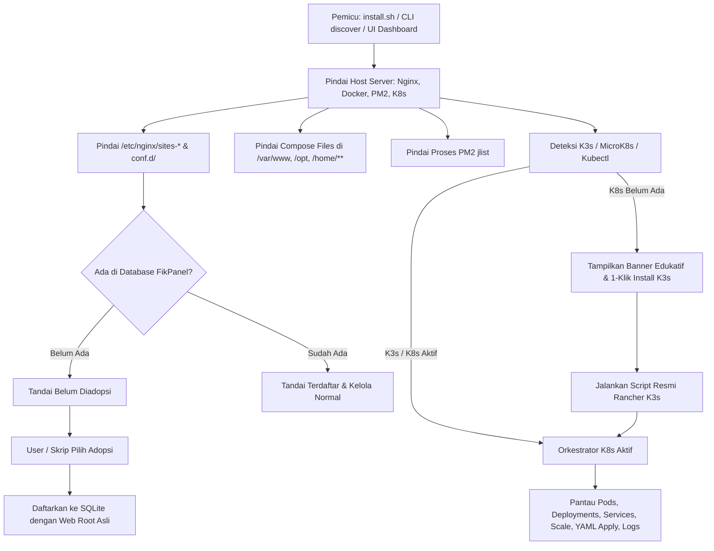
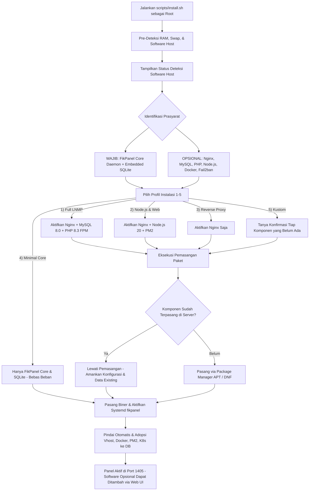
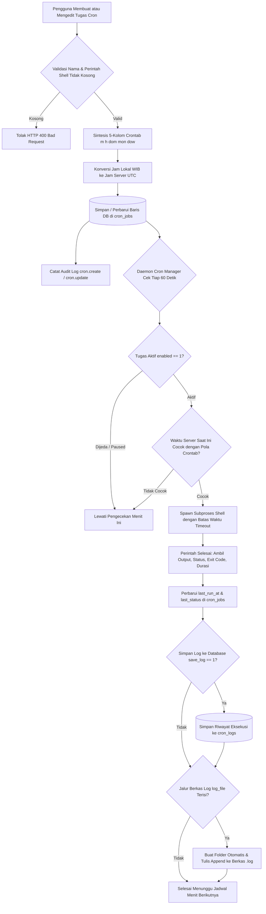
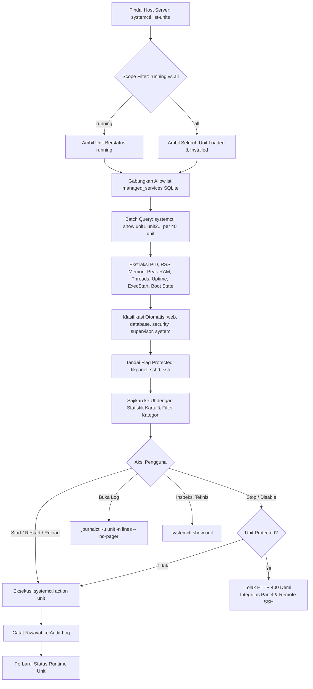

# Dokumentasi Logika Bisnis & Siklus Hidup Entitas (fikpanel)

## 1. Siklus Hidup Entitas

### 1.1 Siklus Hidup Site & Sertifikat SSL



### 1.1a Siklus Penanganan Halaman Galat (Error Pages)



### 1.2 Siklus Hidup Sesi Pengguna & Sudo Mode



### 1.3 Siklus Operasi Manajemen Berkas (File Manager)



### 1.4 Siklus Hidup Database & Antrean Quick Install



### 1.5 Siklus Hidup Kontainer & Stack Docker



### 1.6 Siklus Hidup Pindai Host (Host Discovery) & Orkestrasi Kubernetes



### 1.7 Siklus Instalasi Server Host & Pemilihan Stack Modular



### 1.8 Siklus Manajemen Aturan Firewall Bergaya AWS Security Groups

```mermaid
flowchart TD
    BukaFirewall[Buka Tab Firewall di Security Center] --> LoadExtended[GET /api/firewall/extended]
    LoadExtended --> ParseRules[Generate Deterministic Rule ID sgr-xxxx & Deteksi Service Type]
    ParseRules --> RenderAWS[Render UI: Security Group Details, Subtabs, & Inbound Rules Table]
    
    RenderAWS --> UserAksi{Aksi Pengguna}
    UserAksi -- Toggle Status UFW --> ToggleFW[POST /api/firewall/toggle]
    UserAksi -- Hapus 1 Rule --> DeleteRule[DELETE /api/firewall/rules/{number}]
    UserAksi -- Kelola Massal --> EditMode[Klik 'Edit inbound rules']
    
    EditMode --> MultiRowEditor[Buka Editor Form Multi-Baris]
    MultiRowEditor --> PresetPilih{Pilih Tipe Layanan / Type}
    
    PresetPilih -- Layanan Standar SSH/HTTP/HTTPS/MySQL --> AutoLock[Kunci Protokol TCP & Isi Port Otomatis]
    PresetPilih -- Custom TCP / Custom UDP --> CustomInput[Buka Input Port Bebas & Protokol]
    
    MultiRowEditor --> AddRow[Klik 'Add rule' untuk Baris Baru]
    MultiRowEditor --> SourceType[Pilih Source Type: Custom / Anywhere IPv4 / My IP]
    SourceType --> RenderChips[Render Source Chip misal 0.0.0.0/0]
    
    MultiRowEditor --> SimpanBatch[Klik 'Save rules']
    SimpanBatch --> KirimAPI[POST /api/firewall/rules/batch]
    KirimAPI --> EksekusiAtomik[Terapkan Seluruh Aturan Baru & Bersihkan Aturan Dihapus]
    EksekusiAtomik --> CatatAudit[Catat Audit Log security.port_rules_batch]
    CatatAudit --> KembaliView[Kembali ke Tampilan Tabel Inbound Rules & Refresh Data]
```

### 1.8 Siklus Hidup Penjadwal Tugas (Cron Jobs)



### 1.9 Siklus Hidup Layanan Sistem (Systemd & Supervisor)



---

## 2. Aturan Bisnis Entitas (Entity Rules)

### 2.1 Entitas `users`

| Kolom | Aturan Validasi | Catatan Bisnis |
|---|---|---|
| `id` | Primary Key, Auto Increment | Identitas unik akun pengguna |
| `username` | Panjang 3-32 karakter, alphanumeric, wajib unik | Nama akun login operator panel |
| `password_hash` | Wajib string ter-encode Argon2id valid | Hash menggunakan parameter memori 19 MiB |
| `totp_secret` | BLOB terenkripsi AES-256-GCM, opsional (bisa NULL) | Kunci rahasia 2FA, hanya didekripsi saat validasi |
| `role` | Wajib bernilai `'admin'` atau `'viewer'` | Viewer hanya memiliki akses read-only |
| `created_at` | Timestamp Unix integer, tidak boleh null | Waktu pendaftaran akun |
| `last_login_at` | Timestamp Unix integer, nullable | Diperbarui saat proses autentikasi berhasil |

### 2.2 Entitas `sites`

| Kolom | Aturan Validasi | Catatan Bisnis |
|---|---|---|
| `id` | Primary Key, Auto Increment | Identifikasi unik site |
| `domain` | Wajib RFC1123, non-wildcard, unik (termasuk terhadap alias situs lain) | Domain utama = baris non-wildcard pertama; juga nama file vhost |
| `aliases` | JSON Array domain valid, tanpa duplikat | Boleh wildcard (`*.x.com`); `www.` ditambahkan otomatis untuk domain apex bila opsi aktif |
| `kind` | Wajib salah satu: `'php'`, `'node'`, `'go'`, `'python'`, `'static'`, `'proxy'` | Standar multi-runtime resmi FikPanel |
| `upstream` | Wajib URL `http(s)://host[:port]` jika `kind` bernilai `'proxy'`, `'node'`, `'go'`, atau `'python'` | Karakter `; { } ' "` dan spasi ditolak |
| `root_path` | Wajib path absolut untuk kind selain `'proxy'` | Standar FikPanel: `/home/<user>/web/<domain>/public` (PHP), `/home/<user>/node/<domain>` (Node.js), `/home/<user>/go/<domain>` (Go), `/home/<user>/python/<domain>` (Python), `/home/<user>/static/<domain>/public` (Static). Direktori sistem (`/`, `/etc`, `/usr`, `/root`, dst.) ditolak |
| `php_version` | Format `X.Y`, hanya untuk `kind='php'` | Menentukan socket `/run/php/phpX.Y-fpm.sock` |
| `description` | Maks 200 karakter, opsional | Catatan bebas untuk operator |
| `ssl_mode` | `'none'` atau `'letsencrypt'` | Selalu `none` saat dibuat; diubah hanya dari tab SSL |
| `force_https` | Boolean (0/1), default 1 | Redirect 301 ke HTTPS, aktif hanya bila sertifikat `issued` |
| `hsts` | Boolean (0/1), default 0 | Hanya bisa 1 bila `force_https=1`; header `max-age=31536000` |
| `extra_conf` | String konfigurasi Nginx bebas | Snippet wajib lolos uji sintaks `nginx -t` |
| `enabled` | Boolean (0 atau 1), default 1 | 0 = file vhost di-rename menjadi `.conf.disabled` |
| `request_count` | Integer (terhitung otomatis saat query API) | Jumlah riil permintaan HTTP dari baris log akses Nginx (`/var/log/nginx/<domain>.access.log`, `.log.1`, dan `.log.*.gz`) |
| `has_git` | Boolean (terdeteksi otomatis dari direktori `.git`) | Menentukan ketersediaan badge repositori Git & tombol operasi **Git Pull** khusus situs yang di-clone dari Git |
| `updated_at` | Timestamp Unix integer | Waktu perubahan konfigurasi terakhir |

### 2.3 Entitas `certificates`

| Kolom | Aturan Validasi | Catatan Bisnis |
|---|---|---|
| `site_id` | Foreign Key ke `sites(id)`, Unik, On Delete Cascade | Satu sertifikat per site |
| `status` | `'none'`, `'pending'`, `'issued'`, `'failed'` | Hanya `issued` yang mengaktifkan blok 443 |
| `issuer` | String | Penerbit (misal: Let's Encrypt E6) |
| `domains` | JSON Array | SAN yang tercakup sertifikat (Issued To) |
| `not_before` / `not_after` | Timestamp Unix integer | Masa berlaku sertifikat |
| `signature` / `key_type` | String | Algoritma tanda tangan & jenis kunci (ECDSA P-256) |
| `last_error` | Text, nullable | Pesan kegagalan penerbitan / renew terakhir |
| `renewed_at` | Timestamp Unix integer, nullable | Waktu terakhir penerbitan berhasil |

### 2.4 Entitas `managed_services`

| Kolom | Aturan Validasi | Catatan Bisnis |
|---|---|---|
| `unit` | Primary Key, pola `*.service`, regex aman | Allowlist unit systemd yang diizinkan dikontrol; didaftarkan otomatis via dynamic discovery dari unit file yang terpasang di host Linux |
| `label` | String deskriptif, nullable | Nama manusia untuk unit layanan (misal: "MySQL Database Server", "PHP 8.5 FastCGI (FPM)") |
| `protected` | Boolean (0 atau 1), default 0 | Nilai 1 (seperti sshd, panel) wajib konfirmasi ganda sebelum modifikasi |

### 2.5 Entitas `audit_log`

| Kolom | Aturan Validasi | Catatan Bisnis |
|---|---|---|
| `id` | Primary Key, Auto Increment | Urutan peristiwa audit |
| `ts` | Timestamp Unix integer, wajib terindeks | Waktu presisi eksekusi perintah |
| `user_id` | Foreign Key ke `users(id)`, On Delete Set Null | Operator yang melakukan aksi (NULL jika system/AI) |
| `actor` | Wajib salah satu: `'user'`, `'system'`, `'ai'` | Pengklasifikasi sumber pemicu aksi |
| `action` | String nama aksi terformat (`kategori.verb`) | Nama operasi, misal `site.create`, `service.restart` |
| `target` | String identifier target | Nama unit service, domain site, atau PID |
| `ok` | Boolean (0 atau 1) | Hasil status keberhasilan aksi |
| `detail` | String teks maks 4096 byte | Rangkuman output atau pesan galat |

### 2.6 Entitas Docker & Kontainerisasi

| Entitas | Parameter Wajib | Catatan Bisnis |
|---|---|---|
| `Container` | `name`, `image`, `ports`, `volumes`, `restart_policy` | Kontainer wajib memiliki nama unik; pemetaan port divalidasi agar tidak bentrok dengan port servis host |
| `Image` | `repository`, `tag` | Citra ditarik dari Docker Hub atau registri privat terdaftar; penghapusan citra yang sedang dipakai kontainer wajib konfirmasi force |
| `Volume` | `name`, `driver` | Volume persisten lokal di `/var/lib/docker/volumes`; pembersihan massal (prune) hanya menghapus volume tak terikat |
| `Network` | `name`, `driver`, `subnet`, `gateway` | Jaringan terisolasi untuk komunikasi antarkontainer; jaringan bawaan host (`bridge`, `host`, `none`) diproteksi dari penghapusan |
| `Compose Stack`| `name`, `yaml` | Berkas disimpan di `/www/dk_project/<name>/docker-compose.yml`; mendukung kontrol siklus hidup up/down terpadu |
| `Daemon Config`| `registry_mirrors`, `log-opts`, `live-restore` | Konfigurasi disimpan di `/etc/docker/daemon.json`; perubahan memerlukan reload atau restart daemon Docker |

### 2.7 Entitas `cron_jobs` & `cron_logs`

| Kolom | Aturan Validasi | Catatan Bisnis |
|---|---|---|
| `id` | Primary Key, Auto Increment | Identitas unik tugas terjadwal |
| `name` | String 1-255 karakter, tidak boleh kosong | Nama deskriptif tugas, misal Backup MySQL atau Laravel Artisan |
| `schedule_type` | Wajib salah satu: `'minutes'`, `'hourly'`, `'daily'`, `'weekly'`, `'monthly'`, `'custom'` | Jenis preset interval antarmuka generator crontab |
| `spec` | Format 5 kolom crontab (`m h dom mon dow`), valid | Pola jadwal eksekusi Linux crontab |
| `command` | String shell command tidak boleh kosong | Perintah Linux yang dieksekusi; dilarang menjalankan perintah perusak fatal (misal `shutdown`, `init 0`, `mkfs`) |
| `enabled` | Integer boolean (0 atau 1) | Menandakan status aktif (1) atau jeda sementara (0) |
| `save_log` | Integer boolean (0 atau 1) | Menyimpan histori eksekusi ke tabel `cron_logs` |
| `log_file` | String path file `.log`, opsional | Jalur berkas log fisik kustom pada disk (misal `/var/cronlog/task.log`) |
| `timeout_sec` | Integer > 0 (default 3600) | Batas waktu maksimal eksekusi sebelum subproses dihentikan paksa (SIGKILL) |
| `last_run_at` | Timestamp Unix, nullable | Waktu terakhir tugas berhasil atau gagal dieksekusi |
| `last_status` | String (`'success'`, `'failed'`, `'running'`), nullable | Status eksekusi terakhir |

### 2.8 Entitas `managed_services` & Runtime Systemd Units

| Atribut / Field | Aturan Validasi | Catatan Bisnis |
|---|---|---|
| `unit` | Format nama unit systemd valid (berakhiran `.service`), unik | Pengidentifikasi unik unit layanan di tingkat sistem operasi |
| `name` | String nama pendek tanpa ekstensi `.service` | Nama singkat untuk pemfilteran dan label internal |
| `label` | String deskriptif ramah pengguna | Judul layanan yang ditampilkan pada antarmuka pengguna |
| `description` | String metadata asli dari berkas unit systemd | Deskripsi teknis yang disediakan oleh pengembang paket daemon |
| `category` | Enum: `'web'`, `'database'`, `'security'`, `'supervisor'`, `'system'` | Pengelompokan cerdas fungsional layanan pada arsitektur server |
| `category_label` | String label Bahasa Indonesia | Label tab dan pill kategori ("Web & App", "Database & Cache", dll.) |
| `protected` | Boolean (true/false) | Flag proteksi unit kritis (`fikpanel.service`, `sshd.service`, `ssh.service`); dilarang dihentikan (`stop`) atau dinonaktifkan (`disable`) |
| `load_state` | Nilai status muat systemd (`'loaded'`, `'not-found'`, `'masked'`) | Mengonfirmasi apakah berkas definisi unit tersedia di filesystem host |
| `active_state` | Nilai status aktivitas (`'active'`, `'inactive'`, `'failed'`, `'activating'`) | Status operasional runtime utama |
| `sub_state` | Nilai status spesifik (`'running'`, `'exited'`, `'dead'`, `'failed'`) | Status detil cgroup kernel subproses |
| `unit_file_state` | Nilai startup boot (`'enabled'`, `'disabled'`, `'static'`, `'masked'`) | Konfigurasi apakah layanan otomatis berjalan saat server dinyalakan |
| `main_pid` | Integer positif atau 0 | Nomor Process ID utama dari daemon yang aktif |
| `memory_current` | Angka byte unsigned 64-bit | Penggunaan memori RAM aktual yang dikonsumsi cgroup |
| `memory_peak` | Angka byte unsigned 64-bit | Puncak memori tertinggi yang pernah tercatat sejak unit berjalan |
| `tasks_current` | Integer jumlah task / threads | Jumlah subproses atau worker threads aktif di dalam cgroup |
| `uptime` | String durasi ramah manusia | Lama layanan aktif dihitung dari `ActiveEnterTimestamp` |
| `exec_start` | String perintah bersih | Perintah dan argumen biner yang dieksekusi saat daemon diinisialisasi |
| `restart` | String policy (`'always'`, `'on-failure'`, `'no'`, dll.) | Kebijakan restart otomatis systemd jika terjadi kegagalan proses |

---

## 3. Matriks Transisi Status Entitas

### 3.1 Transisi Status Site

| Status Awal | Pemicu (Trigger) | Status Akhir | Aturan Bisnis & Efek Samping |
|---|---|---|---|
| `None` | User membuat site & `nginx -t` lolos | `Active` | Web root + vhost port 80 dibuat, Nginx di-reload |
| `None` | Web root / vhost gagal diterapkan | `None` | Snapshot file dipulihkan dan baris DB dihapus |
| `Active` | User klik Nonaktifkan | `Disabled` | File di-rename `.conf.disabled`, Nginx di-reload |
| `Disabled`| User klik Aktifkan | `Active` | File vhost dipulihkan dan Nginx di-reload |
| `Active` | User mengubah pengaturan (PUT) | `Active` | Gagal uji sintaks = data DB & file dikembalikan |
| `Active`/`Disabled` | User menghapus site | `Deleted` | Vhost & sertifikat dihapus; isi web root dipertahankan |

### 3.2 Transisi Status Sertifikat SSL

| Status Awal | Pemicu (Trigger) | Status Akhir | Aturan Bisnis & Efek Samping |
|---|---|---|---|
| `none` | User aktifkan SSL & DNS siap / dilewati | `pending` | Job ACME HTTP-01 berjalan di background |
| `none`/`failed` | Domain wildcard terdaftar | (ditolak) | HTTP-01 tidak mendukung wildcard |
| `pending` | Job sedang berjalan & request baru | (ditolak) | HTTP 409, satu job per site |
| `pending` | Validasi & penerbitan sukses | `issued` | File cert ditulis atomik, blok 443 + redirect + HSTS diterapkan |
| `pending` | Validasi gagal | `failed` | `last_error` disimpan, situs tetap HTTP |
| `failed` | User klik terbitkan ulang | `pending` | Sama seperti penerbitan pertama |
| `issued` | Sisa masa aktif < 30 hari (loop 12 jam) | `pending` → `issued` | Perpanjangan otomatis, Nginx di-reload |
| `issued` | Domain / alias situs diubah | `none` | Record sertifikat dihapus, HTTPS nonaktif sampai terbit ulang |
| `issued` | User nonaktifkan SSL | `issued` | `ssl_mode=none`, blok 443 dilepas; sertifikat tetap tersimpan |

### 3.3 Transisi Status Layanan (Systemd & Supervisor Units)

| Status Awal | Pemicu (Trigger) | Status Akhir | Aturan Bisnis & Efek Samping |
|---|---|---|---|
| `inactive` / `dead` | Permintaan `start` | `active` (`running`) | Eksekusi `systemctl start <unit>`, Main PID dan cgroup memory dialokasikan |
| `active` (`running`) | Permintaan `stop` pada unit biasa | `inactive` (`dead`) | Eksekusi `systemctl stop <unit>`, memory dilepas, PID dinonaktifkan |
| `active` (`running`) | Permintaan `stop` pada unit dilindungi (`fikpanel.service`, `sshd.service`, `ssh.service`) | (DITOLAK) | Ditolak HTTP 400; perlindungan sistem mutlak agar akses web panel dan remote SSH tidak terputus |
| `active` / `failed` | Permintaan `restart` | `active` (`running`) | Eksekusi `systemctl restart <unit>`, menyegarkan subproses dan memuat ulang konfigurasi baru |
| `active` (`running`) | Permintaan `reload` | `active` (`running`) | Eksekusi `systemctl reload <unit>`, sinyal SIGHUP dikirim ke master daemon tanpa memutus koneksi klien aktif |
| `disabled` (Boot) | Permintaan `enable` | `enabled` | Eksekusi `systemctl enable <unit>`, membuat symlink di `/etc/systemd/system/multi-user.target.wants/` agar berjalan otomatis saat boot |
| `enabled` (Boot) | Permintaan `disable` pada unit biasa | `disabled` | Eksekusi `systemctl disable <unit>`, melepas symlink startup boot |
| `enabled` (Boot) | Permintaan `disable` pada unit dilindungi | (DITOLAK) | Ditolak HTTP 400; layanan vital wajib tetap aktif saat server dinyalakan kembali |
| `active` (`running`) | Proses daemon mengalami crash atau SIGKILL | `failed` | Terdeteksi otomatis via status systemctl show; diprioritaskan di baris teratas antarmuka pengguna |
| `failed` | Permintaan `restart` pemulihan | `active` (`running`) | Subproses diinisialisasi ulang dari kondisi crash |

---

### 3.4 Transisi Status Antrean Tugas (Task Queue / Quick Install)

| Status Awal | Kejadian (Trigger) | Status Akhir | Keterangan / Efek Samping |
|---|---|---|---|
| `pending` | Worker backend mengambil task dari antrean | `running` | Proses subprocess bash/apt/docker dimulai; output log dibuka untuk streaming SSE |
| `running` | Subprocess instalasi keluar dengan kode 0 & service aktif | `success` | Status engine diperbarui ke `installed: true`; log ditutup dengan penanda selesai |
| `running` | Subprocess menghasilkan kode != 0 atau timeout | `failed` | Catat error ringkas ke task log; sediakan opsi retry kepada user |
| `running` | User membatalkan proses instalasi | `cancelled` | Sinyal `SIGTERM`/`SIGKILL` dikirim ke grup proses |

---

### 3.5 Transisi Status Kontainer Docker

| Status Awal | Pemicu (Trigger) | Status Akhir | Aturan Bisnis & Efek Samping |
|---|---|---|---|
| `created` | Eksekusi start kontainer | `running` | Alokasi port, isolasi cgroup, dan proses utama kontainer dijalankan |
| `running` | Permintaan stop (`POST .../stop`) | `exited` | Mengirim sinyal `SIGTERM` lalu `SIGKILL` setelah grace period (10 detik) |
| `running` | Permintaan pause (`POST .../pause`) | `paused` | Proses dibekukan menggunakan cgroups freezer tanpa melepas alokasi memori |
| `paused` | Permintaan unpause (`POST .../unpause`)| `running` | Proses dicairkan kembali dan melanjutkan eksekusi |
| `running` | Kontainer mengalami crash / OOM | `exited` | Jika kebijakan restart `always` atau `unless-stopped`, daemon akan menyalakan ulang otomatis |
| `exited` / `created` | Permintaan hapus kontainer | `deleted` | Kontainer dihapus; volume persisten yang di-mount tetap aman di host |

### 3.6 Transisi Status Tugas Terjadwal (Cron Job)

| Status Awal | Pemicu (Trigger) | Status Akhir | Aturan Bisnis & Efek Samping |
|---|---|---|---|
| `None` | User membuat tugas baru (`POST /api/cron/jobs`) | `active` | Jadwal dicatat di database, diikutsertakan dalam loop pengecekan tiap menit |
| `active` | User klik jeda tugas (`POST .../toggle` enabled=false) | `paused` | Tugas dilewati oleh scheduler; riwayat eksekusi dan konfigurasi tetap aman |
| `paused` | User klik aktifkan (`POST .../toggle` enabled=true) | `active` | Tugas kembali dievaluasi setiap menit oleh scheduler daemon |
| `active`/`paused` | User mengedit konfigurasi (`PUT /api/cron/jobs/{id}`) | `active`/`paused` | Nilai `spec`, `command`, `timeout_sec`, dan opsi log diperbarui in-place tanpa mengubah ID tugas |
| `active`/`paused` | Pemicu jadwal tiba atau user klik 'Jalankan Sekarang' | `running` | Perintah dieksekusi di background thread; status UI menampilkan animasi loader |
| `running` | Eksekusi selesai dengan exit code 0 | `success` | Durasi dan output dicatat; status diperbarui menjadi 'Berhasil' |
| `running` | Eksekusi selesai dengan exit code != 0 atau timeout | `failed` | Error code dan pesan stderr dicatat; status diperbarui menjadi 'Gagal' |
| `active`/`paused` | User menghapus tugas (`DELETE /api/cron/jobs/{id}`) | `deleted` | Data tugas dan riwayat di `cron_logs` dihapus permanen |

---

## 4. Batasan Bisnis & Pemicu Otomatis (Triggers)

| Kode Aturan | Pemicu | Batasan Bisnis | Tindakan Sistem |
|---|---|---|---|
| **BR-01** | Mutasi Data Sensitif | Membutuhkan status Sudo Aktif | Tolak jika verifikasi sandi terakhir > 5 menit lalu |
| **BR-02** | Login Gagal | Maksimal 5 kegagalan per 15 menit per IP | Kunci autentikasi dari IP terkait selama 15 menit |
| **BR-03** | Eksekusi Alat AI | AI memproses permintaan diagnosa | Batasi hanya fungsi read-only, maks 8 iterasi |
| **BR-04** | Redaksi Log | Data log diambil sebelum dikirim ke AI | Hapus otomatis pola token, password, dan kunci privat |
| **BR-05** | Perpanjangan SSL | Pengecekan sertifikat tiap 12 jam | Picu penerbitan ulang ACME jika sisa masa aktif < 30 hari |
| **BR-06** | Retensi Audit & Chat| Job pembersihan berkala tengah malam | Hapus audit > 90 hari dan pesan AI > 30 hari |
| **BR-07** | Operasi Berkas Kritis | Upaya penghapusan root volume / traversal | Blokir path ilegal dan cegah penghapusan root drive |
| **BR-08** | Editor Teks Berkas | Perubahan konten berkas teks | Deteksi dirty state, konfirmasi sebelum tutup, simpan dengan `Ctrl+S` |
| **BR-09** | Ketersediaan Web Server | Akses menu Sites tanpa Nginx | Tampilkan interactive dependency warning card dan opsi 1-klik instalasi |
| **BR-10** | Live-Reload Pengembangan | File backend Go atau frontend Svelte berubah pada mode dev | Air otomatis kompilasi ulang & restart biner Go; Vite memperbarui komponen UI seketika via HMR tanpa restart manual |
| **BR-11** | SSL Setelah Situs Dibuat | Form tambah situs tidak menyediakan opsi SSL | SSL hanya diaktifkan dari tab SSL setelah vhost port 80 + lokasi ACME aktif |
| **BR-12** | Atomisitas Pembuatan Situs | Web root, vhost, atau `nginx -t` gagal | Baris DB dihapus dan file vhost dikembalikan ke snapshot sebelumnya |
| **BR-13** | Validasi Domain Realtime | Input domain di form (debounce ±450 ms) | Cek format, duplikat, domain terpakai, dan resolusi DNS vs IP server (DNS hanya informatif saat membuat situs) |
| **BR-14** | Prasyarat DNS untuk SSL | Penerbitan Let's Encrypt | Semua domain wajib mengarah ke IP server, kecuali opsi "lewati cek DNS" (NAT/CDN) dicentang |
| **BR-15** | Reset Sertifikat | Domain / alias situs diubah saat sertifikat `issued` | Sertifikat dihapus, situs kembali HTTP, UI meminta terbit ulang |
| **BR-16** | HSTS | Opsi HSTS dicentang | Hanya tersimpan bila Paksa HTTPS aktif |
| **BR-17** | Watchdog Nginx | Opsi daemon Nginx aktif | Nginx yang mati otomatis dinyalakan ulang setiap 1 menit setelah lolos `nginx -t` |
| **BR-18** | Simpan Konfigurasi Nginx | Edit `nginx.conf` dari Nginx Manager | Uji sintaks file sementara, backup rotasi 10 file, rename atomik, lalu reload |
| **BR-19** | Standar Desain UI & Token | Perubahan atau pembuatan komponen antarmuka | Nilai visual wajib berasal dari token terpusat (`tokens.css`). Dilarang memakai warna mentah, font eksternal, atau CDN. Divalidasi oleh `npm run lint:ui`. |
| **BR-20** | Dialog Konfirmasi Destruktif | Aksi penghapusan berkas, situs, stop service, dan reset SSL | Wajib menggunakan `confirmDialog()` atau `promptDialog()` berbasis Svelte runes; dilarang menggunakan fungsi dialog native browser (`confirm/alert/prompt`). |
| **BR-21** | Hardening Header Keamanan | Pengiriman respon HTTP dan frontend statis | Menyematkan `Content-Security-Policy` ketat, `Permissions-Policy`, `COOP`, `CORP`, `X-Content-Type-Options: nosniff`, dan `X-Frame-Options: DENY`. |
| **BR-22** | Klien API Terpusat & Anti-CSRF | Seluruh request HTTP frontend | Wajib melalui `apiFetch` relatif same-origin; menyematkan otomatis header `X-Panel-Request: 1` pada mutasi data dan penanganan 401 otomatis. |
| **BR-23** | Kustomisasi Provider LLM | Pengguna mengonfigurasi AI Copilot | Mendukung OpenAI-compatible (Omniroute, 9router, OpenAI, Groq, Ollama), Anthropic Claude, dan Google Gemini dengan Base URL bebas; API key disensor pada respon dan log. |
| **BR-24** | Persistensi Riwayat Percakapan AI | Pengguna mengirim dan membaca pesan AI | Riwayat disimpan dalam tabel `ai_conversations` dan `ai_messages`; menyertakan judul otomatis dan konteks memori maksimal 16 pesan terakhir. |
| **BR-25** | Fallback Diagnostik Server Offline | Provider eksternal tidak aktif atau gagal | AI Copilot otomatis beralih ke engine diagnostik lokal berbasis status real-time Nginx, CPU, RAM, dan Disk tanpa melempar kegagalan fatal. |
| **BR-26** | Deteksi Dinamis Engine Database | Akses tab engine (MySQL, Postgres, MongoDB, Redis) | Backend memeriksa ketersediaan biner & status systemd. Jika belum terpasang, antarmuka wajib merender State Edukatif disertai tombol Quick Install dan Remote DB. |
| **BR-27** | Asinkronitas & Log Streaming Instalasi | Eksekusi Quick Install paket database | Wajib berjalan di latar belakang (background task) dengan ID unik; output terminal di-stream melalui Server-Sent Events (SSE) agar antarmuka tidak blocking. |
| **BR-28** | Keamanan Kredensial Database | Pembuatan database dan user baru | Password wajib dibuat acak dengan entropi tinggi (minimal 16 karakter acak aman); host default dibatasi `localhost` kecuali user memilih wildcard `%` secara eksplisit. |
| **BR-29** | Prosedur Alih Versi SQL (Backward Incompatibility Protection) | Pengguna melakukan ganti versi (Switch Version) mesin database | Host native hanya menjalankan 1 versi aktif pada port 3306. Sistem wajib mengekspor cadangan otomatis seluruh database (`mysqldump --all-databases`) sebelum memasang paket baru untuk mencegah korupsi format InnoDB. |
| **BR-30** | Akses Web GUI Multi-Jalur (phpMyAdmin / FikPanel Client) | Manajemen visual tabel dan eksekusi query SQL | Menyediakan 3 jalur akses: (1) Melalui Domain Situs Terpasang (`domain/phpmyadmin` pada port standar 80/443 ber-SSL), (2) Melalui FikPanel Independen (`/pma/` pada port panel aktif tanpa keterikatan domain atau port 888), dan (3) Port Khusus Standalone (mis. 888) dengan One-Click SSO dan toggle akses publik. |
| **BR-31** | Batasan Kuota Kapasitas Database | Penetapan kuota ukuran pada database tertentu | Menggunakan kuota sistem berkas OS (XFS/ext4 project quota); pengisian nilai 0 menandakan kapasitas penyimpanan tanpa batas (unlimited). |
| **BR-32** | Integrasi Resmi phpMyAdmin via Reverse Proxy Daemon & Auto-Fill Form | Akses Web GUI phpMyAdmin (`/phpmyadmin/`, `/pma/`, `/phpMyAdmin/`) | FikPanel meneruskan permintaan secara transparan ke instance resmi phpMyAdmin fisik via daemon lokal (`127.0.0.1:8885`) tanpa mock/clone tiruan. Proxy secara otomatis menginjeksi auto-fill username, password (dari sesi SSO), target rute database (`route=/database/structure&db=...`), serta badge visual database pada formulir login resmi phpMyAdmin. |
| **BR-33** | Deteksi & Peringatan Otomatis Engine Docker | Pengguna membuka modul Docker tanpa engine Docker/Compose terpasang | Menampilkan floating alert banner persistens dan menyediakan tombol 1-klik instalasi otomatis ke Messages Box |
| **BR-34** | Manajemen Konfigurasi Atomik `daemon.json` | Pengguna mengubah pengaturan Accelerate URL, Log Rotation, atau konfigurasi JSON | Memvalidasi sintaks JSON sebelum disimpan, mencatat audit log, dan mengizinkan modifikasi langsung via editor modal |
| **BR-35** | Proteksi Jaringan Inti Sistem Docker | Pengguna mencoba menghapus jaringan `bridge`, `host`, atau `none` | Sistem menolak aksi penghapusan demi menjaga integritas konektivitas jaringan kontainer host |
| **BR-36** | Katalog Aplikasi 1-Klik Terisolasi | Pemasangan aplikasi populer (WordPress, Redis, Postgres, MySQL, Portainer, dll.) | Mempersiapkan direktori data persisten `/www/dk_project/<app>/data`, menyuntikkan variabel lingkungan aman, dan memetakan port host default |
| **BR-37** | Manajemen Proses & Port Sistem | Pengguna menginspeksi atau menghentikan proses OS | Menampilkan daftar proses CPU/memori tertinggi; penghentian proses mengirim SIGTERM/SIGKILL dengan larangan keras menghentikan proses vital PID 1 |
| **BR-38** | Pembersihan Sampah & Sinkronisasi Cache OS | Eksekusi System Cleaner | Memindai dan menghapus berkas usang APT, log lama terkompresi, dan berkas temporer `/tmp`; opsi `drop_caches` wajib menjalankan sinkronisasi disk (`sync`) sebelum mengosongkan cache RAM |
| **BR-39** | Perekaman Metrik Persisten aaPanel-Style | Pengguna mengaktifkan fitur Monitoring Historis | Daemon background merekam snapshot penggunaan CPU, RAM, Disk, Load, dan Jaringan setiap 60 detik ke SQLite; data melebihi batas retensi dibersihkan setiap 24 jam |
| **BR-40** | Hardening SSH & Proteksi Fail2Ban | Modifikasi konfigurasi SSH atau penanganan IP terblokir | Perubahan port dan otentikasi kata sandi memodifikasi `sshd_config` lalu me-reload daemon `sshd`; pembukaan blokir IP mengeksekusi unban terarah pada jail Fail2Ban |
| **BR-41** | Software App Store & Toolkit Linux | Instalasi paket aplikasi sistem operasi | Menggunakan antrean worker asinkron (`system_tasks`) dengan streaming kemajuan log real-time agar tidak memblokir UI panel |
| **BR-42** | Manajemen Proses Node.js & PM2 | Pengguna mengelola aplikasi Node.js SSR / API | Menghubungkan langsung ke daemon PM2 host tanpa dummy data; mendukung start aplikasi, reload, delete, dan pembacaan log real-time dengan sinkronisasi `pm2 save` |
| **BR-43** | Integrasi Cadangan S3 pada Modul Database | Pengguna mengelola snapshot database dan S3 Cloud | Modul Backup S3 diintegrasikan sebagai sub-tab di dalam menu Databases, mengeliminasi menu redundan di sidebar dan menyederhanakan alur pencadangan data |
| **BR-44** | Pindai Otomatis Infrastruktur Host & Adopsi Konfigurasi | Instalasi server via `install.sh`, CLI `fikpanel discover`, atau aksi Pindai di antarmuka | Memindai secara dinamis virtual host Nginx, stack Docker Compose, proses PM2, dan status Kubernetes. Menyimpan path root kustom asli (misal `/home/fikfikk/projects/**`) ke database SQLite agar resource terkelola langsung di panel tanpa perombakan struktur direktori. |
| **BR-45** | Orkestrasi Lengkap Kubernetes & K3s Host | Pengguna menginspeksi cluster Kubernetes di menu Kubernetes | Mendeteksi ketersediaan cluster K3s, MicroK8s, atau standar; menyediakan pemantauan workload Pods, Deployments, Services, scaling interaktif, pembacaan log kontainer, dan penerapan manifest YAML langsung via `kubectl apply`. |
| **BR-46** | Kemandirian Database FikPanel & Profil Instalasi Host Modular | Eksekusi installer `scripts/install.sh` di server host (server baru maupun server existing) | FikPanel Core berjalan dengan embedded SQLite independen tanpa memerlukan MySQL/MariaDB eksternal. MySQL, PHP, Docker, dan Fail2ban bersifat sepenuhnya opsional. Installer memindai software existing dengan proteksi smart-skip agar tidak menimpa vhost/data existing, menyediakan profil instalasi terstruktur, dan komponen opsional dapat dipasang kapan saja melalui antarmuka Web Panel (App Store / Databases / Security Center). |
| **BR-47** | Penjadwal Tugas (Cron Manager) & Penerjemah Bahasa Manusia Crontab | Pengguna menambahkan atau mengubah tugas cron pada jam atau ekspresi tertentu | Backend mendukung ekspresi 5-kolom Crontab Linux (`m h dom mon dow`). Antarmuka visual builder mengonversi jam lokal pengguna (WIB UTC+7) ke jam server (UTC) secara otomatis, menyediakan generator 5-kolom Crontab dengan tombol preset contoh cepat, serta mesin penerjemah jadwal human-friendly dalam bahasa Indonesia secara real-time (misal harian jam 12, bulanan tanggal 12, mingguan, interval menit/jam). |
| **BR-48** | Deteksi Dinamis Host Runtime PHP Multi-Version | Akses menu PHP Multi-Version & FPM Tuning | Memindai secara dinamis socket `/run/php/php*-fpm.sock`, direktori `/etc/php/*`, dan biner FPM (mendeteksi PHP 8.5, 8.4, 8.3, 8.2, 8.1, dst.) dengan sorting numerik menurun. Versi belum terpasang dapat diinstal 1-klik via paket APT sistem. |
| **BR-49** | App Store Terpadu & Fleksibilitas Tampilan (Grid / Table Switcher) | Pengguna membuka App Store dan mengelola aplikasi web stack atau paket sistem | Menggabungkan seluruh software katalog dan repositori global Linux (APT) dalam satu antarmuka terpadu tanpa pemisahan tab yang kaku. Menyediakan View Switcher (Tampilan Kartu Modern & Tabel Rinci), bilah pencarian autocomplete fuzzy dengan riwayat pencarian lokal dan rekomendasi populer (Trending), filter kategori (Semua, Terpasang, Web Server, Runtime, Database, Alat & Keamanan), serta tautan langsung ke manajer software terkait. |
| **BR-50** | Proteksi Auto-Renew SSL Ganda (Cron Task & Background Daemon) | Pemindaian masa aktif sertifikat Let's Encrypt / ACME HTTP-01 seluruh domain | Menggunakan proteksi 2-lapis: (1) Tugas Cron terdaftar `Domain SSL Auto-Renew (Let's Encrypt / ACME)` dieksekusi harian pukul 02:00 via CLI `fikpanel renew-ssl` dengan perekaman log dan eksekusi manual; (2) Goroutine daemon `sites.RunRenewLoop` memeriksa berkala setiap 12 jam (dan saat panel start) untuk sertifikat dengan sisa masa aktif < 30 hari, menulis sertifikat atomik, dan me-reload Nginx tanpa downtime sehingga sertifikat domain tidak pernah expired. |
| **BR-51** | Arsitektur Keamanan Enterprise 7-Tab & 6 Pilar Proteksi Utama | Pengguna membuka dan mengelola modul Keamanan FikPanel | Antarmuka menyajikan 7 tab utama (Overview, Firewall, SSH, Server Security, Brute Force, Anti Intrusion & Hardening, Scan Detection) dengan pemantauan 6 pilar proteksi (Firewall, SSH Protection, Nginx WAF, Tamper-Proof, Intrusion Detection, Fail2Ban). |
| **BR-52** | Perlindungan Brute-Force Berbasis Akun & IP dengan Whitelist/Blacklist | Percobaan autentikasi pada panel atau layanan SSH | Melacak frekuensi kegagalan autentikasi berdasarkan nama pengguna dan alamat IP. IP yang terdaftar di Whitelist dikecualikan dari pemblokiran; IP penyerang diblokir secara otomatis dan dimasukkan ke Blacklist dengan durasi retensi tertentu. Menyediakan banner peringatan dan tombol 1-klik untuk mendaftarkan IP aktif pengelola ke Whitelist. |
| **BR-53** | Evaluasi Keamanan Server 10-Poin & Auto-Remediation | Audit postur keamanan server | Menghitung Safety Rating dinamis (0-100) berdasarkan 10 kriteria evaluasi (Default SSH Port, Password Complexity, Password Length Limit, SSH Login Alert, Root Login Settings, SSH Brute-force, Panel Login Alert, Panel Google Authenticator TOTP, UnAuth Status Code, Panel SSL) dengan tombol perbaikan otomatis 1-klik. |
| **BR-54** | Hardening Sistem Kernel & Pembatasan Akses Compiler Non-Root | Pengerasan keamanan kernel dan sistem operasi | Mendukung pemblokiran ping ICMP (`net.ipv4.icmp_echo_ignore_all`), mitigasi TCP SYN Flood (`net.ipv4.tcp_syncookies`), verifikasi reverse-path IP spoofing (`net.ipv4.conf.all.rp_filter`), penonaktifan core dump, dan pembatasan izin biner compiler (`/usr/bin/gcc`, `/usr/bin/make` chmod 700) khusus root untuk mencegah eksekusi dan kompilasi malware oleh user web biasa. |
| **BR-55** | Manajemen Firewall Bergaya AWS EC2 Security Groups & Editor Multi-Row Inbound | Pengguna mengonfigurasi aturan port dan keamanan firewall UFW | Antarmuka mengadopsi format konsol AWS EC2 Security Groups: Security Group Details Card (`sg-...`, hostname, owner, VPC, ringkasan inbound/outbound), Sub-tab switching (`Inbound rules`, `Outbound rules`, `Firewall Settings & Logs`), tabel inbound terperinci dengan Rule ID unik (`sgr-...`), identifikasi preset layanan otomatis (SSH, HTTP, HTTPS, MySQL, Postgres, Redis, FikPanel Web, dll.), badge status listening real-time, serta editor multi-baris interaktif ("Edit inbound rules") dengan tombol "Add rule" dinamis dan penyimpanan massal atomik (`POST /api/firewall/rules/batch`) untuk mengeliminasi UFW race condition. |
| **BR-56** | Pencatatan Log Berkas Cron Dinamis (Dynamic File Logging) | Pengguna membuat atau mengubah tugas cron dengan opsi simpan berkas log | Mendukung jalur berkas kustom (misal `/var/cronlog/myjob.log` atau `/var/log/cron/...`). Sistem secara otomatis membuat hierarki direktori induk (`os.MkdirAll`) saat eksekusi tugas berjalan, menyematkan timestamp eksekusi beserta stdout dan stderr. Pada tabel Cron antarmuka, pill tautan log berkas ditampilkan secara dinamis. Modal penampil log menyediakan tab ganda: pembaca berkas disk langsung dengan tombol pengosongan log ("Kosongkan Log") dan riwayat eksekusi database SQLite standar. |
| **BR-57** | Modul WAF (Web Application Firewall) & Peta Serangan Dunia Zero-Dependency | Pengguna memantau dan mengelola mitigasi serangan web di menu WAF | Menyediakan arsitektur perlindungan 5 sub-tab: Overview, WebSite, Attack Map, Black/White List, dan Cloudflare Hub. Visualisasi peta dunia interaktif dibangun murni berbasis standar SVG dan proyeksi koordinat bawaan tanpa dependensi pihak ketiga atau file geo eksternal; menampilkan animasi sinar laser dari negara penyerang menuju server terlindungi, statistik QPS, ranking Top 10 domain dan URL yang diserang, serta perlindungan CC bertingkat. |
| **BR-58** | Integrasi Cloudflare Hub Dual-Auth, Auto-Discovery DNS Lokal, Diagnostik Izin Token (`Read` vs `Edit`), & Manajemen Edge/DNS Lengkap | Pengguna menghubungkan FikPanel dengan akun Cloudflare via API Token atau Global API Key dan mengelola zona/DNS | Mendukung autentikasi ganda: **Custom API Token** (`Authorization: Bearer`) dan **Global API Key + Email** (`X-Auth-Key` + `X-Auth-Email`). Memprioritaskan IPv4 publik server (`!ip.IsPrivate()`) di atas IP privat VPC/Docker (`172.31.x.x`) saat memverifikasi apakah rekaman `A`/`AAAA` mengarah ke server ini. Jika token aktif namun `/client/v4/zones` mengembalikan 0 zona (karena token belum diberi izin `Zone -> Zone -> Read` atau `Zone Resources: Include All Zones`), sistem secara otomatis menjalankan **Local Cloudflare DNS Auto-Discovery** terhadap seluruh domain situs di FikPanel (memeriksa NS `*.ns.cloudflare.com`, rentang CIDR Anycast Cloudflare, serta resolusi IP subdomain seperti `yuha.fikfikk.my.id`) dan menampilkan banner diagnostik izin `Read` vs `Edit`. Menyediakan filter cakupan (`Semua Zona`, `Mengarah ke Server Ini`, `Domain Situs FikPanel`), CRUD DNS penuh (`A`, `AAAA`, `CNAME`, `TXT`, `MX`, toggle `Proxied` / `DNS Only`, dan 1-klik Point Semua Subdomain Situs), serta kontrol Edge Settings real-time (`SSL/TLS Mode`, `Security Level / I'm Under Attack! Mode`, `Always Use HTTPS`, `Auto HTTPS Rewrites`, `Brotli`, `TLS 1.3`, `Development Mode`, dan `Purge Cache`). |
| **BR-59** | Konsol Web Terminal Multi-Sesi, Remote Server SSH & Dynamic Command Runner | Pengguna mengelola terminal konsol, menghubungkan server remote lain, dan menggunakan pintasan perintah | Antarmuka mengadopsi format multi-tab interaktif (aaPanel-style) dengan status koneksi real-time (`online`, `running`, `offline`) dan mode layar penuh (fullscreen). Pengguna dapat menyimpan kredensial remote server (IP, Port, Akun SSH, Password / Private Key dengan Passphrase, Remarks) dan melakukan pengujian konektivitas live ("Test connection") dengan pengukuran latensi milidetik (ms). Sesi terminal dapat berpindah antar-server secara dinamis. Panel samping menyediakan tab "Server List" (Connect, Test, Edit, Delete) dan "Commands" (Run langsung di tab aktif, Paste ke input prompt, Edit, Delete, serta filter pencarian instan). Eksekusi remote memanfaatkan native Go SSH Client (`golang.org/x/crypto/ssh`) dengan batasan timeout 15 detik dan buffer aman 64KB. |
| **BR-60** | Otomasi Pengunduhan Fisik, Proteksi ZipSlip & On-Demand Self-Healing phpMyAdmin | Pengguna melakukan Quick Install atau mengakses rute Web GUI phpMyAdmin | Menjalankan pengunduhan arsip resmi phpMyAdmin secara riil via HTTP client Go, mengekstrak arsip zip dengan perataan struktur direktori (root flattening) dan proteksi path traversal ZipSlip, menghasilkan Blowfish Secret 32-byte acak pada `config.inc.php`, serta menyiapkan direktori temporer `tmp` (0777). Jika berkas fisik belum tersedia saat rute `/phpmyadmin/` diakses, sistem secara otomatis mengeksekusi mekanisme pemulihan on-demand (self-healing) sehingga pengguna tidak mengalami kegagalan direktori hilang. |
| **BR-61** | Provisi Otomatis Database & User Fisik (Host Provisioning) | Pembuatan dan penghapusan database via `/api/databases/{engine}/create` dan `delete` | Sistem tidak hanya mencatat metadata ke SQLite internal, melainkan langsung mengeksekusi perintah SQL administratif (`CREATE DATABASE`, `CREATE USER`, `GRANT ALL PRIVILEGES`, `FLUSH PRIVILEGES`) ke daemon database aktif (MySQL) sehingga akun dan skema langsung aktif di server dan dapat diakses instan oleh phpMyAdmin. |
| **BR-62** | Autentikasi Bebas Sandi phpMyAdmin (One-Click SSO) | Pengguna mengklik tombol "Web GUI" pada baris tabel database di menu Databases | Tombol Web GUI pada baris database langsung memicu autentikasi SSO bebas sandi (`openWebGuiSso`) tanpa membuka modal konfigurasi berulang. Backend menerbitkan token SSO dengan validitas 2 menit untuk mencegah sesi hangus prematur saat redirect/refresh. Reverse proxy FikPanel menginjeksi kredensial target secara tegas (menimpa autofill usang peramban) dan mengeksekusi submit otomatis sehingga pengguna langsung masuk ke struktur tabel database target tanpa memasukkan sandi manual. |
| **BR-63** | Penyembunyian Skema Sistem MySQL di phpMyAdmin (`hide_db`) | Akses Web GUI phpMyAdmin oleh pengguna database | Konfigurasi `config.inc.php` secara otomatis menyuntikkan `$cfg['Servers'][$i]['hide_db'] = '^(information_schema|performance_schema|mysql|sys)$';` baik pada instalasi baru maupun server existing saat daemon FikPanel aktif, sehingga bilah navigasi kiri phpMyAdmin bersih dan hanya menampilkan database milik pengguna. |
| **BR-64** | Penyalinan Papan Klip Universal Anti-Gagal (Clipboard Non-Secure Context) | Pengguna mengklik tombol salin password, URL, atau token pada antarmuka panel | Fungsi penyalinan mendeteksi kapabilitas lingkungan: memprioritaskan Clipboard API modern jika berada dalam Secure Context (`isSecureContext` HTTPS / localhost), dan secara otomatis menggunakan fallback textarea DOM terfokus dengan `setSelectionRange` dan `document.execCommand('copy')` ketika diakses melalui HTTP IP server polos sehingga terbebas dari penolakan izin peramban. |
| **BR-65** | Panel Manajemen PHP Super Dinamis, Editor Fisik `php.ini` & Profil Tuning FPM | Pengguna mengonfigurasi runtime PHP, directives, pool FPM, fungsi terlarang, atau berkas konfigurasi | Antarmuka mengadopsi modal 2-kolom komprehensif bergaya aaPanel dengan 10 sub-tab (Service, Configuration, Configuration file, FPM profile, FPM www.conf, Disabled functions, Install extensions, Optimization, Logs, phpinfo). Editor berkas mentah (`php.ini` dan `www.conf`) dilengkapi penomoran baris (gutter), pencarian interaktif, shortcut keyboard (`Ctrl+S`, `Ctrl+F`), indikator perubahan (dirty state), dan pembuatan cadangan otomatis `.bak` sebelum penyimpanan dengan reload service FPM seketika. Formulir visual menyediakan kalkulator preset RAM 1-klik (1GB, 2GB, 4GB, 8GB) untuk parameter `pm.max_children`, `start_servers`, `min_spare`, dan `max_spare`, serta manajemen chip interaktif untuk fungsi keamanan PHP berbahaya. Sub-tab Install Extensions mendukung pemasangan/pencopotan modul otomatis 1-klik via paket APT host serta menyajikan modal panduan perintah terminal SSH siap-salin untuk kebutuhan administrasi manual. |
| **BR-66** | Arsitektur Direktori Standar Multi-Runtime Terpadu FikPanel (`/www/sites/<domain>/`) | Pembuatan situs baru atau penataan berkas situs di server | Mengeliminasi kelemahan HestiaCP (yang memisahkan berkas web di `/home/user/web/` dan konfigurasi di `/home/user/conf/web/` secara berjauhan). FikPanel menyatukan seluruh komponen situs dalam satu direktori induk mandiri (`/www/sites/<domain>/`) dengan sub-struktur terisolasi: `public/` (document root Nginx untuk Static, SPA build, atau Laravel `public`), `app/` (aplikasi backend Node.js, Go biner, Python venv, atau PHP core), `conf/` (konfigurasi vhost Nginx terisolasi, `rewrite.conf`, dan `custom.conf`), dan `logs/` (log akses dan kesalahan per-situs). Nginx `/etc/nginx/conf.d/` langsung merujuk ke konfigurasi ini, dan izin folder ACME dijamin `0755` agar validasi HTTP-01 Let's Encrypt tidak terhalang permission denied kernel Linux. |
| **BR-67** | Modal Pengaturan Situs Kontekstual Berbasis Tipe Proyek (`php`, `static`, `node`, `go`, `python`, `proxy`) | Pengguna membuka pengaturan situs di tabel Website | Menampilkan tab dan opsi yang relevan secara dinamis sesuai tipe proyek (`site.kind`): (1) **PHP Project (`php`)** menampilkan `Domain Manager`, `Directory` (dengan proteksi `PHP open_basedir`), `PHP Version` (pemilih soket PHP-FPM), `URL Rewrite` (preset Laravel, WordPress, ThinkPHP, CodeIgniter, SPA), `Default Document`, `SSL`, `Limit Access`, `Redirect`, `Hotlink Protection`, `Maintenance Mode`, `Error Pages`, `Nginx Config`, dan `Response Logs` (tanpa tab Reverse Proxy); (2) **Static HTML / SPA (`static`)** menyembunyikan tab `PHP Version`, `Reverse Proxy`, serta toggle `PHP open_basedir`, dan hanya menampilkan preset routing statis/SPA (`SPA History Mode` dan `Static Files Murni`); (3) **Node.js / Go / Python (`node`, `go`, `python`)** menyembunyikan tab `PHP Version` dan menggabungkan konfigurasi `Site Directory (Root Aplikasi)` dengan `Alamat & Port Layanan Lokal (Upstream)` di dalam tab runtime khusus (`Node.js & Port` / `Go Runtime & Port` / `Python & Port`) sambil mempertahankan `site.kind` asli saat disimpan; (4) **Reverse Proxy (`proxy`)** menampilkan tab `Reverse Proxy` murni tanpa direktori lokal atau opsi PHP. |
| **BR-68** | Telemetri Forensik WAF Real-Time, Geolokasi Presisi & Studio Peta Leaflet | Pengguna memantau percobaan serangan atau mengakses tab Attack Map di menu WAF | Pemindai log Nginx latar belakang (`waf.LogWatcher`) memindai berkas log akses secara real-time setiap 4 detik untuk mengekstraksi alamat IP klien, klasifikasi pola serangan OWASP (SQLi, XSS, Path Traversal, Sensitive File Probe, RCE, Bad Bot Scanner), status HTTP, dan User-Agent. Resolusi geolokasi presisi melacak negara, provinsi, kota, ISP/organisasi, dan koordinat GPS (lat/lng), dipadukan dengan parser fingerprint perangkat (Desktop/Mobile/Tablet/Bot, OS, dan Browser). Antarmuka Attack Map menyajikan studio peta interaktif penuh berbasis Leaflet dan CartoDB Dark Matter dengan dukungan zoom mulus hingga level jalan, lintasan kurva laser serangan real-time ke host server, filter pencarian multi-dimensi, chip filter negara asal serangan, serta laci inspeksi forensik detail dengan tombol blokir IP 1-klik ke blacklist. |
| **BR-69** | Pembaruan Konfigurasi & Penjadwalan Tugas Cron (In-Place Edit) serta Penstabilan Waktu Header Tabular | Pengguna memperbarui tugas cron atau mengamati live clock pada header Cron Manager | Antarmuka menyediakan tombol aksi Edit (`ri-edit-line`) pada tabel tugas untuk memuat dan memodifikasi konfigurasi tugas yang sudah ada via `PUT /api/cron/jobs/{id}` secara in-place tanpa perlu menghapus tugas. Tampilan jam server dan waktu klien diposisikan di header atas secara mandiri dengan styling monospace `tabular-nums` agar lebar karakter seragam, mengeliminasi goyangan layout ("maju mundur") pada tombol aksi (Refresh / Tambah Tugas) saat detik berganti. |
| **BR-70** | Manajemen Layanan Super Detail (Systemd & Supervisor), Telemetri Cgroup Kernel, dan Proteksi Unit Kritis | Pengguna memantau, memeriksa log, mengubah status boot, atau mengeksekusi aksi lifecycle layanan pada menu Services | Memindai seluruh layanan yang berjalan di server secara dinamis (`systemctl list-units`) dengan klasifikasi kategori otomatis (`web`, `database`, `security`, `supervisor`, `system`), telemetri cgroup (Main PID, Tasks Current / thread count, Memory RSS & Peak, Uptime presisi, dan ExecStart). Mendukung penampil log jurnal real-time (`journalctl -u <unit> -n <lines> --no-pager`) dan inspeksi teknis metadata bus systemd. Unit vital sistem (`fikpanel.service`, `sshd.service`, `ssh.service`) diproteksi mutlak dari perintah `stop` dan `disable` (ditolak HTTP 400) untuk menjamin kelangsungan koneksi panel dan SSH administrator. |
| **BR-71** | Live Clock Global pada Header Topbar, Relokasi Logout ke Footer Sidenav, dan Dekluter Tombol Aksi | Pengguna menavigasi seluruh halaman panel (Dashboard, Sites, Services, Cron, dll.) | Jam sinkronisasi real-time (Server UTC dan Waktu Lokal Klien / WIB) dipindahkan ke Topbar global sehingga dapat dipantau di semua rute panel dan tidak menyebabkan pergeseran layout pada halaman spesifik (Cron Manager). Tombol Keluar (Logout) direlokasi ke footer bilah samping (Sidenav) di samping label versi biner (`v0.2.0`) demi kemudahan akses dan kerapian visual. Tombol redundan pada Topbar (badge status Live, tombol Terminal yang sudah ada di menu kelola, dan tombol Refresh global) dieliminasi untuk menghasilkan antarmuka header yang bersih, tenang, dan fokus pada informasi penting. |
| **BR-72** | Pemetaan & Manajemen Situs Terhubung (Connected Websites) per Versi PHP serta Alih Versi 1-Klik | Pengguna membuka PHP Manager dan mengelola runtime PHP multi-version | Backend memetakan seluruh virtual host jenis PHP dari SQLite ke versi PHP aktif/terpasang dengan resolusi user Linux (misal `fikpanel`, `www-data`, `root`) dan path root direktori. Kartu versi PHP menyajikan ringkasan visual jumlah situs terhubung dan chip interaktif domain. Modal manajemen menyediakan sub-tab khusus 'Situs Terhubung' yang menampilkan tabel komprehensif seluruh domain terkait, status aktif, dan dropdown pemilih untuk mengalihkan runtime PHP situs secara instan (`POST /api/php/sites/{site_id}/switch`) yang merender ulang konfigurasi Nginx vhost tanpa downtime. |
| **BR-73** | Pelacakan Direktori Kerja Stateful (`cwd`) & Auto-Complete `Tab` / `Tab 2x` (`ls -la`) pada Web Terminal | Pengguna mengeksekusi perintah navigasi (`cd`) atau menekan tombol `Tab` pada input terminal lokal maupun remote SSH | Setiap tab terminal mempertahankan state direktori kerja aktif (`cwd`) secara persisten melalui pembungkusan eksekusi shell (`pwd` sentinel). Menekan `Tab` 1x pada satu kecocokan tunggal langsung melengkapi path otomatis (misal `cd da` menjadi `cd data/`). Jika terdapat lebih dari satu kandidat yang cocok, `Tab` ke-1 melengkapi hingga Longest Common Prefix (LCP) dan menampilkan baki kandidat interaktif; menekan `Tab` ke-2 (`Tab 2x`) mencetak daftar rinci bergaya `ls -la` dari seluruh kandidat yang cocok ke layar terminal. |
| **BR-74** | Desain Telemetri Arsitektural Dashboard Home & Pembersihan Tombol Simulasi Dev | Pengguna memantau metrik server di halaman Dashboard Home dan mengelola daftar Website | Kartu metrik utama (`System Load`, `CPU Usage`, `Memory (RAM)`, `Disk Storage`) menggunakan tata letak arsitektural bersih dengan tipografi angka tabular kontras tinggi, rincian kapasitas aktual, dan bilah progres tunggal 4px yang berubah warna hanya saat melampaui ambang batas peringatan/kritis (menggantikan cincin gauge warna-warni neon). Pada halaman Website, status ketersediaan Nginx selalu diambil langsung dari deteksi biner/systemd host tanpa tombol simulasi pengujian antarmuka. |
| **BR-75** | Site Builder Dinamis 5-Tab, Integrasi GitHub Multi-Mode (Public & Private Repo), One-Click Deploy, Batch Create & Backup Restore | Pengguna membuat situs baru melalui modal Add Site | Menyediakan 5 tab terpadu: (1) **Create site** (multi-runtime `php`, `node`, `go`, `python`, `static`, `proxy`, opsi `Apply for SSL` otomatis, dan pembuatan database MySQL `utf8mb4` otomatis); (2) **One-click Deploy** (template siap pakai Laravel, WordPress, Node.js Express, Golang HTTP, Python FastAPI, dan SPA dengan injeksi `.env`/`wp-config` otomatis); (3) **Create for Git** (mendukung koneksi akun GitHub via Personal Access Token 1-klik untuk repositori **Public & Private**, OAuth Device Flow `github.com/login/device` dengan kode 8 digit tanpa callback URL, maupun Username Publik tanpa token, ditambah generator Server SSH Deploy Key `id_ed25519.pub`, auto-detect runtime dari bahasa repo, pemilih branch dinamis, dan perintah build pasca-clone); (4) **Batch create** (pembuatan banyak situs sekaligus dengan format pipa `domain\|path\|kind\|php_or_port\|db` dan tabel pratinjau real-time); serta (5) **Create from backup** (pemindaian arsip `.tar.gz`/`.zip` lokal maupun unggah arsip dari browser untuk diekstrak langsung ke direktori situs). |
| **BR-76** | Proteksi Penghapusan Situs Berlapis (Anti-Paste Manual Typing, Opsi Granular & Auto-Backup Pra-Hapus) | Pengguna menghapus situs pada menu Website | Menggantikan dialog konfirmasi biasa dengan modal Danger Zone berlapis: (1) menampilkan peringatan destruktif serta path proyek dan nama database MySQL terkait; (2) menyediakan 3 checkbox granular yang aktif secara default (`Auto-Backup Proyek & Database Sebelum Dihapus` ke `/var/backups/fikpanel/<domain>-pre-delete-<timestamp>.tar.gz`, `Hapus Direktori Proyek & File Web Root`, dan `Hapus Database & User MySQL Terkait`); serta (3) mewajibkan pengetikan nama domain secara manual menggunakan keyboard (memblokir `paste`, `drop`, `contextmenu`, dan `Ctrl+V`/`Cmd+V`) sebelum tombol penghapusan permanen diaktifkan. |
| **BR-77** | Orkestrasi Auto-Deploy Universal PHP Biasa, Composer, Laravel & Filament (Pre-Migration Provider Bypass) | Situs di-deploy melalui Git Clone (`cloneGitRepoToSite`) | Sistem secara otomatis mendeteksi arsitektur proyek pasca-clone: (1) menyesuaikan `RootPath` vhost Nginx ke `/public` jika terdeteksi struktur Laravel/Symfony (`artisan` atau `public/index.php`), atau mengarahkannya langsung ke root proyek dan membersihkan folder `/public` kosong jika proyek berupa PHP Biasa / WordPress (`index.php` di root); (2) menghasilkan `APP_KEY` `base64:...` 32-byte secara native di Go saat menulis `.env`; (3) menjalankan pipeline Composer dan Artisan anti-deadlock yang secara otomatis mengosongkan sementara `bootstrap/providers.php` apabila `AdminPanelProvider` atau `AppServiceProvider` melakukan query ke tabel database yang belum dimigrasi (seperti tabel `settings` pada paket `outerweb/filament-settings`), mengeksekusi `migrate --force`, memulihkan `bootstrap/providers.php`, lalu menjalankan `package:discover`, `storage:link`, `filament:assets`, dan `shield:generate`; serta (4) memastikan kepemilikan `chown -R www-data:www-data` dan izin `chmod -R 775` pada akhir proses agar tidak terjadi `Permission denied` pada `storage/logs/laravel.log`. |
| **BR-78** | Penggunaan Kembali Sertifikat SSL Lokal (Anti Rate-Limit Let's Encrypt) & Pemulihan Status Pending Otomatis | Penerbitan sertifikat SSL (`IssueSSL` / `acmeIssue` / `RenewAllExpiring`) | Sebelum meminta sertifikat baru ke server ACME Let's Encrypt, sistem memeriksa apakah pasangan sertifikat dan kunci privat yang valid (`/etc/fikpanel/ssl/<domain>/{fullchain.pem,privkey.pem}`) sudah tersedia di disk, mencakup seluruh domain situs, dan memiliki sisa masa berlaku memadai. Jika tersedia, sertifikat lokal langsung digunakan kembali seketika sehingga penghapusan dan pembuatan ulang situs berulang kali tidak membentur batas *rate limit* Let's Encrypt (maksimal 5 sertifikat per 7 hari untuk domain yang sama). Selain itu, klien ACME menghentikan *retry* seketika pada respons HTTP 429 tanpa menggantung 5 menit, dan penyimpanan hasil akhir ke SQLite selalu menggunakan *context* independen agar status sertifikat tidak pernah terjebak pada `pending` ("Menerbitkan…"). |
| **BR-79** | Provisi Otomatis, Sanitasi Stub Policy `bezhansalleh/filament-shield` & Manajemen GUI Akun Super Admin | Pembuatan situs PHP/Laravel/Filament (`AddSiteModal`) dan tab `Super Admin (Filament)` pada pengaturan situs (`SiteSettings`) | Saat memilih repositori GitHub berbasis Laravel/Filament (`composer.json` memuat `filament/filament`, `bezhansalleh/filament-shield`, atau `laravel/framework`), panel secara otomatis mengaktifkan form pembuatan akun Super Admin (`Admin Name`, `Email Login`, `Password Login`), mengeksekusi `php artisan shield:generate --all`, memperbaiki otomatis placeholder stub policy yang tidak terganti (seperti `'{{ ViewAny }}'` atau `'{{ DeleteAny }}'` pada `app/Policies/*Policy.php` ketika sebagian `permission_prefixes` dikomentari di `config/filament-shield.php`), mendaftarkan seluruh permission yang direferensikan oleh policy ke tabel `permissions`, serta menyinkronkannya ke role `super_admin` dan `admin` sehingga seluruh menu Resource langsung tampil lengkap di sidebar Filament. Untuk situs yang sudah berjalan, tab **Super Admin (Filament)** pada modal pengaturan situs menampilkan seluruh pengguna di tabel `users` beserta role-nya dan memungkinkan pembuatan akun baru maupun reset password/role `super_admin` secara instan melalui GUI. |
| **BR-80** | Sanitasi Nama `SESSION_COOKIE` Berprefiks Unik Tanpa Titik (Anti-419 Page Expired) & Pelacakan Progress Bar Deployment Real-Time (`0%`–`100%`) | Injeksi `.env` proyek Laravel/Filament dan eksekusi pembuatan situs (`AddSiteModal`) | Karena `Str::snake(env('APP_NAME')).'_session'` mempertahankan karakter titik (`.`) dari nama domain sementara parser C `$_COOKIE` pada PHP (`PARSE_COOKIE`) mengubah karakter titik menjadi underscore (`_`) dan mengutamakan kemunculan cookie pertama pada header `Cookie` (RFC 6265), FikPanel secara eksplisit menyuntikkan `SESSION_COOKIE=fikpanel_<domain_slug>_session` berprefiks unik bebas titik pada `.env`. Prefiks `fikpanel_` memastikan cookie sesi baru tidak pernah tertimpa oleh cookie bertitik usang (`<domain>_session`) yang masih tersimpan di browser pengguna, sehingga sesi dan token CSRF Livewire/Filament selalu terbaca konsisten tanpa memicu galat `419 This page has expired`. Selama proses pembuatan dan deployment situs berlangsung, backend memperbarui tahapan dan persentase real-time (`vhost` 8% → `database` 18% → `git_clone` 28% → `env` 44% → `composer` 56% → `migrate` 72% → `filament` 84% → `admin` 90% → `ssl` 96% → `done` 100%) yang ditampilkan pada bilah progres interaktif di modal pembuatan situs, dilengkapi deteksi header `X-FikPanel-Build` agar tab panel otomatis menyegarkan diri ketika biner server diperbarui. |
| **BR-81** | Metrik Permintaan & Cadangan Nyata Situs, Deteksi Proyek Git, Sinkronisasi Kredensial Global & Modal Git Pull Dinamis | Pengguna membuka menu Website dan mengeksekusi aksi `Git Pull` atau `Perbarui SSL Semua` | Kolom `Permintaan` menghitung jumlah baris riil pada berkas `/var/log/nginx/<domain>.access.log*` (termasuk log terotasi `.1` dan `.gz`) dengan sparkline 6-segmen proporsional, sedangkan kolom `Cadangan` menghitung jumlah berkas arsip nyata di `/var/backups/fikpanel/`. Situs yang memiliki repositori `.git` menampilkan badge `repo branch #commit` dan tombol `Git Pull` yang membuka modal konfirmasi interaktif dengan editor perintah shell dinamis (`git pull origin <branch> && ...`) serta chip pintasan 1-klik (`&& php artisan optimize:clear`, `&& php artisan migrate --force`, `&& composer install`, `&& php artisan shield:generate --all`, `&& npm run build`). Backend menyinkronkan token GitHub ke `/root/.git-credentials` (`credential.helper store`), menyetel `core.fileMode=false` serta `safe.directory`, dan menjalankan pembaruan SSL hanya untuk situs ber-SSL aktif atau menerbitkan sertifikat bagi situs yang belum ber-SSL. |
| **BR-82** | Observatorium Lalu Lintas HTTP & Ancaman WAF Real-Time serta Stabilisasi Peta Serangan Saat Refresh Halaman | Pengguna membuka atau me-refresh (`F5`) halaman WAF (`#/waf`) dan menginspeksi lalu lintas masuk | Peta `Access / Block Map` dan `Attack Map` diikat secara reaktif (`$effect` + parameter `use:overviewMapAction={overview?.recent_events}` + `ResizeObserver`) serta dilengkapi fallback geolokasi deterministik multi-negara (`ensureValidEventCoordinates`) agar garis busur serangan dan titik koordinat selalu ter-render stabil meskipun halaman baru di-refresh. Pemindai `waf.LogWatcher` mem-parsing seluruh log akses Nginx (termasuk payload biner SOCKS5/TLS tanpa spasi dan berkas rotasi `.access.log.1`) ke dalam ring buffer real-time untuk menyajikan distribusi kode status HTTP (`2xx`, `3xx`, `4xx`, `5xx`), total bandwidth, Top 15 endpoint yang diakses, agregasi pengunjung aktif (`top_visitors`), serta tab khusus **Lalu Lintas & Akses Detail** dengan filter multi-dimensi dan modal forensik paket HTTP lengkap (dilengkapi aksi 1-klik Blokir IP, Whitelist IP, dan Blokir URL Path). |


