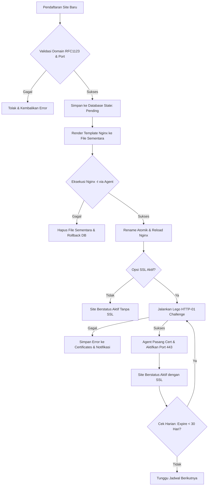
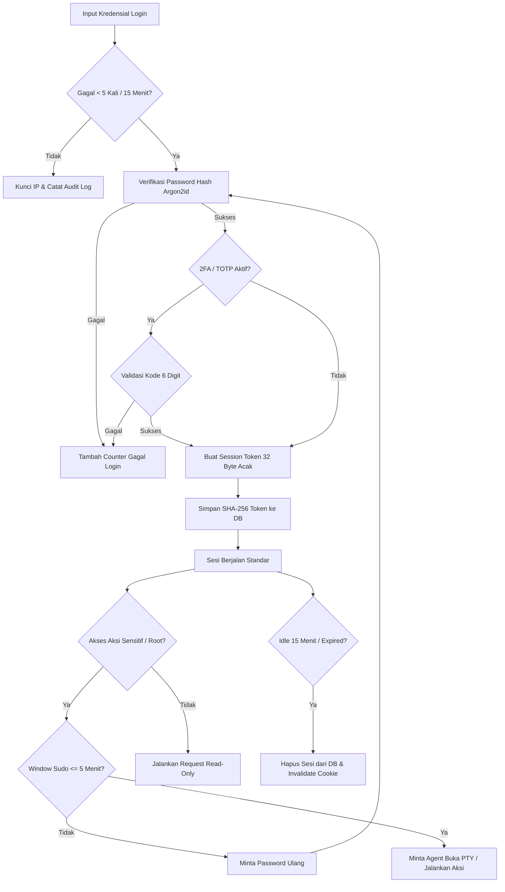

# Dokumentasi Logika Bisnis & Siklus Hidup Entitas (fik-panel)

## 1. Siklus Hidup Entitas

### 1.1 Siklus Hidup Site & Sertifikat SSL

### 1.2 Siklus Hidup Sesi Pengguna & Sudo Mode

---

## 2. Aturan Bisnis Entitas (Entity Rules)

### 2.1 Entitas `users`

| Kolom | Aturan Validasi | Catatan Bisnis |
|---|---|---|
| `id` | Primary Key, Auto Increment | Identitas unik akun pengguna |
| `username` | Panjang 3-32 karakter, alphanumeric, wajib unik | Nama akun login operator panel |
| `password_hash` | Wajib string ter-encode Argon2id valid | Hash menggunakan parameter memori 19 MiB |
| `totp_secret` | BLOB terenkripsi AES-256-GCM, opsional (bisa NULL) | Kunci rahasia 2FA, hanya didekripsi saat validasi |
| `role` | Wajib bernilai `'admin'` atau `'viewer'` | Viewer hanya memiliki akses read-only |
| `created_at` | Timestamp Unix integer, tidak boleh null | Waktu pendaftaran akun |
| `last_login_at` | Timestamp Unix integer, nullable | Diperbarui saat proses autentikasi berhasil |

### 2.2 Entitas `sites`

| Kolom | Aturan Validasi | Catatan Bisnis |
|---|---|---|
| `id` | Primary Key, Auto Increment | Identifikasi unik site |
| `domain` | Wajib RFC1123 host domain, unik | FQDN domain utama situs yang dikelola |
| `aliases` | JSON Array string domain valid | Daftar domain alternatif / alias |
| `kind` | Wajib salah satu: `'proxy'`, `'static'`, `'php'` | Tipe template virtual host yang di-generate |
| `upstream` | Wajib URL/host:port valid jika `kind='proxy'` | Alamat aplikasi internal/backend |
| `root_path` | Wajib path absolut valid jika `kind='static'/'php'` | Direktori berkas statis atau script PHP |
| `ssl_mode` | Wajib salah satu: `'none'`, `'letsencrypt'`, `'custom'` | Kebijakan enkripsi TLS situs |
| `force_https` | Boolean (0 atau 1), default 1 | Otomatis redirect port 80 ke 443 |
| `extra_conf` | String konfigurasi Nginx bebas | Snippet wajib lolos uji sintaks `nginx -t` |
| `enabled` | Boolean (0 atau 1), default 1 | Mengaktifkan/menonaktifkan simlink file vhost |
| `updated_at` | Timestamp Unix integer | Waktu perubahan konfigurasi terakhir |

### 2.3 Entitas `certificates`

| Kolom | Aturan Validasi | Catatan Bisnis |
|---|---|---|
| `id` | Primary Key, Auto Increment | Identitas sertifikat |
| `site_id` | Foreign Key ke `sites(id)`, Unik, On Delete Cascade | Relasi satu sertifikat per site aktif |
| `issuer` | String tidak boleh kosong | Penerbit sertifikat (misal: Let's Encrypt) |
| `not_after` | Timestamp Unix integer | Waktu kadaluarsa sertifikat SSL |
| `last_error` | Text, nullable | Pesan kegagalan saat proses penerbitan / renew |
| `renewed_at` | Timestamp Unix integer, nullable | Waktu terakhir perpanjangan sertifikat berhasil |

### 2.4 Entitas `managed_services`

| Kolom | Aturan Validasi | Catatan Bisnis |
|---|---|---|
| `unit` | Primary Key, pola `*.service`, regex aman | Allowlist unit systemd yang diizinkan dikontrol |
| `label` | String deskriptif, nullable | Nama manusia untuk unit layanan |
| `protected` | Boolean (0 atau 1), default 0 | Nilai 1 (seperti sshd, panel) wajib konfirmasi ganda |

### 2.5 Entitas `audit_log`

| Kolom | Aturan Validasi | Catatan Bisnis |
|---|---|---|
| `id` | Primary Key, Auto Increment | Urutan peristiwa audit |
| `ts` | Timestamp Unix integer, wajib terindeks | Waktu presisi eksekusi perintah |
| `user_id` | Foreign Key ke `users(id)`, On Delete Set Null | Operator yang melakukan aksi (NULL jika system/AI) |
| `actor` | Wajib salah satu: `'user'`, `'system'`, `'ai'` | Pengklasifikasi sumber pemicu aksi |
| `action` | String nama aksi terformat (`kategori.verb`) | Nama operasi, misal `site.create`, `service.restart` |
| `target` | String identifier target | Nama unit service, domain site, atau PID |
| `ok` | Boolean (0 atau 1) | Hasil status keberhasilan aksi |
| `detail` | String teks maks 4096 byte | Rangkuman output atau pesan galat |

---

## 3. Matriks Transisi Status Entitas

### 3.1 Transisi Status Site

| Status Awal | Pemicu (Trigger) | Status Akhir | Aturan Bisnis & Efek Samping |
|---|---|---|---|
| `None` | User membuat site | `Draft` | Validasi format domain dan port upstream |
| `Draft` | Sintaks Nginx lolos uji | `Active` | File vhost ditulis dan Nginx di-reload |
| `Draft` | Sintaks Nginx gagal uji | `Failed` | File sementara dihapus, status dikembalikan |
| `Active` | User klik Nonaktifkan | `Disabled` | File vhost dihapus/direname, Nginx di-reload |
| `Disabled`| User klik Aktifkan | `Active` | File vhost dipasang kembali dan Nginx di-reload |
| `Active` | User menghapus site | `Deleted` | File vhost dan sertifikat terkait dibersihkan |

### 3.2 Transisi Status Layanan (Systemd Unit)

| Status Awal | Pemicu (Trigger) | Status Akhir | Aturan Bisnis & Efek Samping |
|---|---|---|---|
| `inactive` | Permintaan start | `active` | Agent mengeksekusi `systemctl start <unit>` |
| `active` | Permintaan stop | `inactive` | Ditolak jika unit `protected=1` tanpa konfirmasi |
| `active` | Permintaan restart | `active` | Agent mengeksekusi `systemctl restart <unit>` |
| `failed` | Permintaan restart | `active` | Mencoba pemulihan unit yang crash |
| `active` | Unit mengalami crash | `failed` | Terdeteksi oleh loop polling / supervisor |

---

## 4. Batasan Bisnis & Pemicu Otomatis (Triggers)

| Kode Aturan | Pemicu | Batasan Bisnis | Tindakan Sistem |
|---|---|---|---|
| **BR-01** | Mutasi Data Sensitif | Membutuhkan status Sudo Aktif | Tolak jika verifikasi sandi terakhir > 5 menit lalu |
| **BR-02** | Login Gagal | Maksimal 5 kegagalan per 15 menit per IP | Kunci autentikasi dari IP terkait selama 15 menit |
| **BR-03** | Eksekusi Alat AI | AI memproses permintaan diagnosa | Batasi hanya fungsi read-only, maks 8 iterasi |
| **BR-04** | Redaksi Log | Data log diambil sebelum dikirim ke AI | Hapus otomatis pola token, password, dan kunci privat |
| **BR-05** | Perpanjangan SSL | Pengecekan waktu sertifikat harian | Picu renovasi ACME jika sisa masa aktif < 30 hari |
| **BR-06** | Retensi Audit & Chat| Job pembersihan berkala tengah malam | Hapus audit > 90 hari dan pesan AI > 30 hari |
